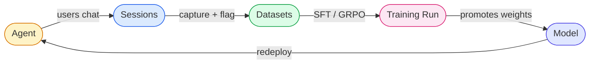
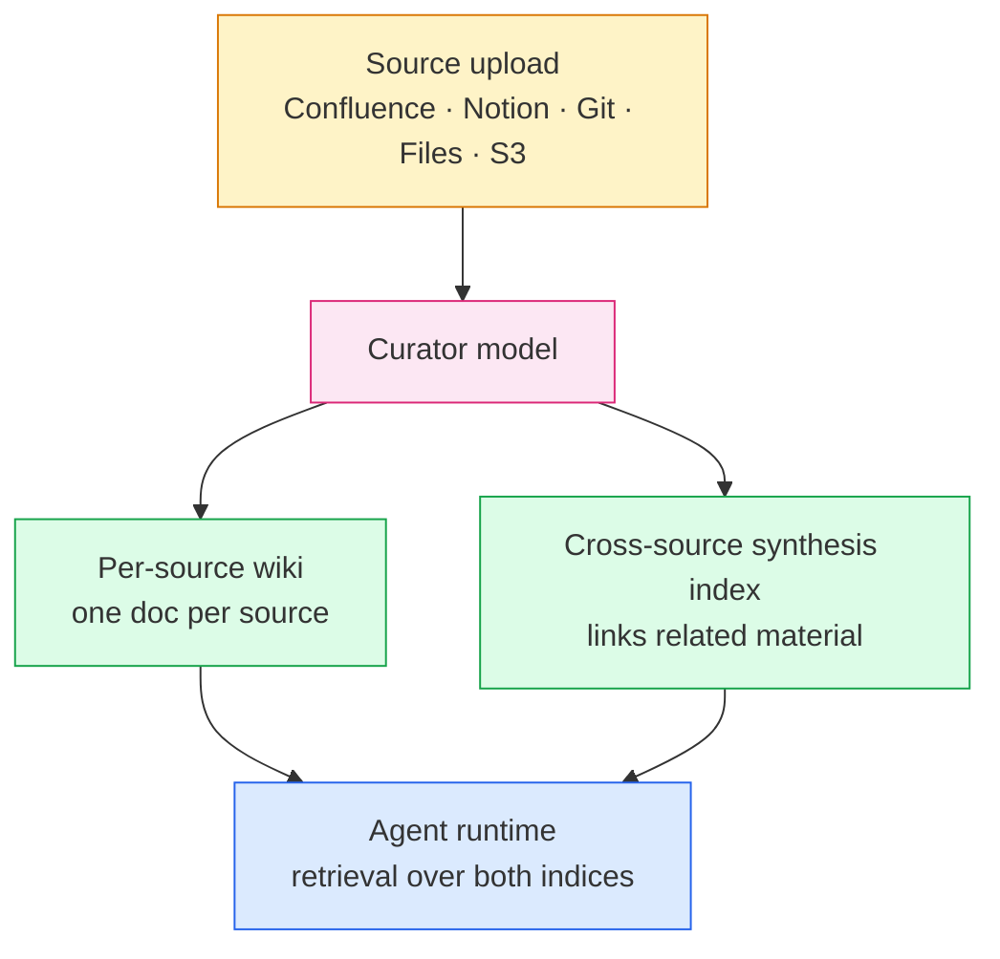
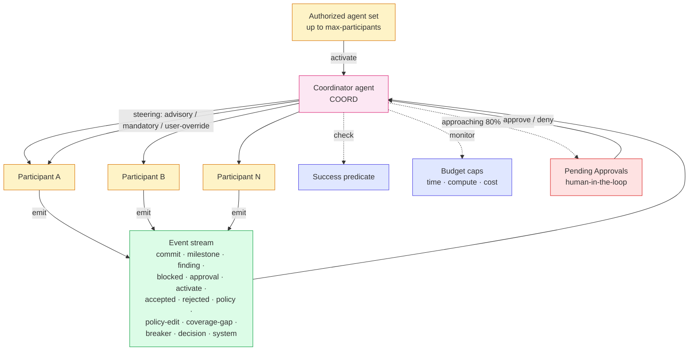
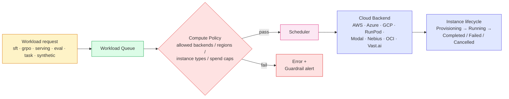

# Platform architecture

Surogate Ops is built around a small set of objects that loop. Four diagrams cover the loops you'll touch most often: the product-lifecycle loop, the Knowledge-Base curator pipeline, the Arena coordinator model, and the Compute scheduler.

## The lifecycle loop

Every other thing in this manual is a node on this graph. You build an agent, it produces sessions, sessions feed datasets, datasets feed a training run, the run produces a model, the model goes back into the agent. The loop is the product.

Three things to notice:

- The loop is **bi-directional in your head, single-directional in the system.** The model serves the agent; the agent doesn't write back into the model. To go from agent-back-to-model you do a training run, which is an explicit, scheduled step.
- **Sessions are the only persistent product of a deployed agent.** Everything else (training, evals, datasets) flows from them.
- The graph is also the path of authority: an agent can fail without producing bad training data (sessions are filterable), bad training data can fail without producing a bad model (evals gate promotion), and a bad model can fail without breaking agents (redeploy is opt-in).

## Knowledge Base curator pipeline

Knowledge Bases aren't just an embedding index. A curator model runs after every ingest and writes two indices: a per-source wiki (one document per source, structured) and a cross-source synthesis index that links related material across all sources.

The curator model is configurable per KB (Settings → Curator). Default is the Surogate curator; you can swap in a different model or edit the system prompt to bias what the curator extracts. Re-ingest after editing the prompt to regenerate both indices.

See [Knowledge Bases](../features/knowledge-bases.mdx) for the operational steps.

## Arena coordinator

An Arena runs a set of agents against an objective. A dedicated **coordinator agent** drives the run: it activates participants from an authorized set, steers them, promotes shared findings, and requests human approval when budget caps approach.

The coordinator is itself an agent, just with a special role. Its steering modes:

- **Advisory** — coordinator suggests; participants may ignore.
- **Mandatory** — coordinator's steering blocks the participant until acknowledged.
- **User-override** — operator can override either direction in the Pending Approvals queue.

Budget caps escalate: crossing the 80% soft threshold on any cap (time, compute, cost) triggers a `request-approval` event. Cross 100% without human approval and the arena enters **POLICY PAUSED**.

See [Arenas](../features/arenas.mdx) for the operational steps.

## Compute scheduling

Every workload — serving a model, training a run, generating synthetic data, running an eval — goes through the same scheduler. The queue is shared; compute policies decide what's allowed; the chosen cloud backend provisions the instance.

The eight supported cloud backends each have their own credential form and their own offer list. Workloads request a GPU; the scheduler picks an offer; the backend provisions; the instance runs until completion or cancellation.

See [Compute](../features/compute.mdx) for the operational steps.

## Where these diagrams live in the manual

| Diagram | Where the operational detail is |
|---|---|
| Lifecycle loop | [Agents](../features/agents.mdx), [Sessions](../features/sessions.mdx), [Datasets](../features/datasets.mdx), [Training Runs](../features/training.mdx), [Models](../features/models.mdx) |
| KB curator | [Knowledge Bases](../features/knowledge-bases.mdx) |
| Arena coordinator | [Arenas](../features/arenas.mdx) |
| Compute scheduling | [Compute](../features/compute.mdx) |
