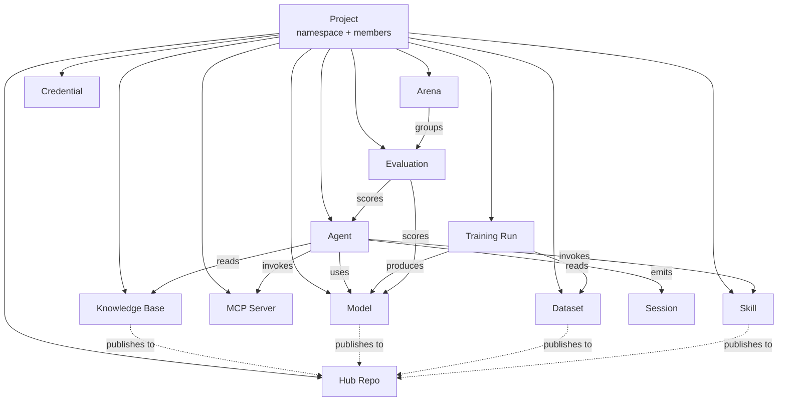

_Last updated: 2026-05-12 · App snapshot: surogate-ops-main (2026-05-10)_

# Core objects

Every object in Surogate Ops belongs to exactly one Project. The graph below is the canonical relationship map (the diagram matches the SQLAlchemy models under `surogate_ops/core/db/models/`).

## Project
`Project` (`models/platform.py`). Has a `name`, a generated `namespace`, a generated `hub_namespace`, a `color` for UI distinction, a `status` (`active` / `archived`), and a list of `ProjectMember` rows with project roles (`owner`, `editor`, `viewer`). Every other object listed below has a single parent Project. Cross-project sharing happens through the Hub.

## User-facing objects

### Agent
Conversational workflow. Pairs one Model with optional Skills, MCP Servers, and Knowledge Bases. Lives at `/work/agents/<id>` (operator view) and `/studio/agents/<id>` (builder view). Status lifecycle: `Deploying → Running → Error/Stopped`.

### Model
LLM. Either served by Surogate on a Cloud Backend, or proxied to an upstream provider. Status lifecycle: `Deploying → Serving → Error/Stopped`. Identified by `model_id`. The Surogate proxy enforces `sk-agent-*` API keys scoped to one Model.

### Skill
Reusable function or workflow callable by an agent. Versioned on save. Built in the Skill Builder at `/studio/skills`.

### MCP Server
External Model Context Protocol endpoint registered with Surogate. Surogate routes tool calls to it but does not host it. Listed under `/studio/skills/mcp`.

### Knowledge Base
Indexed document store. Status lifecycle: `Compiling → Active → Error`. Attached to Agents in their settings.

### Session
A single chat thread with one Agent. Has a `sessionId`. The Trajectory view (`/studio/sessions?agentId=…&sessionId=…`) shows the agent's reasoning + tool calls.

### Conversation
Used interchangeably with Session in the UI; the backend distinguishes them in the data model (`models/observe.py`).

## Training and evaluation

### Dataset
Collection of examples. Kinds: `sft`, `eval`, `synthetic`, `environment`. Listed at `/studio/datasets`. Built by hand, imported, or captured from agent interactions.

### Training Run
A model training job. Kinds: `sft`, `grpo`, `pretraining`. Scheduled onto Compute as a workload with the matching kind. Identified by `runId`.

### Evaluation
A scored run of an Agent or Model against a benchmark. Result has per-metric scores plus a per-sample breakdown.

### Arena
A tournament across multiple Evaluations. Used for A/B-and-pick-a-winner studies.

## Compute

### Cloud Backend
A connected cloud provider account. One of: AWS, Azure, GCP, RunPod, Modal, Nebius, OCI, Vast.ai.

### Cloud Account
A specific account/project inside a Cloud Backend (e.g. a single AWS account number).

### Backend Offer
A specific GPU/instance type available on a Cloud Backend, with price.

### Workload (Job)
A scheduled unit of work. Kinds match the Workload Queue filter: `sft`, `grpo`, `serving`, `eval`, `task`, `synthetic`.

### Policy (Compute)
A rule limiting where workloads may land — backend, region, instance type, spend cap, schedule window.

## Storage

### Hub Repo
HuggingFace-compatible repository in the integrated Data Hub. Kinds: `Models`, `Datasets`, `Skills`, `Experiments`, `Environments`. Has branches and tags. Surogate writes weights, datasets, and skill bundles here. Reached at `/studio/hub/<namespace>/<repo>`.

## Identity

### User
Has `username` (immutable after sign-up), `name`, `email`, optional avatar, bio, company. `User.perspective` is `work` or `develop`. `User.default_project_id` decides which project new objects land in.

### AuthIdentity
A user's link to an external identity (Google, GitHub, email-password via Firebase). A user can have several; logging in via any one of them resolves to the same User.

### Project Member
A row in `project_members`. One row per `(user, project)`. Carries a project role (`owner`, `editor`, `viewer`).

### UserRoleAssignment
A row in `user_roles`. Carries a system role: `admin`, `skill_author`, `devops`, `developer`. A user can hold several.

### API Key
`sk-agent-<id>`. Scoped to one Model. Used by external callers of the Surogate proxy.

### Refresh Token
Opaque 48-byte token, 7-day TTL, issued at login alongside the JWT. Storage: hashed in `refresh_tokens`.

### Credential
A stored secret used by the platform (cloud API key, integration token, provider key). Never shown back after creation.

## How they wire up in practice

A typical project ends up with this graph:

- 1 Project, 3-10 members.
- 1-2 Cloud Backends (e.g. AWS + RunPod for redundancy).
- 3-10 Models (mix of served and proxied).
- 5-20 Skills + 1-3 MCP Servers.
- 5-15 Knowledge Bases.
- 2-5 Agents in production, plus a few in development.
- Tens to thousands of Sessions accumulating over time.
- A handful of Datasets and an ongoing stream of Training Runs and Evaluations.
- A growing Hub of Models, Datasets, Skills, and Experiments.

## Related

- [Work vs Develop](./work-vs-develop)
- [Lifecycle states](./lifecycle)
- [Glossary](../glossary)
- [Reference → Permissions matrix](../reference/permissions-matrix)
