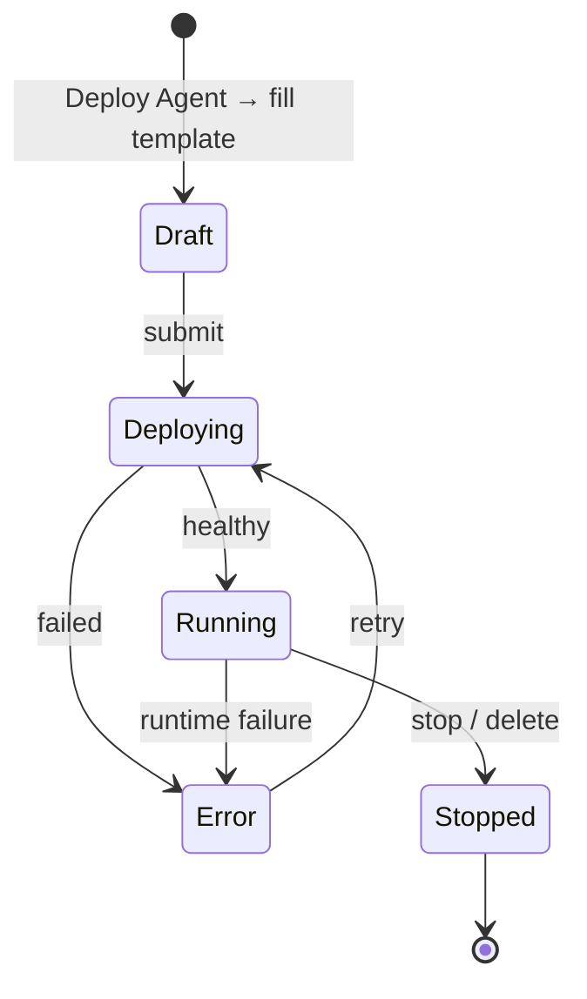
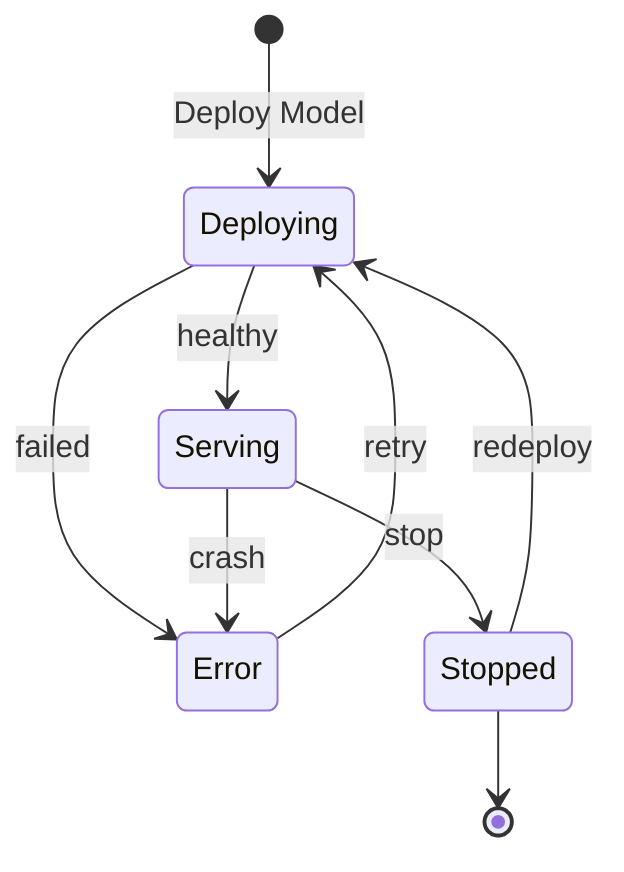
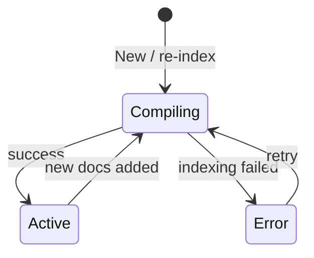
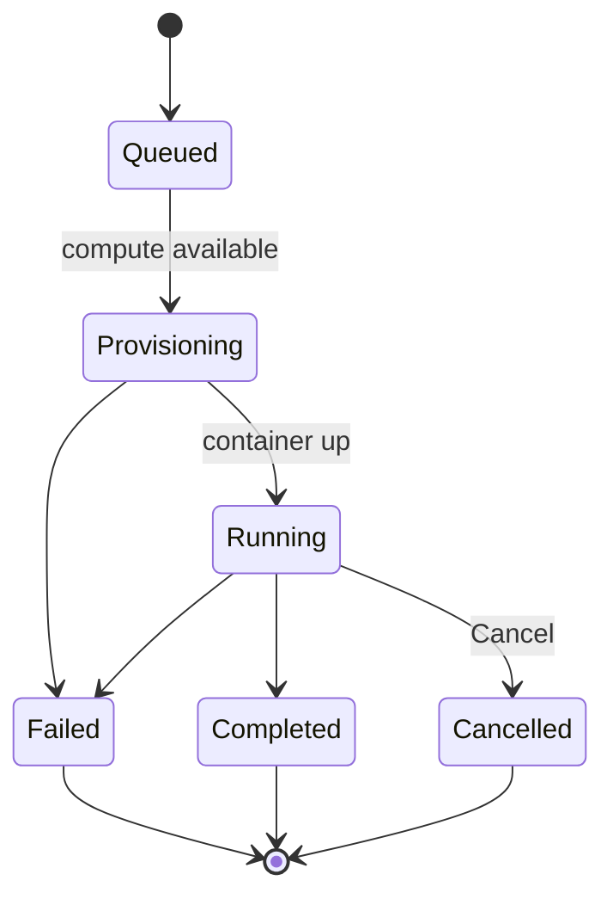
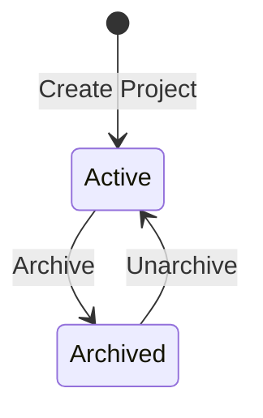
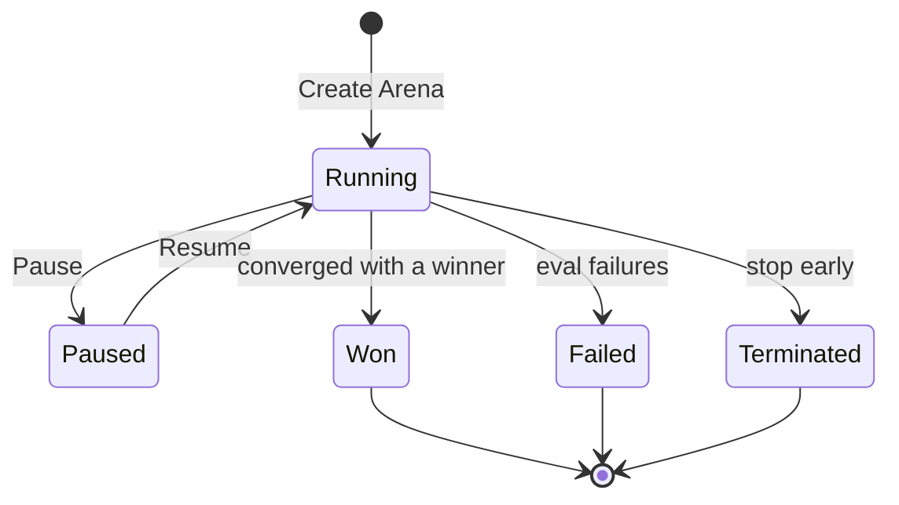
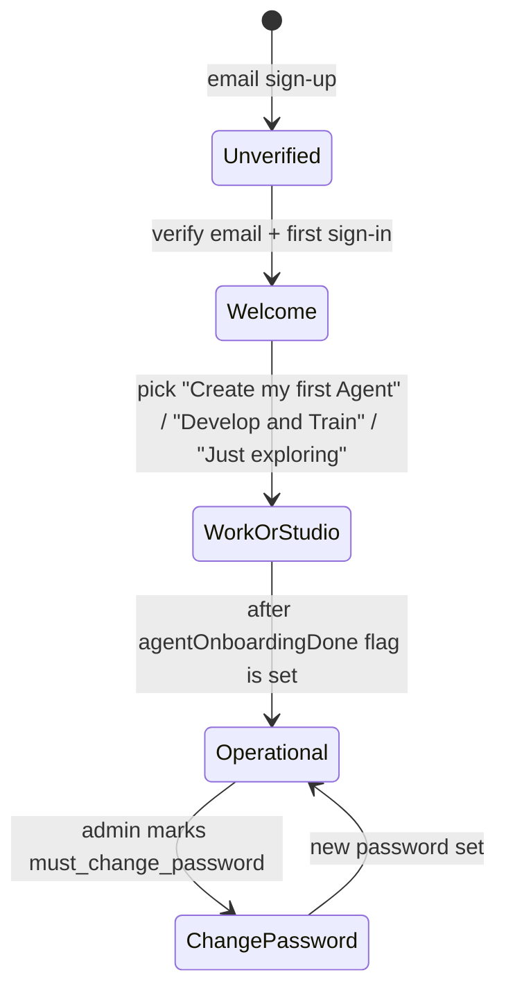

_Last updated: 2026-05-11 · App snapshot: surogate-ops-main (2026-05-10)_

# Lifecycle states

The status filters you see in the UI (e.g. **All · Running · Deploying · Error**) map to the underlying enums on each object. This page collects them.

## Agent

The Agents page tabs are: **All · Running · Deploying · Error**.

## Model

The Models page tabs are: **All · Serving · Error · Stopped**.

## Knowledge Base

The KB page tabs are: **All · Active · Compiling · Error**.

## Workload (compute jobs)

The Workload Queue tabs are: **all · sft · grpo · serving · eval · task · synthetic** (the **kind** of workload). Within each kind, statuses appear in the **Status** column. Common values seen in the UI:

> **TODO(verify):** the exact strings used in the Status column for each kind. Confirm with the populated workload queue on an account with running jobs.

## Project

## Arena

The Arenas page tabs are: **All · Running · Paused · Won · Failed · Terminated**.

## Account / onboarding

The `agentOnboardingDone` flag is per-browser (`localStorage`). Clearing browser storage resets the user to the **Welcome** state — but their data is untouched.

## Related

- [Core objects](./core-objects)
- [Glossary](../glossary)
