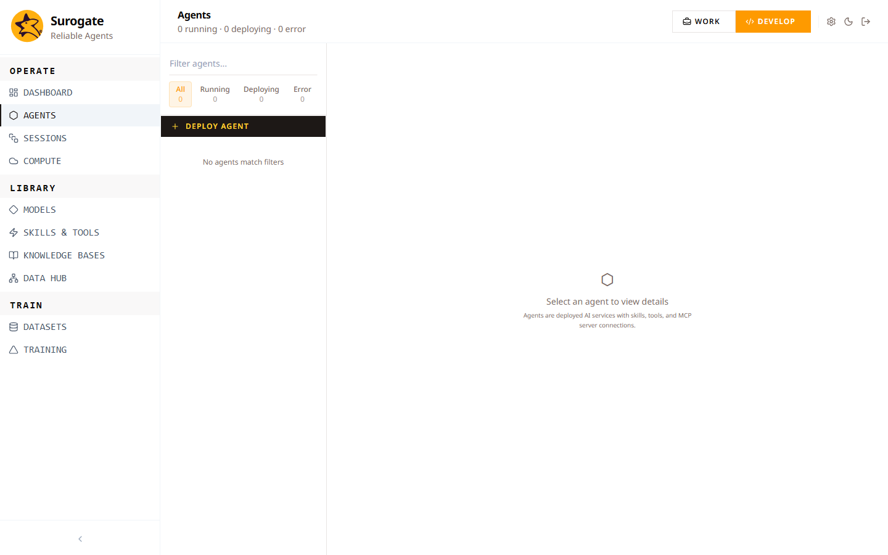

# Agents

An Agent is a deployed conversational workflow. It pairs a model with the skills, knowledge bases, and tools your team needs, and exposes a chat surface your end users can talk to.

You build agents from the Agents page. End users run them from the Work dashboard.

## Deploy your first agent

Click **Deploy Agent**. Fill in four things:

- **Display Name** — what users will see.
- **Slug** — a short, URL-safe identifier. Pick it carefully; it's permanent.
- **Description** — one sentence about what the agent does.
- **Model** — pick one of your available models. (No model yet? See [Models](./models.md).)

Hit **Create Agent**. The first deploy of a model takes a couple of minutes while the serving container comes up. Subsequent deploys reuse cached layers and land in seconds.

## Attach skills and knowledge

The deploy dialog keeps things light. Once the agent exists, open its **Settings** tab to attach **Skills**, **MCP Servers**, and **Knowledge Bases**. Each one is a multi-select; pick as many as you need.

A few things to know:

- Agents **pin** to the version of each skill that exists at deploy time. Editing a skill won't change deployed agents until you redeploy.
- A knowledge base in **Compiling** or **Error** state can still be attached. The agent just returns no retrieval results until the KB reaches **Active**.

## Run the agent

End users find their agents on the Work dashboard. Each card has a chat entry point. New sessions start fresh; existing sessions resume on a stable id, so anyone with the link can pick up a chat where they left it.

Builders see the same sessions in Sessions, with the agent's full step-by-step run attached. See [Sessions](./sessions.md) for the loop from "user reports a bad answer" to "fix the prompt and redeploy".

## Iterate

After a few real chats, look at Monitoring for RPS, latency, error rate, and the alerts feed. Flag any session that shouldn't have happened (a hallucinated answer, a refused request that should have gone through), and the rest of the loop kicks in: those flags feed datasets, datasets feed training, training produces a better model, and you redeploy the agent on top of it.

The full loop is described in [Train](./datasets.md).

## When it goes wrong

- Stuck in **Deploying** beyond ten minutes — the compute scheduler can't find a GPU. Check the related job in the Workload Queue.
- Transitions to **Error** — the underlying model is in **Stopped** or **Error**. Fix the model first, then re-deploy the agent.
- Runs but every chat returns an error — a required skill failed to initialize. Open the agent's settings, untick the failing skill, redeploy.

## Where to go next

- **[Skills & Tools](./skills.md)** — the things your agent can call.
- **[Knowledge Bases](./knowledge-bases.md)** — what your agent can read.
- **[Models](./models.md)** — what your agent thinks with.
- **[Sessions](./sessions.md)** — what your agent did.
