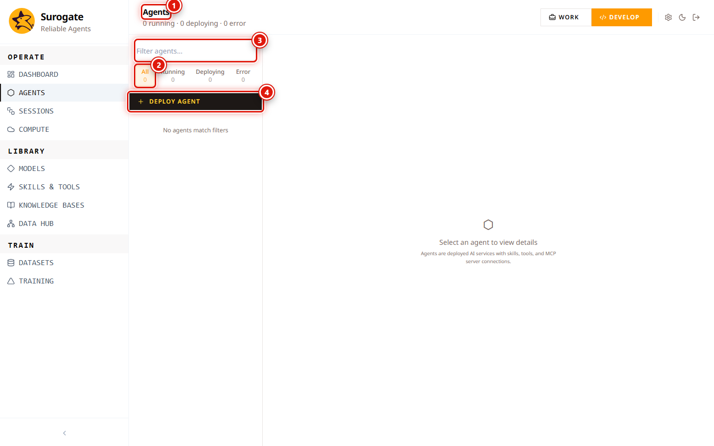

_Last updated: 2026-05-12 · App snapshot: surogate-ops-main (2026-05-10)_

# Agents

An Agent is a deployed conversational workflow that pairs a Model with a fixed set of Skills, MCP servers, and Knowledge Bases. It exposes a chat surface in Work mode and (optionally) an API surface through the `sk-agent-*` proxy.

## Where it lives

| URL | Audience |
|---|---|
| `/work` | Operators. Card grid of agents you can run. |
| `/work/agents/<id>` | Operator agent detail. Tabs: Overview, Chat, Settings. |
| `/work/agents/<id>/chat/<sessionId>` | Resume an earlier session. |
| `/studio/agents` | Builders. Full list with status filters and Deploy Agent. |
| `/studio/agents/<id>` | Builder agent detail (TODO(verify) — not reachable without an agent on the test account). |

## The Studio list

1. **Agents** header.
2. **Status filter pills**: `All · Running · Deploying · Error`. Each pill has its own count badge. Clicking a non-active pill applies the filter without leaving the page.
3. **Filter agents…** input. Full-text search by agent name. Case-insensitive.
4. **Deploy Agent** button (top-right). Opens the deploy dialog covered below.

The empty state ("No agents") is reached when you've never deployed one. The dashboard at `/studio` will redirect you to `/onboarding` until either the welcome flow is acknowledged or at least one agent exists.

## Deploy flow

The dialog header reads **Deploy New Agent**. The base form has four controls; the **Cancel** and **Create Agent** buttons stay at the bottom. The video in [Workflow → Deploy an agent](../workflows/deploy-an-agent.md) shows the flow.

| Field | Type | Notes |
|---|---|---|
| **Display Name** | text | The agent's label across `/work`, `/studio`, and Monitoring. |
| **Slug** | text | Help text in the dialog: _"unique within project"_. Becomes the agent's stable identifier and the URL segment under `/studio/agents/<slug>`. Cannot be changed once set. |
| **Description** | text | Shown on the agent card and in tooltips. |
| **Model** | combobox | Picker scoped to Models in this project. Models in non-Serving state still appear in the list but the agent will fail to deploy against them. |

Submit with **Create Agent**. The agent appears in the **Deploying** filter and transitions to **Running** once the serving container is healthy. The first deploy of a given Model can take several minutes; subsequent deploys reuse cached layers.

> The Skills, MCP Servers, and Knowledge Bases multi-selects are surfaced after the agent exists — open the agent's Settings tab to attach them. The deploy dialog itself does not include them.

## Status reference

| Status | What it means | Common cause |
|---|---|---|
| Deploying | Serving container being built or started. | Normal during a first-time deploy. |
| Running | Healthy and accepting traffic. | — |
| Error | The serving container or model is unhealthy. | Underlying Model in Error or Stopped, or a Skill failed to load. |
| Stopped | You manually stopped it. | Agent stays in the list but won't serve. TODO(verify the exact stop control). |

## Reading an agent's runtime

From a deployed agent you can:

- See its **live metrics** at `/studio/monitoring` (RPS, P50/P95/P99, errors, CPU/MEM per agent).
- Browse its **sessions** at `/studio/sessions?agentId=<id>`. Each session has a **Thread** view (messages) and a **Trajectory** view (reasoning + tool calls).
- Run an **evaluation** against it from `/studio/evaluations` → **New Evaluation**.

## API surface

Agents are reachable through the Surogate proxy when their Model has an `sk-agent-*` API key. The key authorizes calls scoped to `model:<model_id>`, not `agent:<id>`. Multiple agents that share a Model share the same key.

Failed auth (401/403) on the proxy hot path is negative-cached for a short interval to protect the upstream — fixing a wrong key takes effect after the cache clears or on a key change.

## Deletion

Deleting an agent stops it from serving and removes it from `/work` and `/studio/agents`. Sessions it produced remain at `/studio/sessions` in read-only form. The agent's row drops out of Monitoring on the next refresh. TODO(verify whether deletion is hard or soft).

## Permissions

| Action | Project role |
|---|---|
| List, open, chat with an agent | `viewer` and above |
| Deploy / edit / stop / delete | `editor` or `owner` (TODO(verify)) |

System role `admin` overrides project-level limits. See [Reference → Permissions matrix](../reference/permissions-matrix).

## Related

- [Workflow — Deploy an agent](../workflows/deploy-an-agent)
- [Models](./models)
- [Skills & Tools](./skills)
- [Knowledge Bases](./knowledge-bases)
- [Monitoring](./monitoring)
- [Sessions](./sessions)
