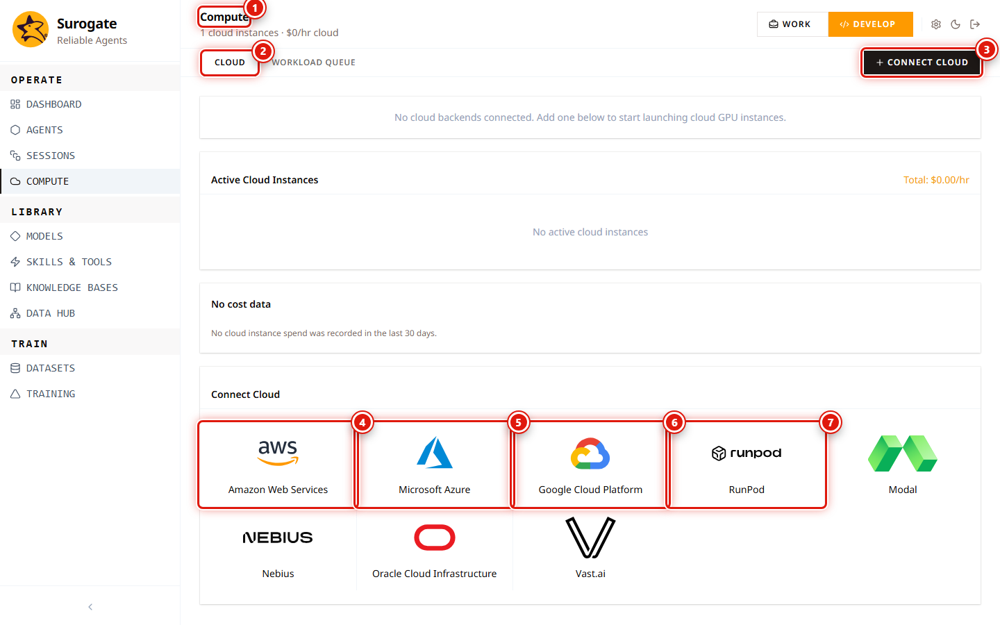
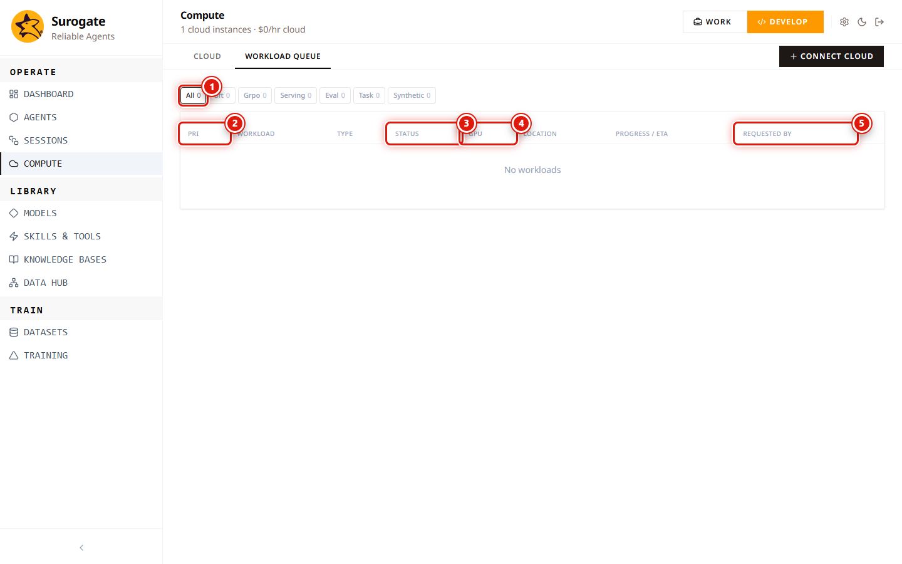

_Last updated: 2026-05-12 · App snapshot: surogate-ops-main (2026-05-10)_

# Compute

Compute is the surface that ties the rest of the platform to actual machines. Serving containers, training runs, eval jobs, and synthetic-data pipelines all draw from the cloud accounts you connect here. Visiting `/studio/compute` redirects to `/studio/compute/cloud`.

## Cloud tab

1. **Compute** header (shared across the three sub-tabs).
2. **Tab strip**: `Cloud · Workload Queue` (and `Policies` is a third destination but renders without the tab being selected).
3. **Connect Cloud** entry point. Equivalent to clicking a tile.
4-7. **Provider tiles**. Eight in total: Amazon Web Services, Microsoft Azure, Google Cloud Platform, RunPod, Modal, Nebius, Oracle Cloud Infrastructure, Vast.ai. Clicking one navigates to `/studio/connect-cloud?provider=<name>` with a provider-specific credential form.

Internal mapping (from the backend route file): each tile posts to `/api/compute/cloud/backends/{nebius|azure|runpod|oci|aws|gcp|vastai|modal}` after the form is submitted.

## Workload Queue tab

Filter pills at the top split workloads by **kind**: `all · sft · grpo · serving · eval · task · synthetic`. The pill shows a live count for that kind. Visible columns:

1. **Pri** — priority rank. Lower number runs first.
2. **Workload** — the human name of the job.
3. **Type** — same as the active filter pill (sft, grpo, etc.).
4. **Status** — Queued → Provisioning → Running → Completed / Failed / Cancelled. TODO(verify exact string per kind).
5. **GPU** — the offer reserved (e.g. `H100 80GB`).
6. **Location** — region / availability zone.
7. **Progress / ETA** — % complete and time-to-finish for long-running kinds.
8. **Requested By** — the username that started the job.
9. _(unnamed)_ — row actions. Cancel, View logs, link to source. TODO(verify the menu's contents).

The page accepts `?filter=<kind>&id=<workload-id>` for deep links — bookmark a filtered view if you watch one kind closely.

## Policies tab

`/studio/compute/policies` lists allocation rules. Each Policy bounds where a workload may land. The page exposes:

- **+ New Policy** — opens the policy editor (role-gated).
- **Edit** on a row — same editor against an existing policy.

Each Policy carries (per the API surface in `routes/compute.py`):

- Allowed backends (a subset of the eight providers).
- Allowed regions per backend.
- Allowed instance types or offers.
- Maximum hourly spend cap.
- Schedule windows during which new workloads may start.

Policies are evaluated before the workload is scheduled. A workload that violates a policy lands in **Error** with a Guardrail alert and never enters the queue.

> The `+ New Policy` button is a no-op for project-`viewer` accounts (the click registers but no editor opens). Operators with `devops` or `admin` see the editor.

## Connect Cloud (provider-specific forms)

`/studio/connect-cloud?provider=<name>` is reached by clicking a provider tile. The per-provider field tables are in [Workflow → Connect a cloud backend](../workflows/connect-a-cloud-backend.md#credentials-per-provider). Every provider's form has a **Back to Cloud** link, a deep-link to the provider's own console, and **Cancel** / **Connect** buttons.

Saving the form creates a Cloud Account scoped to your project. Cloud Accounts surface their **offers** under `/studio/backend-offers?backend=<name>` — that's where you pick GPU type when deploying.

## Backend Offers

`/studio/backend-offers?backend=<name>` is reached from a connected backend's tile. The list is offered GPU instances with prices. Sort by price to find the cheapest, by performance to find the fastest. Backend offers refresh at most every few hours; the displayed price is a guideline, not a binding quote.

## Cost reporting

The API exposes `GET /api/compute/costs` (`routes/compute.py:228`). It is not currently surfaced as a top-level tab; the Studio dashboard's serving / training panels reflect spend at a coarse level. TODO(verify whether a dedicated cost view exists).

## Permissions

| Action | Roles |
|---|---|
| View Cloud / Workload Queue / Policies | Project `viewer` and above |
| Connect or disconnect a backend | System `devops` or `admin`. TODO(verify whether project `owner` is sufficient). |
| Cancel a workload | The user who started it, project `owner`, or system `admin` (TODO(verify)). |
| Edit a Policy | System `devops` or `admin` (TODO(verify)). |

## Troubleshooting

- **A connected backend lists zero offers.** Credentials are valid but missing read permissions on instance-type metadata, or the account has no GPU quota in the regions Surogate queries.
- **A workload stays Queued forever.** No backend has capacity for the requested GPU. Loosen the workload's GPU requirement or connect a provider with stock.
- **A workload fails to provision.** Open the row menu → View logs. Most common cause is a transient provider error (retry usually clears it).

## Related

- [Workflow — Connect a cloud backend](../workflows/connect-a-cloud-backend)
- [Models](./models) — where serving workloads are configured.
- [Training](./training) — where SFT / GRPO workloads are scheduled.
