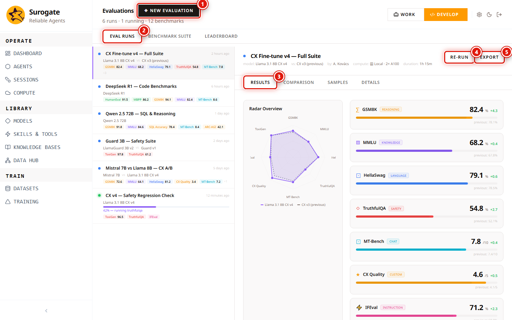

_Last updated: 2026-05-11 · App snapshot: surogate-ops-main (2026-05-10)_

# Evaluations

`/studio/evaluations` is where you measure agents and models against fixtures and benchmarks. The page is a two-pane layout: list on the left, detail of the selected run on the right.

1. **◈ New Evaluation** (top-right). Opens the run configurator.
2. **Eval Runs / Benchmark Suite / Leaderboard** tabs. The default view is Eval Runs.
3. **Per-run tabs** on the detail pane: `Results · Comparison · Samples · Details`.
4. **Re-run** on a row — rerun with the same suite and target, fresh seed.
5. **Export** — download the run's results (JSON or CSV — TODO(verify the format)).

The list shown on a fresh account is example data (CX Fine-tune v4, DeepSeek R1, Qwen 2.5 72B, Guard 3B, Mistral vs Llama). It illustrates layout. Your own runs replace it after the first **New Evaluation**.

## The three tabs

### Eval Runs

A reverse-chronological list of single runs. Each row shows:

- Run name (e.g. "CX Fine-tune v4 — Full Suite").
- Time since last completed event ("2 hours ago").
- Target (Model + variant, e.g. "Llama 3.1 8B CX v4").
- An optional comparison ("vs CX v3 (previous)").
- A small chip with the headline metric (e.g. "GSM8K 76.4").

Filters appear above the list. TODO(verify exact filter set — observed in the demo: by suite, by target Model, by status).

### Benchmark Suite

A library of reusable suites you compose runs from. Each suite is a named collection of cases with a scoring rubric (an LLM judge, an exact match, a regex, or a numeric tolerance). TODO(verify the editor for suites).

### Leaderboard

Cross-eval ranking. Pick a metric and the table sorts Models or Agents by that score. Completed runs feed it; running or failed runs are excluded.

## The detail pane

Selecting a run loads it into the right pane. The four sub-tabs:

| Tab | Contents |
|---|---|
| Results | Headline scores per metric. Bars + numbers. |
| Comparison | Side-by-side scores against the run named in the "vs …" chip. |
| Samples | Per-case drill-down: input → output → expected → judge verdict. Filter to wins, losses, errors. |
| Details | The run's configuration: target, suite, suite version, dataset version, runtime params, seed. |

## New Evaluation flow

1. **Target**: pick an Agent or a Model.
2. **Suite**: pick a Benchmark Suite, or assemble cases ad hoc.
3. **Runtime params**: sampling parameters and parallelism. TODO(verify the panel).
4. Submit. The run appears at the top of the Eval Runs list with status `Running`.

The job is dispatched to Compute → Workload Queue with kind `eval`. Cancel it there if you need to abort.

## Demo data

The runs visible on a fresh account are read-only — selecting them shows the layout but the **Re-run** action will not succeed on demo rows.

## Permissions

| Action | Role |
|---|---|
| View runs / leaderboard | Project `viewer` and above |
| New Evaluation / Re-run / Export | Project `editor` or `owner` (TODO(verify)) |

## Related

- [Arenas](./arenas) — multi-eval tournaments.
- [Datasets](./datasets) — where eval fixtures live.
- [Compute → Workload Queue](./compute) — to watch or cancel a running eval.
