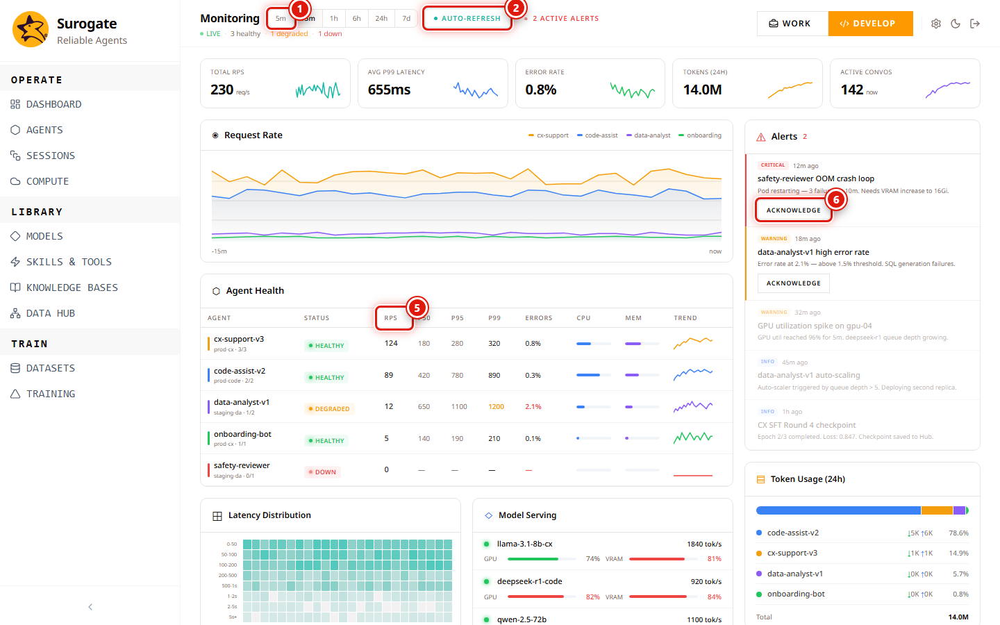

_Last updated: 2026-05-11 · App snapshot: surogate-ops-main (2026-05-10)_

# Monitoring

`/studio/monitoring` is the live ops view. It draws data over a WebSocket the app opens at sign-in (`useMonitorSocket` in `__root.tsx`). Counters update without polling; closing the tab and reopening reconnects.

> The screenshot below uses example data so the layout is visible — your account renders the same panels populated by your own traffic.

## Controls

1. **Time-range tabs**: `5m · 15m · 1h · 6h · 24h · 7d`. The whole page (counters, table, panels) re-aggregates on click.
2. **Auto-refresh** toggle. On by default. Off freezes the view at the current window.
3. **⏸ Pause** halts the live stream without flipping Auto-refresh — useful while writing an incident note.
4. **Severity filter**: `All · 5xx · Timeout · Guardrail`. Limits both the agent table and the alerts feed.
5. **Per-agent table**, columns: `Agent · Status · RPS · P50 · P95 · P99 · Errors · CPU · MEM · Trend`. Sortable by clicking a column header (TODO(verify which columns sort)).
6. **Acknowledge** on each alert row — silences re-fire for the same root cause until manually re-armed.

## Panels

| Panel | What it shows |
|---|---|
| Top counters | Headline numbers: total RPS, P95, error rate, token usage rate. |
| Request Rate chart | RPS over the time window, stacked by agent. |
| Agent Health table | One row per agent. Columns above. |
| Alerts | Live feed. Each entry: severity, agent/model, one-line reason. Click an entry to open the offending session. |
| Latency Distribution | Heatmap. Rows are latency buckets, columns are time slices. Spot tail spikes. |
| Model Serving | Aggregate per Model. Useful when one model degrades across many agents. |
| Token Usage (24h) | Tokens per Model. Quick budget check. |

## Severity meanings

- **5xx**: the agent's serving endpoint returned an HTTP 500-series error to the proxy.
- **Timeout**: the agent didn't respond before the proxy timeout. Often correlates with a slow Skill or MCP call — open the session trajectory to confirm.
- **Guardrail**: either a compute policy refused the workload (see [Compute → Policies](./compute#policies)) or a content guardrail intervened on a response.

## Reading the heatmap

The Latency Distribution heatmap is normalized per-column. A dark cell at the top-right means a tail spike in the most recent slice for the highest-latency bucket. Cross-reference with the Alerts feed to find the offending agent.

## Permissions

| Action | Role |
|---|---|
| View Monitoring | Project `viewer` and above |
| Acknowledge alert | Project `editor` or `owner` (TODO(verify)) |

## When Monitoring stops updating

The page connects to a WebSocket. Symptoms of a dropped socket:

- Counters freeze at the value they had when you lost connectivity.
- Newly running jobs don't appear in **/studio/compute/workload-queue** until you refresh.

Reload the tab. The socket re-establishes on page load.

## Demo data caveat

A fresh account renders the page with example agents (CX, DeepSeek R1, etc.) so the layout is visible. The data is not stored on your account — clicking an agent in the demo set will not open a real session. Once you deploy your own agents, the seed data is replaced.

## Related

- [Agents](./agents)
- [Sessions](./sessions) — the trajectory view for a single chat.
- [Reference → Errors](../reference/errors) — the alert categories and their meanings.
