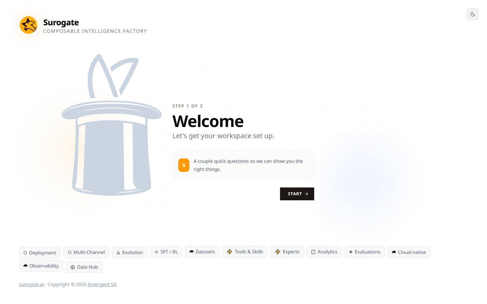

_Last updated: 2026-05-12 · App snapshot: surogate-ops-main (2026-05-10)_

# First-run setup

The first time you sign in, Surogate Ops shows a two-step welcome at **/onboarding**.

## Step 1 — Welcome

A single big **Start** button. Click it.

## Step 2 — What brings you here?

Three option cards:

- **Create my first Agent** — _Suggested_. Quickly build and deploy an Agent. Picks the **Work** perspective and drops you on `/work` so you can browse templates and create your first agent from one.
- **Develop and Train Agents** — For advanced / enterprise use cases. Picks the **Develop** perspective and drops you on `/studio`.
- **Just exploring** — Walks you through a guided tour of the platform without setting up anything.

> **What gets stored.** Picking any of the three flips a local flag (`AGENT_ONBOARDING_DONE` in the browser's `localStorage`) so the welcome screen doesn't reappear. It does **not** yet create an agent — that happens later when you pick a template or click **Deploy Agent**.

> **If you clear browser storage**, you'll see the welcome again next time you sign in. That's harmless.

## What you see next

If you picked **Create my first Agent**, the **Work dashboard** opens with a "What will you automate today?" prompt and a **Find Templates** button. Browse [the templates catalogue](../features/agents) and pick one to deploy.

If you picked **Develop and Train Agents**, the **Studio dashboard** opens with **Active Agents = 0** and the Quick Actions panel (Deploy Agent, Serve Model, New Skill, Start Training, New KB, New Dataset). See [the five-minute tour](./tour) for a walkthrough.

## Related

- [The five-minute tour](./tour)
- [Where to find things](./where-to-find-things)
- [Concepts — Work vs Develop](../concepts/work-vs-develop)
