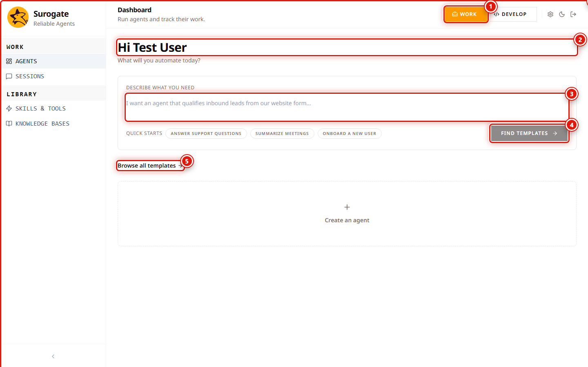
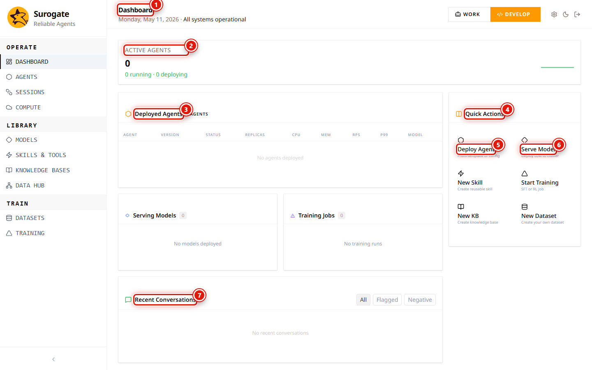

_Last updated: 2026-05-11 · App snapshot: surogate-ops-main (2026-05-10)_

# Five-minute tour

The app at `ops.surogate.ai` has two UIs under one account. Operators run agents from **Work mode** at `/work`. Builders configure, deploy, and observe them from **Develop mode** at `/studio`. The switch is a single button in the top bar, persisted on your user record.

## The top bar

Numbered controls, top-right:

1. **WORK / DEVELOP** — perspective toggle. Sets `User.perspective`, then routes to `/work` or `/studio`.
2. **Hi, &lt;Name&gt;** — greeting; uses the value of `User.name`, not username.
3. **Describe what you need** textarea — the input that unlocks the **FIND TEMPLATES** button below.
4. **Quick Starts** — three pre-baked prompts. Clicking one is equivalent to typing it.
5. **FIND TEMPLATES** — disabled until the textarea has at least one character.
6. **Browse all templates** — opens `/work/templates` without prompting for a description.
7. **+ Create an agent** — start an agent from scratch (no template).

Right-edge utility icons, not numbered above: **settings (⚙)**, **theme toggle**, **sign-out (⏻)**.

## Work mode (`/work`)

Sidebar order: **Agents** (`/work`), **Sessions** (`/work/sessions`), **Skills & Tools** (`/work/skills`, `/work/skills/mcp`), **Knowledge Bases** (`/work/knowledge-bases`).

The Agents view is your home. Each agent appears as a card with a chat affordance. Open one and you see four tabs:

- **Overview** — what the agent does and recent activity.
- **Chat** — `/chat` for a fresh session, `/chat/<sessionId>` to resume.
- **Settings** — per-agent configuration. Editable by project `editor` and `owner`.
- Tabs for **Knowledge Bases**, **Skills**, and **Channels** appear when the agent has them configured.

Sessions started here also appear in the builder view at `/studio/sessions` (Develop mode), with the agent's reasoning trace attached.

## Develop mode (`/studio`)

The dashboard at `/studio` is the operator's overview. Reading the screenshot above:

1. **Dashboard** header with today's date and a one-line system status (`All systems operational`).
2. **ACTIVE AGENTS** counter with a `running / deploying` breakdown.
3. **Deployed Agents** table (columns: Agent, Version, Status, Replicas, CPU, MEM, RPS, P99, Model). Empty when no agents.
4. **Quick Actions** panel — six starter shortcuts.
5. **Deploy Agent** — from template or config (Quick Action #1).
6. **Serve Model** — deploy an LLM to a cluster (Quick Action #2).
7. **Recent Conversations** feed, with filter pills: **All / Flagged / Negative**.

The four remaining Quick Actions (not numbered): **New Skill**, **Start Training**, **New KB**, **New Dataset**. They map 1:1 to features in the sidebar.

Sidebar groups (in order):

- **OPERATE**: Dashboard, Agents, Sessions, Compute.
- **LIBRARY**: Models, Skills & Tools, Knowledge Bases, Data Hub.
- **TRAIN**: Datasets, Training.

Routes not in the sidebar — accessed from in-page CTAs or by URL:

| Route | Reached from |
|---|---|
| `/studio/monitoring` | The Active Agents counter and the Recent Conversations feed link here. |
| `/studio/evaluations` | From an agent's detail page, or from this list directly. |
| `/studio/arenas` | From `/studio/evaluations` (grouping multiple runs into a tournament). |
| `/studio/playground` | From a Model's detail (`?modelId=…`). |
| `/studio/connect-cloud` | From `/studio/compute/cloud` → Connect Cloud or a provider tile. |
| `/studio/backend-offers` | From a connected backend's tile (View offers). |
| `/studio/settings/{projects,integrations,notifications}` | Hidden from the Settings sidebar for non-admin roles. Reach by URL. |

## Settings (both perspectives)

`/work/settings` and `/studio/settings` open the same component but keep the active sidebar (you don't get bounced into the other perspective).

Sidebar tabs for project-`viewer` accounts: **Profile**, **Data Hub** only.

Additional tabs visible to system `admin` (see [Reference → Permissions matrix](../reference/permissions-matrix) for the full table):

- **Projects & Teams** (`/studio/settings/projects`).
- **Integrations** (`/studio/settings/integrations`).
- **Notifications** (`/studio/settings/notifications`).

## Next

- [Where to find things](./where-to-find-things) for the full route map.
- [Work vs Develop](../concepts/work-vs-develop) for when to switch perspectives.
- [Core objects](../concepts/core-objects) for how agents, models, KBs, and skills connect.
