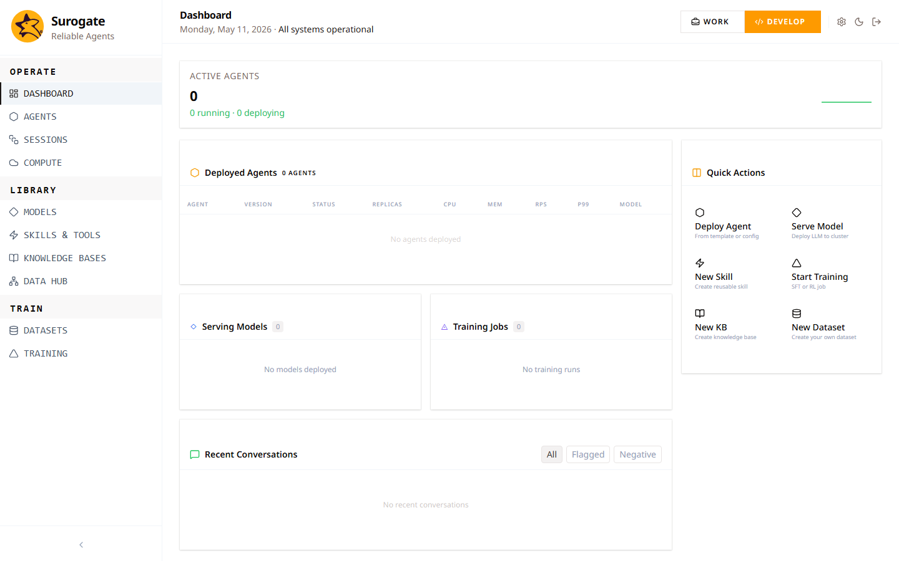

_Last updated: 2026-05-11 · App snapshot: surogate-ops-main (2026-05-10)_

# Surogate Ops

The web application at **ops.surogate.ai**. It hosts the lifecycle of an autonomous agent: build, deploy, run, observe, evaluate, retire. Two user-facing surfaces share one backend and one project graph.

| Surface | URL prefix | For |
|---|---|---|
| **Work** | `/work/*` | Operators running existing agents. Chat, sessions, attached skills and knowledge bases. |
| **Develop** (Studio) | `/studio/*` | Builders. Agents, Models, Skills, Knowledge Bases, Datasets, Training, Hub, Compute, Monitoring, Evaluations. |

Switch between them with the top-right toggle. Your default lives on `User.perspective`.

## Reading order

1. [Sign in](./getting-started/sign-in) — authenticate.
2. [First-run setup](./getting-started/first-run) — the two-screen welcome flow.
3. [Five-minute tour](./getting-started/tour) — the two perspectives, the navbar groups, the side rails.
4. [Where to find things](./getting-started/where-to-find-things) — a flat route map.

From there:

- **End users**: head to [Workflow → Explore as an end user](./workflows/explore-as-end-user). Most of the rest of the manual is for builders.
- **Builders**: start with [Core objects](./concepts/core-objects), then read the relevant feature page when you need it.
- **Admins**: [Permissions matrix](./reference/permissions-matrix), then [Admin → Projects & roles](./admin/projects-and-roles).
- **On-call**: [Monitoring](./features/monitoring), then [Troubleshooting](./troubleshooting).

## What's not in this manual

- The Surogate Trainer library reference — see the rest of [docs.surogate.ai](/) for that.
- HTTP API reference — `surogate_ops/server/routes/*.py` is canonical; the OpenAPI schema (when exposed) is generated from it.
- On-prem deployment — the `surogate-ops` repo has the Dockerfiles and k8s manifests.

## Conventions

- **Bold** marks verbatim UI labels (button text, tab names, headings as rendered).
- `code` marks URLs, paths, identifiers, config keys.
- Screenshots are at 1440×900 desktop and 390×844 mobile. Personal data is masked (`user@example.com`, `Test User`).
- Annotated screenshots end in `-annotated.png` — numbered red circles pin specific UI elements. Cropped close-ups end in `-zoom-<name>.png`.
- `TODO(verify):` flags marks behavior we could not confirm against the test account. The list is tracked at the docs repo root in `OPEN_QUESTIONS.md`.
- This manual was produced from app snapshot `surogate-ops-main` downloaded 2026-05-10. Every page footer carries that stamp.
