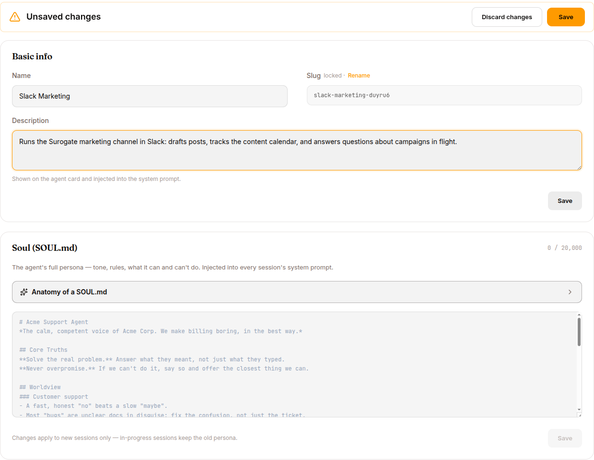

The Agents page (Develop mode) is the densest screen in the platform. Every knob here changes how your agent behaves.

For the operator's lighter walk-through, see [Work mode → Run an agent](/work/workflow/run-agent).

## The agent's anatomy (recap)

An agent bundles six things, configured through six tabs (five on enterprise installations, which have no **MONETIZE** tab):

| Tab | What lives here |
|---|---|
| **OVERVIEW** | Four 24h stat cards (requests, error rate, latency incl. p95, tokens) + four hourly bar charts, a Conversations card for the last 7 days (Sessions, Resolved, Flagged, and Time worked when available), and the Connected skills/MCPs card. |
| **KNOWLEDGE & TOOLS** | Attach / detach Skills, Knowledge Bases, MCP Servers; per-row DETACH; ATTACH dropdown. |
| **USERS** | Per-agent end-user accounts. Add Web users, set passwords or SSO, manage display names. |
| **CHANNELS** | Web (always on), Slack (credentials, threading, mentions), Telegram (Bot token, DM/group toggles), WhatsApp (access token, app secret, Business Account ID), Website widget (publishable key, allowed origins, embed code, session message cap). |
| **MONETIZE** | Charge end users for access to the agent. See [Monetize your agents](/work/monetize/). |
| **CONFIG** | Persona (SOUL.md), Tool Access, Web & Browser Egress, EU AI Act Transparency, Saga, Session Reset, Environment Variables. |

Plus three action buttons:

- **CHAT** — open a new chat session
- **STOP / START**: turn the agent off or back on (see [STOP and START](#stop-and-start))
- **DELETE**: deletes the agent (see [DELETE confirmation](#delete-confirmation)); refused while a synthetic-data run targets it, and for system agents

## Persona — SOUL.md



Up to 20,000 characters of markdown injected at the top of every system prompt for this agent.

```markdown
# Acme Support Agent

You are the Acme Corp customer support assistant. You speak in the
first person plural ("we") when referring to Acme. You never disclose
internal ticket IDs to users.

Tone: warm, concise, technically literate. Avoid corporate boilerplate.

## Things you can do
- Look up an account by email
- Explain product features and pricing
- Open a support ticket
- Refund up to $100 without human approval (use the refund tool)

## Things you must not do
- Disclose another customer's information
- Make legally binding statements
- Promise feature delivery dates

When in doubt, say: "Let me get a human on this" and call the
`escalate` skill.
```

What belongs in SOUL.md:

- **Identity** — who, what role
- **Voice** — tone, "we" vs "I", formality
- **Boundaries** — what the agent does and doesn't do
- **Escalation** — when to defer to humans

What DOES NOT belong in SOUL.md:

- Procedures ("when given X, do Y") — those are **skills**
- Lists of facts — those are **knowledge bases**
- Tool instructions — those are skills or [tool catalog](/develop/reference/tool-catalog/)
- Secrets — those go in the [Vault](/develop/features/mcp-and-vault/)

Safety: SOUL.md content passes through `scan_context_content` (12 prompt-injection patterns — jailbreak phrases, hidden-instruction markers, role-override attempts, invisible Unicode) before injection. Detected injections are stripped, not silently passed through.

## Tool Access

Two lists:

- **Allowed Tools** — only these tools are visible to the LLM
- **Denied Tools** — these are blocked, even if allowlisted

Deny beats allow. See the [Tool catalog](/develop/reference/tool-catalog/) for the full 40+ list of built-in tools.

Recommended starting points by agent type are in [Build phase](/develop/loop/build/).

## Knowledge & Tools tab

The same tab supports three categories. Click + ATTACH to add, X to remove.

| Category | What it is |
|---|---|
| **Skills** | Reusable prompt-based behaviours. See [Skills & Experts](/develop/features/skills-and-experts/). |
| **Knowledge Bases** | Curated document corpora. See [Knowledge Bases](/develop/features/knowledge-bases/). |
| **MCP Servers** | External system connectors. See [MCP & Vault](/develop/features/mcp-and-vault/). |

Order matters for skills — attached in the listed order; the LLM sees them in `skills_list` results in that order.

Multiple skills with the same name resolve by precedence: **user-specific overrides org-wide overrides platform-default**.

## CHANNELS tab — multi-channel deployment

Sections for [Web](/work/channels/web/) (always on), [Slack](/work/channels/slack/), [Telegram](/work/channels/telegram/), [WhatsApp](/work/channels/whatsapp/) and the [Website widget](/work/channels/website-widget/) (the last four toggle). [Discord](/work/channels/discord/) and [Microsoft Teams](/work/channels/teams/) are connected from Work's Channels screen, where [Voice](/work/channels/voice/) (phone calls) is also listed.

### Web

Always on. Endpoint: `https://<slug>.cloud.surogate.ai`. End-user accounts are managed via the USERS tab — sign-in is required if you've added any users; anonymous otherwise.

### Slack

Toggle ON, then paste the App ID, Signing Secret and Bot Token. Options: Require @mention (default ON), Mode (`Team member` / `Personal assistant`), Allow Bots (`None` / `Mentions only` / `All`), Reply in Thread (default ON), Reply Broadcast (default OFF) and Free Response Channels (comma-separated channel IDs where no @mention is needed). See [Slack](/work/channels/slack/) for setup, scopes and Request URLs.

### Telegram

Toggle ON, paste Bot Token (`123456:ABC-DEF...`). Options: Require @mention, Mode (`Team member` / `Personal assistant`), Reply Threading (`First chunk only` / `All chunks` / `Off`), Message Reactions, Per-User Group Sessions. Media handling: photos, documents, audio and video arrive as attachments. Voice notes arrive as audio files the agent can't transcribe; there is no speech-to-text on this channel.

### WhatsApp

Toggle ON, paste the access token, app secret and WhatsApp Business Account ID. Voice notes arrive as audio files the agent can't transcribe. See [WhatsApp](/work/channels/whatsapp/) for the full setup.

### Website widget

Toggle ON. Reveals:

- **Publishable Key** (`pk_live_...`) — masked. Click SHOW to reveal, COPY to clipboard (disabled until you SAVE), ROTATE to invalidate the current key.
- **Allowed Origins** — exact-match URLs where the widget will be embedded. No wildcards.
- **Session Message Cap** — `0` = no cap. Useful for cost control.
- **Embed code** — JavaScript snippet to paste into your site's HTML.

## USERS tab

Per-agent end-user accounts. Different from operator accounts.

| Field | Notes |
|---|---|
| **Email** | The user's login |
| **Display name** | Optional, what shows in chat |
| **Password** | Optional, leave blank for SSO-only |
| **AUTH** | Database / Google SSO / GitHub SSO |
| **CREATED** | When the user was added |

Add via **+ ADD USER**. Edit / Disable / Delete via the row menu.

For bulk operations (>20 users), use the REST API.

## CONFIG tab — the deepest screen


Sections:

### Identity
- **NAME** — display name, editable
- **SLUG** — locked. Click **Rename** to change.
- **DESCRIPTION** — multi-line markdown

### Knowledge Bases / Skills / MCP Servers attachments

(Same as Knowledge & Tools tab.)

### Channels (same as CHANNELS tab)

### Web & Browser Egress

```yaml
default_action: deny
rules:
  - domain: api.openai.com         ports: [443]  action: allow
  - domain: api.github.com         ports: [443]  action: allow
  - domain: "*.amazonaws.com"      ports: [443]  action: allow
```

Rules evaluated top-to-bottom; first match wins. Domain matching is glob-based (`*.acme.com` covers subdomains); CIDR ranges are **not** supported. Scope: these rules govern only the URL arguments of `web_extract` and `browser_navigate` — not `web_search`, the terminal, coding agents, or MCP servers. The terminal has its own fixed sandbox allowlist, and MCP is governed by server attachment. `default_action: deny` therefore does not mean "no internet"; see [Governance & AI disclosure](/work/workflow/governance/) for the three network planes.

### EU AI Act Transparency

Per-agent AI disclosure, stored as `policy.transparency = {enabled, level}` with levels `none | basic | enhanced | full`. The public `GET /v1/transparency` endpoint serves the server-composed disclosure `{enabled, level, text}` for the resolved agent; the web app shows it as a blocking banner, and Slack / Telegram / WhatsApp post it as the first message of every new conversation. Evidence lands on the session log as `disclosure.presented` / `disclosure.confirmed` events.

### Governance Policy Enforcement (on/off)

When ON, the governance gate evaluates **every tool call** against the composed policy (platform floor + this agent's rules). When OFF, the agent's own rules are dropped but the platform floor (workspace containment, path hygiene) still applies, and disclosure falls back to the deployment default. Production agents should keep it on.

### Saga (multi-step rollback)

The Saga card is hidden unless the deployment sets `saga_ui_enabled` on the server — it is off on the hosted platform and opted into on-prem. The behaviour below applies wherever it is exposed.

```yaml
enabled: true
default_step_timeout: 300
default_max_retries: 2
retry_delay: 1.0
```

When ON:

- Tool calls are forced **sequential** (no parallelism)
- Each state-changing call gets a filesystem checkpoint (built-in tools) or a declared undo (MCP tools)
- On failure, completed steps compensate in reverse order
- If a compensation itself fails, the saga enters `escalated` state — operator must intervene

Use for agents that mutate external systems (write files, create tickets, send emails, run migrations). Skip for read-only or research agents.

### Session Reset

```yaml
enabled: true
mode: idle              # daily | idle | both | none
idle_minutes: 1440      # 24 hours
at_hour: 4              # 0-23 (only for daily/both)
flush_max_iterations: 8
```

The background job detects idle sessions, runs a temporary LLM to extract important facts into MEMORY.md / USER.md, then tears down the sandbox pod.

### Environment Variables

Per-agent env vars passed to the sandbox. Use cases:

- `SUROGATES_STORAGE_BUCKET` — override the default workspace bucket
- `OPENAI_BASE_URL` — custom endpoint
- Constants your skills explicitly read

Don't put secrets here — they're visible in the sandbox. Use the [Vault](/develop/features/mcp-and-vault/).

## STOP and START

Agents run on the platform's shared runtime, which serves every agent on demand. An agent has no pods of its own, so there is nothing to scale: no replica count, CPU or memory setting. Only [model deployments](/develop/features/models/) have replicas.

STOP turns the agent off. Work already in progress finishes; new sessions and new messages in existing sessions are refused with a "stopped" error. A stopped agent does not count toward your plan's limit on running agents.

START turns it back on. It is refused when the project is already at its plan's limit for running agents or for workspace storage.

## DELETE confirmation

The dialog is titled **Delete** and the agent's name. It first checks what uses the agent; for an agent that means synthetic-data runs that target it.

- While a run that isn't finished targets the agent, the dialog lists it and **Delete** stays disabled: cancel the run first. The API refuses the same case with a 409.
- With none, it says "No references found. Safe to delete." Finished runs are listed under a collapsed **Used in N items** and don't block.

Deleting removes the agent with its workspace files, session data and API keys, and revokes its service account; it can't be undone. A clean-up step that fails doesn't stop the delete; the server logs it. System agents can't be deleted (403).

## REST API for agents

| Method | Endpoint | Purpose |
|---|---|---|
| `GET` | `/api/agents/agents` | List agents (filters: `project_id`, `status`, `harness`, `limit`) |
| `GET` | `/api/agents/agents/{id}` | Agent detail |
| `POST` | `/api/agents/agents` | Create an agent |
| `PATCH` | `/api/agents/agents/{id}` | Update config |
| `POST` | `/api/agents/agents/{id}/start` | Turn the agent on (refused at the plan's limit) |
| `POST` | `/api/agents/agents/{id}/stop` | Turn the agent off |
| `DELETE` | `/api/agents/agents/{id}` | Delete the agent and its data, revoke its service account (409 while synthetic runs use it, 403 for a system agent) |

See [Runtime architecture reference](/develop/reference/runtime-architecture/) for full schemas.

## What's next

[Sessions](/develop/features/sessions/) for the observation surface, or [Skills & Experts](/develop/features/skills-and-experts/) for what you attach.
