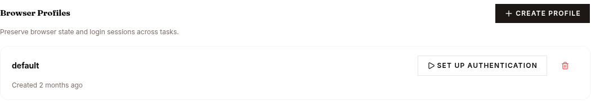
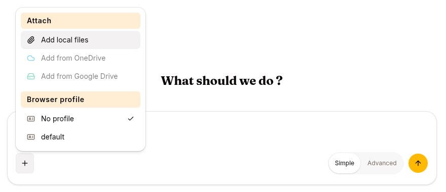

A browser profile is a saved, encrypted browser login that an agent can reuse, so it stays signed in to a site across sessions instead of logging in every time.

Profiles build on the [Agent browser](/develop/features/browser). A profile captures the cookies and storage a real login produced; attaching it to a session starts the agent's browser already authenticated.

## What a profile stores

Each profile is one row owned by exactly one principal — either a human user or a service account (never both).

| Field | Meaning |
|---|---|
| `name` | Human-readable label, unique per owner within an org. |
| `source` | How the state was captured (default `manual_vnc` — a human login). |
| storage state | The encrypted browser storage state: cookies plus local/session storage from the logged-in session. Stored encrypted at rest and never returned to the client. |
| `cookie_domains` | The domains the saved cookies belong to — a non-secret summary so the UI can show what a profile covers. |
| `created_at` / `last_used_at` | Creation time and the last time the profile was injected into a browser. |

The login state itself (`storage_state`) is encrypted before it is written and decrypted only when it is injected into a browser. Only the derived `cookie_domains` list and metadata are stored in the clear.

## How a profile is created

Creating a usable profile is a three-step, interactive flow — you log in by hand once, and the profile keeps that login:

1. CREATE — an empty named profile is created for the caller's principal.
2. SETUP SESSION — a dedicated, interactive browser-setup session is started and its browser is handed to you in the [live view](/develop/features/browser#live-view) with control already granted. You navigate to the site and sign in by hand (including MFA/CAPTCHA). This session is short-lived: it self-terminates after 15 minutes, and nothing is saved unless you explicitly capture it. On monetized agents, setup sessions are exempt from per-buyer browsing-time metering — capture never spends a buyer's minutes.
3. CAPTURE — while you still hold control, the post-login cookies and storage you just established are exported and saved (encrypted) onto the profile. The setup browser is then torn down.

Capture is deliberately narrow: it can only export from the dedicated setup session bound to that specific profile, and only for the person who holds control of it — it cannot export login state out of an ordinary agent session.

## How a profile is attached

To use a profile, a session is bound to it (its `profile_id` travels in the session config). On the first `browser_*` tool call, the runtime looks up the profile for the session's principal, decrypts its storage state, and injects it into the fresh browser so it starts logged in. The profile's `last_used_at` is updated each time it is loaded.

If the profile can't be loaded — no state saved yet, principal mismatch, or a decryption failure — the browser still starts, just unauthenticated (it "fails open" to a fresh browser rather than breaking the tool). To the agent this looks the same as no profile at all.

## Security model

- **Encrypted at rest.** The stored login state is encrypted; a database read alone does not reveal cookies or session tokens.
- **Principal-scoped.** Every profile operation filters on the exact owning principal, so one user's or service account's profile is unreadable by another principal even if its id is guessed. A database constraint enforces that a profile has exactly one owner.
- **Capture is bounded.** Login state can only be captured through the dedicated setup session for that profile, by the control holder — not siphoned from arbitrary sessions.
- **Fail-safe.** A profile that cannot be decrypted (for example after a key rotation) degrades to an unauthenticated browser instead of failing the session.
