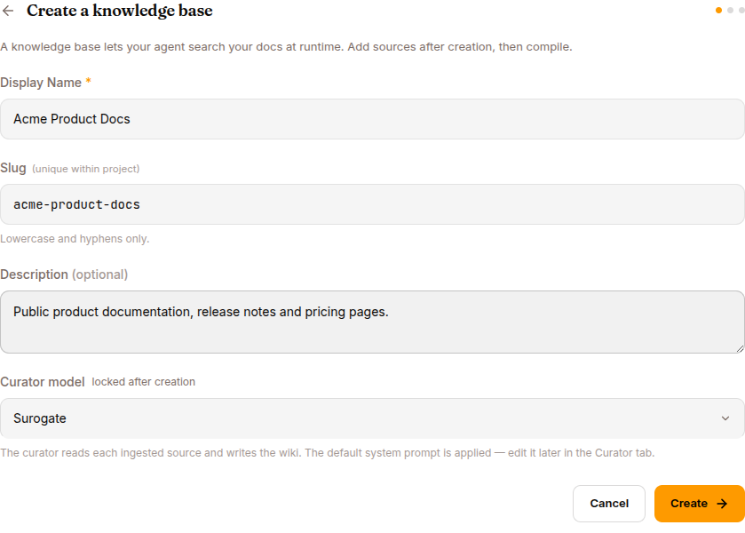

A KB is a curated corpus the agent can search and read at runtime via `kb_search_pages`, `kb_list_pages` and `kb_read_page`. Where a skill teaches the agent **how** to do something, a KB tells it **what it knows**.

For the operator's view, see [Work mode → Knowledge bases](/work/library/knowledge-bases).

## How a KB works (architecturally)



```
Source files (markdown, PDF, CSV)
        │
        ▼ uploaded via POST /api/knowledge-bases/{id}/sources
   ┌─────────────────────────────┐
   │   Curator (an LLM)          │
   │   Reads sources, extracts   │
   │   structured knowledge,     │
   │   deduplicates              │
   └─────────────┬───────────────┘
                 │ COMPILE (POST /api/knowledge-bases/{id}/compile)
                 ▼
   ┌─────────────────────────────┐
   │   Wiki — searchable index   │
   │   (Hub-versioned)           │
   └─────────────┬───────────────┘
                 │
                 ▼  kb_list_pages / kb_read_page at runtime
   Agent's session context grows by relevant pages
```

The curator distills and links the material into a wiki. Hybrid search covers passages from both original sources and generated pages. Agents can read exact source passages, expand to the parent document, or follow a PDF section tree to its page ranges.

## What a KB carries

| Field | Notes |
|---|---|
| **Name** | Unique within your org |
| **Description** | Free-form |
| **Curator model** | Locked at creation — can't be changed later. Default works for most cases; pick a smarter model (Claude Sonnet 4.6, GPT-5) at creation for highly technical content. |
| **Sources** | List of files / S3 prefixes / GitHub repos / Notion pages / URLs (only File works in current builds) |
| **Status** | `error` (no successful compile yet) → `compiling` → `active` |
| **Counters** | sources, wiki pages, attached agents |

Published artifacts are versioned in Hub. Search results and reads refer to the same published content. A failed compile preserves the previous publication; changing a Hub branch alone does not roll back the search registry.

## Five source types

Five types are listed in ADD SOURCE. **Only File is enabled in current builds** — the rest are scaffolded but not yet wired.

| Type | Available | Notes |
|---|---|---|
| **File** | ✅ | Upload `.md`, `.pdf`, `.txt`, `.docx`, `.csv` |
| **S3** | 🚧 | Recursive pull from a bucket/prefix |
| **GitHub** | 🚧 | Auto-pull from a repo's docs folder with branch tracking |
| **Notion** | 🚧 | OAuth into a Notion workspace |
| **URL** | 🚧 | Crawl a domain or specific URLs |

When the other source types ship, they'll have continuous sync (re-compile on detected changes).

## Curator model

Locked at KB creation. Can't be changed later. Common choices:

- **Surogate default** — fine for most cases
- **Claude Sonnet 4.6** — better for highly technical content
- **GPT-5** — alternative

The curator runs once per source on COMPILE. The cost is dominated by the size of the source corpus.

## Compile

```bash
curl -X POST http://localhost:8000/api/knowledge-bases/{id}/compile \
  -H "Authorization: Bearer $TOKEN"
```

What happens:

1. For each source: read, parse, chunk
2. For each chunk: curator extracts structured knowledge
3. Per-source wiki page assembled
4. Cross-source synthesis index built
5. Wiki committed to the Hub

Compile time: 30s to several minutes per source.

### When compile fails

A failed source is marked `error` with its recorded message in the SOURCES list. Source, concept-generation, upload or publication failures leave the previous published knowledge available. Successfully prepared summaries are checkpointed for a retry; a PDF retry also recovers its extracted source and section tree.

- **Retry the failing file** — transient failures (curator LLM rate limits) are common, and files a dead compile left locked are requeued automatically on every finalize path, so retry never reports "no files to compile"
- **Reduce source size** — splitting large documents into chapters can shorten individual retries. Long PDFs use the section-tree indexer; oversized documents and sections are summarized in parts, then combined so the summary process covers the full text.
- **Check format** — corrupt PDFs and non-UTF-8 markdown choke the parser
- **Read the per-file error** — it names the actual reason

## Wiki search

After attaching a KB, agents use `kb_search_pages` for hybrid lexical/vector search across their permitted knowledge bases, then `kb_read_page` to read the matching pages. Validate retrieval by asking the attached agent representative questions and inspecting its search and read tool results.

Search hits include a `passage_id` when an exact evidence passage is available. Pass it to `kb_read_page` with the returned KB ID and path. Omit it to expand the document; use `pages` for a PDF range. Reads report the published version and location.

Deleting a source file retires its dependent searchable evidence. Existing KBs need a full rebuild to populate source passages and provenance.

The wiki browser's "Search wiki" field filters page titles locally; it does not run the agent's retrieval pipeline.

## Attach to an agent

```bash
curl -X POST http://localhost:8000/api/agents/{agent_id}/knowledge-bases \
  -H "Authorization: Bearer $TOKEN" \
  -d '{"kb_id": "..."}'
```

The agent's system prompt gains:

```

## Available Knowledge Bases

- acme-product-docs: Product documentation, runbooks, known-issues database.
  Browse via kb_list_pages("acme-product-docs"), then kb_read_page(path).
```

Plus the agent's tool catalogue grows by `kb_search_pages`, `kb_list_pages` and `kb_read_page`.

## REST API

| Method | Endpoint | Purpose |
|---|---|---|
| `GET` | `/api/knowledge-bases` | List |
| `GET` | `/api/knowledge-bases/{id}` | Detail |
| `POST` | `/api/knowledge-bases` | Create. Body: `{name, description, curator_model}` |
| `DELETE` | `/api/knowledge-bases/{id}` | Delete (pre-flight: warns if attached to agents) |
| `GET` | `/api/knowledge-bases/{id}/sources` | List sources |
| `POST` | `/api/knowledge-bases/{id}/sources` | Add source (multipart for File, JSON for others) |
| `DELETE` | `/api/knowledge-bases/{id}/sources/{source_id}` | Remove source |
| `POST` | `/api/knowledge-bases/{id}/compile` | Trigger compile |
| `GET` | `/api/knowledge-bases/{id}/wiki` | Browse wiki |

## What's next

[MCP & Vault](/develop/features/mcp-and-vault/) for external system integration. [Datasets](/develop/features/datasets/) for the other corpus type used in training.
