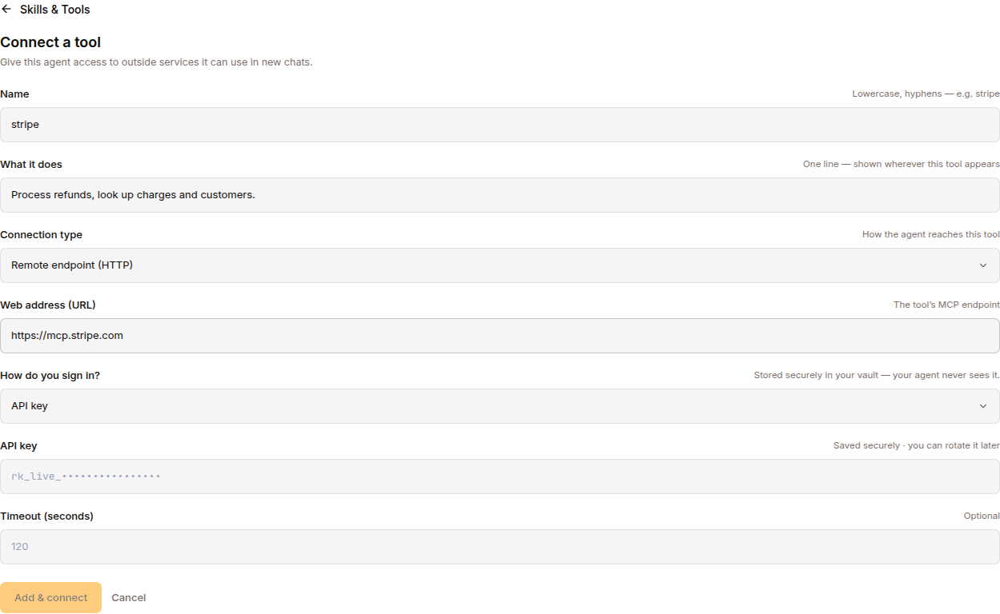
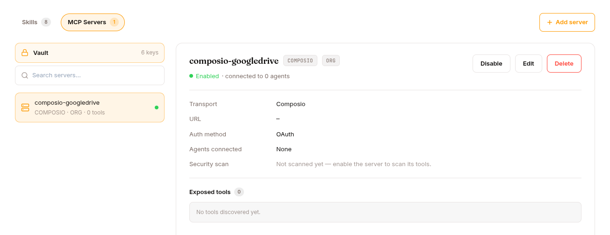

The **Model Context Protocol** (MCP) is an open standard for connecting LLMs to external tools and data. Surogate ships a full MCP client + a credential-injecting proxy + security scanning.

You manage MCP servers in **Skills & Tools → MCP SERVERS tab** (Develop or Work mode). The **Vault** entry at the top of the left rail takes you to the credential store in **Settings → Vault** (see [Vault](/work/settings/vault/)).

## Architecture

```
Sandbox / Worker
    │
    │  MCP tool call
    ▼
MCP Proxy (separate K8s service)
    │
    │  injects credentials from vault
    ▼
External MCP Server (stdio or HTTP)
```

The proxy is the trusted credential broker:

- Sandboxes can only reach the MCP proxy (K8s NetworkPolicy enforces this)
- The proxy holds credentials in memory (fetched from the Vault on connection)
- Outbound calls to MCP servers carry injected headers/args without the sandbox ever seeing secrets

This is the structural fix for "what if my agent leaks an API key" — the agent literally cannot access keys, even if fully prompt-injected.

## Two transports



The blocks below show the shape of a server's stored config — the same fields the Studio form (or `/api/mcp-servers`) writes into the registry. There is no config file on disk to edit.

### Stdio

Launch the MCP server as a subprocess; communicate via stdin/stdout. Configuration:

```yaml
mcp_servers:
  github:
    transport: stdio
    command: npx
    args: ["-y", "@modelcontextprotocol/server-github"]
    credential_refs: ["GITHUB_TOKEN"]   # resolved from Vault
    timeout: 120
```

Best for: locally-installable CLI-like tools, MCP servers shipped as npm packages.

### HTTP / StreamableHTTP

Connect to a remote MCP server over HTTP:

```yaml
mcp_servers:
  jira:
    transport: http
    url: "https://mcp.acme.com/jira"
    auth: oauth
    oauth:
      client_id: "surogates-agent"
      scope: "read write"
    timeout: 120
```

Best for: cloud-hosted MCP servers, shared infrastructure across tenants.

## MCP client features

| Feature | Description |
|---|---|
| **Auto-reconnect** | Exponential backoff with up to 5 retries on connection loss |
| **Sampling** | MCP servers can request LLM completions back through the client |
| **Environment filtering** | Only explicitly allowed env vars passed to stdio servers |
| **Credential stripping** | Secrets scrubbed from error messages |
| **Per-server timeout** | Configurable per server |
| **Thread safety** | Dedicated background event loop for MCP connections |

## OAuth 2.1 PKCE for protected servers

```
1. Agent needs to call an OAuth-protected MCP tool
2. MCP client checks for cached tokens (on disk)
3. If no valid token:
   a. Start ephemeral localhost HTTP server for redirect
   b. Open browser to authorization URL with PKCE challenge
   c. User approves in browser
   d. Callback server receives authorization code
   e. Exchange code for access + refresh tokens
   f. Store tokens on disk for reuse
4. Attach access token to MCP requests
5. Auto-refresh when token expires
```

Configuration:

```yaml
mcp_servers:
  salesforce:
    url: "https://mcp.salesforce.com/mcp"
    auth: oauth
    oauth:
      client_id: "pre-registered-id"
      client_secret: "secret"
      scope: "api refresh_token"
      redirect_port: 0                # auto-pick available port
      client_name: "Surogates Agent"
      token_dir: "/var/lib/surogates/tokens"
```

## The credential vault

**Settings → Vault** is the project's credential store; values are write-only and never shown again after saving, and the list API never returns them. The **Vault** entry on the MCP Servers tab links to it. See [Vault](/work/settings/vault/) for the full tab. Entries are named in an MCP server's `credential_refs`, and every MCP server in the project can reference them.

System-owned credentials (used by platform/system agents) are protected: the API refuses to delete them (`403`), and a credential still consumed by a running agent's MCP server can't be deleted until you stop the consumer (`409`, in-use conflict).

### How references work

A server config never carries a secret. It carries a `credential_refs` array naming Vault entries and saying where each value is injected. The short form is a bare name:

```json
"credential_refs": ["GITHUB_TOKEN"]
```

- **stdio** → injected as `env.GITHUB_TOKEN`
- **http** → injected as `headers.Authorization: Bearer <value>`

Use the structured form when the target variable or header differs from the Vault name:

```json
"credential_refs": [
  {"name": "MY_TOKEN", "env": "GITHUB_PERSONAL_ACCESS_TOKEN"},
  {"name": "API_KEY", "header": "X-API-Key"},
  {"name": "AUTH", "header": "Authorization", "prefix": "Bearer "}
]
```

| Field | Notes |
|---|---|
| `name` | Vault entry name (required) |
| `env` | Inject as this environment variable (stdio) |
| `header` | Inject as this HTTP header (http) |
| `prefix` | Prepended to the value — header form only (e.g. `Bearer `) |

With neither `env` nor `header`, the value is injected as an environment variable named after the credential.

The Auth dialog on an MCP server writes these for you: **API key** produces `{"name": …, "header": "X-API-Key"}`, **Bearer** produces `{"name": …, "header": "Authorization", "prefix": "Bearer "}`, **OAuth** produces `{"name": …, "env": "CLIENT_SECRET"}`.

At runtime the proxy resolves each ref from the Vault and injects it into the outbound connection. The sandbox never sees the value, and every lookup is written to the tenant audit log as a `credential.access` entry.

### Encryption

Vault credentials are encrypted at rest with Fernet (AES-128-CBC + HMAC-SHA256). The symmetric key lives in a K8s cluster secret.

## Where MCP servers are registered



The registry is exclusively DB-backed — the `mcp_servers` table, written by the Studio UI and `/api/mcp-servers`. There are no on-disk config layers.

Servers are **project (org) scoped**: every server you register is visible to the whole project. What a given session actually loads is decided per agent — the proxy loads only the servers attached to that agent, so two agents in the same project get different toolsets from the same registry. Servers toggled off are skipped entirely.

The **PLATFORM / ORG / USER** chip on a server row is a label for your own bookkeeping (the REST list can filter on it). It does not change who can see the server and it does not affect load precedence.

## Security scanning

Every MCP tool definition is scanned before registration:

| Threat | What it catches |
|---|---|
| **Invisible Unicode** | Zero-width chars, bidi marks in tool names/descriptions |
| **Prompt injection** | Deceptive descriptions that trick the LLM |
| **Hidden HTML** | HTML comments with invisible instructions |
| **Tool poisoning** | Descriptions that manipulate the LLM into dangerous behaviour |
| **Rug-pull** | Tool definitions that change between connections (SHA-256 fingerprinting) |

Tools failing scanning are not registered. Scan results land in the tenant audit log:

```sql
SELECT * FROM audit_log
WHERE type = 'mcp.tool_scan'
  AND org_id = $1
ORDER BY created_at DESC;
```

## Rug-pull detection

If a server returns a different tool definition on reconnect (different fingerprint), the scanner emits a warning. Common cause: the upstream MCP server got updated. Review the diff before re-enabling.

## REST API

| Method | Endpoint | Purpose |
|---|---|---|
| `GET` | `/api/mcp-servers` | List (filter by `project_id`, `enabled`, `layer`) |
| `GET` | `/api/mcp-servers/composio/catalog` | Live Composio toolkit catalog |
| `GET` | `/api/mcp-servers/{id}` | Detail with connected tools |
| `POST` | `/api/mcp-servers` | Add server |
| `PATCH` | `/api/mcp-servers/{id}` | Update config (including the `enabled` toggle) |
| `GET` | `/api/mcp-servers/{id}/in-use` | List agents referencing this server |
| `DELETE` | `/api/mcp-servers/{id}` | Remove server (409 if attached to a running agent) |
| `GET` | `/api/credentials` | List Vault entries (names + timestamps only, never values) |
| `POST` | `/api/credentials` | Store a credential (same name overwrites — this is how "Update" works) |
| `GET` | `/api/credentials/{name}/in-use` | List MCP servers referencing this credential |
| `DELETE` | `/api/credentials/{name}` | Remove (403 if system-owned, 409 if in use) |

There is no dedicated `/enable` endpoint — enabling/disabling is a `PATCH` that flips the `enabled` flag. Tool security scanning happens in the MCP proxy at tool-discovery time, not as a synchronous call on this API. Updating a credential is a `POST` with the same name (the store upserts); there is no `PUT`.

## What's next

[Hub](/develop/features/hub/) for the artifact versioning layer. [Datasets](/develop/features/datasets/) and [Training](/develop/features/training/) for the training pipeline. [Use cases](/develop/use-cases/) → "Build an MCP server with OAuth."
