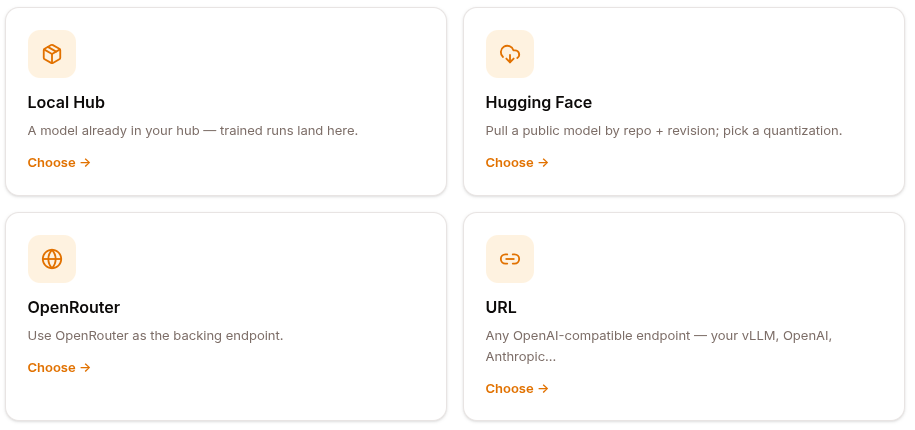
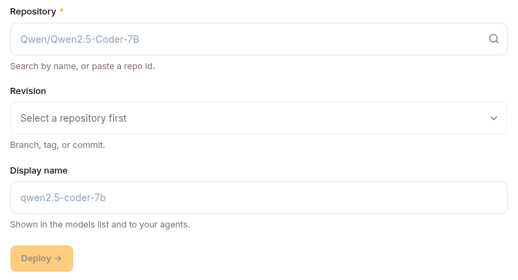
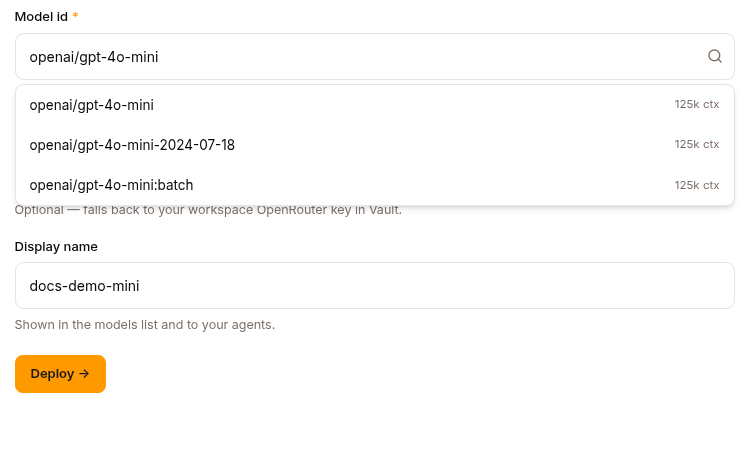
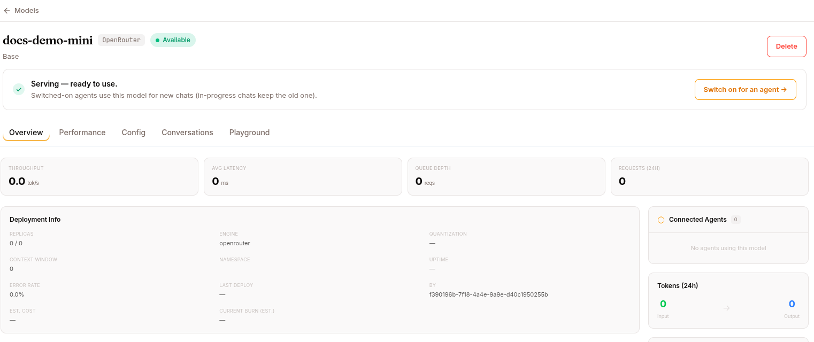
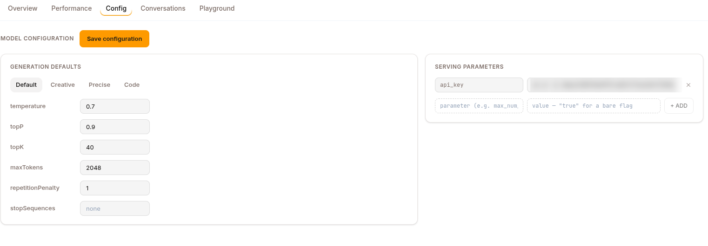
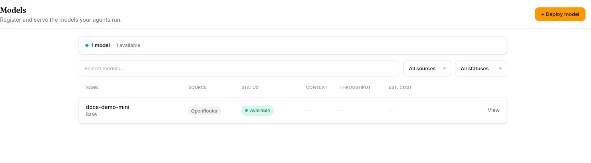

The Models page is where you register and serve the LLM endpoints your agents call. Click **+ Deploy model** at the top of the page to open the deploy flow: first a source picker, then a per-source form, then the model's detail page where you configure and start it.

## The four sources

The deploy flow opens on **"Where is the model coming from?"** — four cards:

| Source | What it is | When to use |
|---|---|---|
| **Local Hub** | A model already in your tenant's Hub | A model you trained (see [Local Hub](#local-hub)) |
| **Hugging Face** | Pull a public model from HF Hub by repo + revision | Public bases, quantized variants |
| **OpenRouter** | Use OpenRouter as the backing endpoint | Mix-and-match commercial models through one key |
| **URL** | Any OpenAI-compatible endpoint | Your own vLLM server, Anthropic, OpenAI direct, etc. |

The split that matters: **Local Hub** and **Hugging Face** are *served* models — Surogate provisions GPUs and runs an inference server (vLLM / llama.cpp) for them, so they have a start/stop lifecycle. **OpenRouter** and **URL** are *proxy* models — Surogate just forwards to an endpoint someone else runs, so there's no GPU, no CONFIG compute step, and they're usable the moment you save.

Every form ends with a **Display name** (shown in the models list and to your agents; defaults to the last path segment of what you picked) and a **Deploy →** button. The back arrow returns to the source picker; **Cancel** returns to the models overview.

### Local Hub

Serve a model that already lives in your hub. This is where a trained model reaches Models: a finished run is never added here by itself. On the run's page, **Publish to Hub** (for a LoRA run, also **Merge** or **Promote** it, see [Header actions](/develop/features/training/#header-actions)), then add it here.

| Field | Required | Notes |
|---|---|---|
| **Model** | yes | Dropdown of the `model`-type repos in your hub. Empty state: "No models in your hub yet." |
| **Revision** | — | A commit or tag in that repo. The dropdown groups **Branches** and **Tags** (each shows its short commit); defaults to the repo's default branch. |
| **Display name** | — | e.g. `support-sft-001`. |

Registered with source `local_hub` and a `hub_ref` of `repo@revision`.

### Hugging Face

Pull a public base or fine-tune from the HF Hub.

| Field | Required | Notes |
|---|---|---|
| **Repository** | yes | Type ≥3 characters to search HF, or paste a repo id directly (`owner/name`, e.g. `Qwen/Qwen2.5-Coder-7B`). |
| **Revision** | — | Branch, tag, or commit — the dropdown lists the repo's refs (grouped Branches / Tags), defaulting to `main`. |
| **Quantization** | — | Segmented control: **fp16 · int8 · int4 · GGUF**. Lower precision = less GPU memory, slightly lower quality. |
| **Display name** | — | e.g. `qwen2.5-coder-7b`. |

Registered with source `huggingface`, the chosen `quantization`, and a `revision` in the serving config when it isn't `main`.

### OpenRouter

Point at a model hosted by OpenRouter and use it as the backing endpoint.

| Field | Required | Notes |
|---|---|---|
| **Model id** | yes | Type to filter OpenRouter's catalog (shows each model's context length) or paste an id — e.g. `openai/gpt-4o`, `anthropic/claude-3.5-sonnet`. |
| **OpenRouter API key** | yes | Picked from the Vault (see [The key picker](#the-key-picker)). **Deploy** stays off until you choose one. |
| **Display name** | — | e.g. `gpt-4o (judge)`. |

Registered with source `openrouter`, engine `openrouter`, and a reference to the Vault key you picked in the serving config. This is a proxy model: no GPU, no serving config.

### URL

Point at any OpenAI-compatible endpoint you already run.

| Field | Required | Notes |
|---|---|---|
| **Endpoint URL** | yes | Your vLLM, OpenAI, Anthropic, or any OpenAI-compatible server — e.g. `https://expert-pool.your-cluster.svc:8000/v1`. |
| **Model name** | — | Passed verbatim to the endpoint (e.g. `expert-router`). |
| **API key** | — | Optional. Picked from the Vault (see [The key picker](#the-key-picker)). |
| **Context window** | — | Tokens the model accepts, as a whole number. Agents compact their context against it. Blank uses 128K. |
| **Display name** | — | e.g. `expert-pool`. |

Registered with source `url`, engine `openai_compat`, and the endpoint (plus a reference to the Vault key, if you picked one) in the serving config. Also a proxy model, usable immediately.

### The key picker

On OpenRouter and URL models the API key is a dropdown of the keys in your project's [Vault](/work/settings/vault/), not a text box. The model stores only a reference to the key, never its value. The choices are:

- **Select a key** (OpenRouter) or **No key** (URL): none chosen.
- Each Vault key by name, with the agent that uses it when there is one. Keys that belong to a single agent's own account aren't offered.
- **+ New key…**: opens a name and value; **Save** adds the key to the Vault and selects it.

A reference to a key that was removed later shows as **(missing)** until you pick another. The server also refuses a deploy or save that names a key not in the Vault. The same picker is on the **Config** tab of a proxy model, as **API key**, next to **Context window**, which you can change there later.

## The model detail page

Deploying drops you on the model's detail page. The header shows the display name, a source badge, and a status pill: `Creating` (amber), `Serving` (green), `Stopped`, or `Error`; proxy models show a permanent `Proxy` pill. Next to the name, the pencil (**Rename**) edits it in place: press Enter or click away to save, Esc to cancel. Saving an empty name restores the old one. Renaming needs the editor role or higher: viewers can open **Rename**, but the save is refused. It changes only the display name. Action buttons live top-right: **Stop** / **Start** (or **Restart** after an error), **View job** (jumps to the serving job in the workload queue), and **Delete**. When a served model is up, a green **"Serving — ready to use"** banner offers to switch it on for an agent.

Up to six tabs:

### Overview

- **KPIs:** Throughput (tok/s), Avg Latency (ms), Queue Depth, Requests (24h), each with a sparkline.
- **GPU Resources** (served models, while running): GPU-utilization and VRAM gauges, plus GPU type/count, VRAM used/total, tensor-parallel size, batch size. Shows "no GPU allocated" when stopped.
- **Deployment Info:** replicas (current / desired), engine, quantization, context window, namespace, uptime, error rate, last deploy, deployed-by.
- **Connected Agents**, **Tokens (24h)** (input → output), and a **Model Card** (family, parameters, base, hub ref).

### Performance

Period selector (**Last hour / Last 24h / Last 30d**) driving five KPIs — Tokens/sec, Avg Latency, Total Tokens, Requests, Success Rate — sparkline charts for throughput / latency / total tokens / requests, and a prompt-vs-completion token breakdown.

### Config

The serving configuration. For **served** models it has three parts:

- **Deployment configuration**
  - **Compute** — pick a provider and instance offer (or a Modal GPU). `kubernetes` and `ssh` back-ends use pre-existing nodes and skip the offer picker.
  - **Engine** — **vLLM** or **llama.cpp**. Modal serving is vLLM-only.
- **Generation defaults** — presets (Default / Creative / Precise / Code) plus editable rows: temperature, topP, topK, maxTokens, repetitionPenalty, stopSequences.
- **Serving parameters** — engine flags as key/value rows. vLLM seeds `max_model_len`, `tensor_parallel_size`, `gpu_memory_utilization`, `quantization`, `enforce_eager`, `attention_backend`, `reasoning_parser`, `tool_call_parser`; llama.cpp seeds `ctx_size`, `threads`, `reasoning_format`. You can add arbitrary parameters — each is passed to the serving command as `--kebab-cased-key`. On Modal, an extra card exposes snapshot mode (CPU+GPU / CPU / off), scale-to-zero window, startup timeout, and max concurrent requests per replica.

Start requires only **Engine** and **Compute**; quantization can stay unset. The yellow **"Required before serving"** note also lists quantization. Settings lock while the model is serving or starting: **Stop to edit**.

**Proxy** models (OpenRouter / URL) have no compute or engine to configure — CONFIG only carries generation defaults and the endpoint/API-key serving fields, and it never locks.

### Conversations

Sessions that used this model, filterable and searchable — useful for seeing the model against real production traffic.

### Fine-tunes

Served models only. Lists the fine-tuned models derived from this base — each row shows its training run, success rate, and status — with a **+ NEW FINE-TUNE** button to launch another training run from this base.

### Playground

Send prompts to the model right from the detail page. Proxy models work immediately; a served model has to be running first (otherwise you get a "start to test" prompt).

## Starting a model

**Start** is disabled until CONFIG is complete — for served models that means an engine plus a GPU (or a `kubernetes`/`ssh`/llama.cpp setup where the GPU is resolved at schedule time). Then:

1. Click **Start** and confirm.
2. The platform provisions compute on the selected backend — dstack (Kubernetes / cloud) or Modal.
3. The model is downloaded, loaded, and exposed at an endpoint.
4. Status moves `creating` → `serving`, usually 1–10 minutes (HF download + load can be slow, and it costs money while it runs).

The endpoint then becomes available to your agents (via the agent's model selection) and to any skill that references it.

## Stopping a model

**Stop** drops the model's replicas to 0 and the endpoint stops responding. The model record is retained — **Start** again brings it back; cached model files mean it usually doesn't re-download.

## Scaling replicas

Studio has no replica control; the REST API does: `POST /api/models/{id}/scale` with a `replicas` count (editor role or higher).

## Connecting a model to an agent

Open the agent → CONFIG → Model section and pick the model from the dropdown.

- New sessions use the new model.
- In-progress sessions keep their old model (session-start freeze).

The **"Switch on for an agent →"** button on a serving model's banner takes you straight there.

## Models for experts

A served model can also back an **expert** — a skill (`type: expert`) the base LLM delegates to when a request matches its trigger. The expert runs its own mini agent loop on this model and hands the answer back, so you can drop an LLM that's specialised in one thing (a fine-tuned coder, a domain classifier) inside an ordinary agent. The expert references the model + its endpoint; it can't be activated until the model is actually serving. See [Skills & Experts](/develop/features/skills-and-experts/) for the expert setup.

## BYO LLM

If you run your own provider end-to-end (not Surogate-served models), enable **BYO LLM** in Settings → Billing. Your agents route LLM calls through your own provider and you pay them directly; Surogate charges only for platform usage. See [BYO LLM](/develop/features/byo-llm/).

## REST API

All routes are mounted at `/api/models`.

| Method | Endpoint | Purpose |
|---|---|---|
| `GET` | `/api/models` | List models (filters: `project_id`, `status`, `search`, `limit` ≤ 200) |
| `GET` | `/api/models/{id}` | Model detail |
| `POST` | `/api/models` | Register a model (any source) |
| `PATCH` | `/api/models/{id}` | Update serving / generation config |
| `POST` | `/api/models/{id}/start` | Provision and serve |
| `POST` | `/api/models/{id}/stop` | Drop replicas |
| `POST` | `/api/models/{id}/restart` | Restart a serving model |
| `POST` | `/api/models/{id}/scale` | Update replica count |
| `GET` | `/api/models/{id}/in-use` | Active + historical references to the model |
| `DELETE` | `/api/models/{id}` | Unregister (409 if anything still references it) |
| `GET` | `/api/models/artifacts` | List indexed model artifacts (filters incl. `project_id`, `hub_repo`, `hub_ref`, `source_kind`, `limit` ≤ 500) |
| `GET` | `/api/models/artifacts/{artifact_id}/lineage` | Artifact plus its parents/children |
| `POST` | `/api/models/artifacts/{adapter_id}/merge` | Merge an adapter into its base and publish to the hub |
| `POST` | `/api/models/artifacts/{adapter_id}/promote` | Promote train-time-merged weights into their own repo |

## What's next

[Skills](/develop/features/skills-and-experts/) for how to reference a served or fine-tuned model from a skill. [Training](/develop/features/training/) for producing a fine-tuned model of your own.
