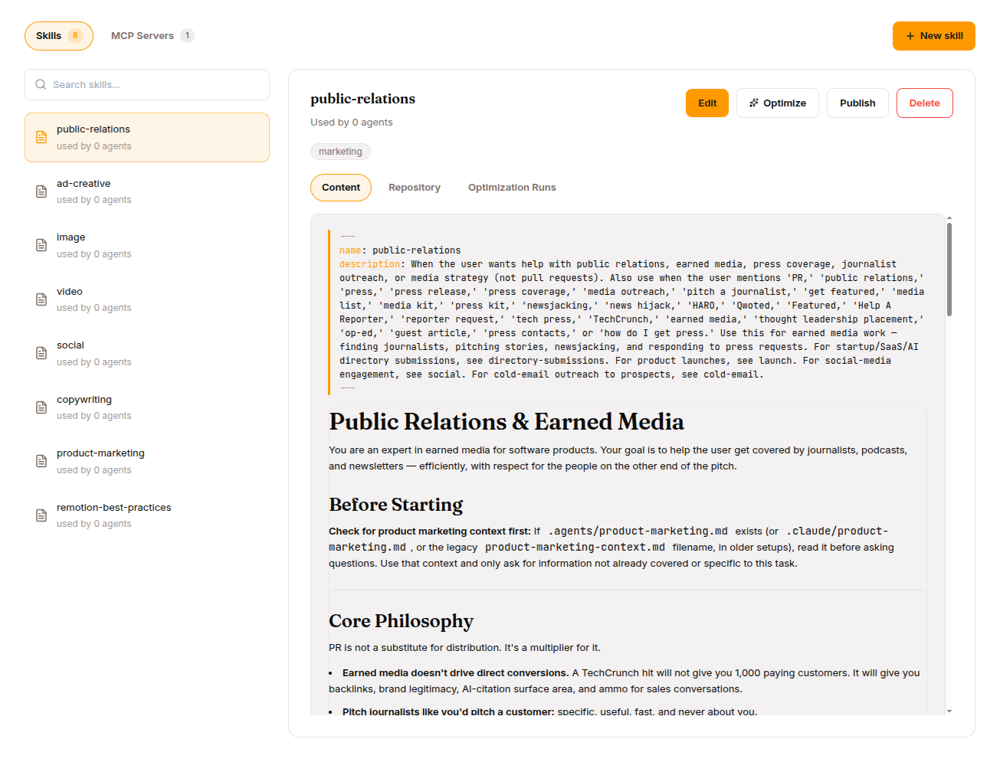
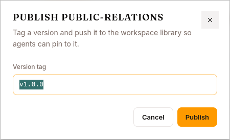

The **Skills & Tools** page (in Work mode's nav) has two tabs — **SKILLS** and **MCP SERVERS**; this chapter is the builder's deep dive into both. A skill is a markdown file (`SKILL.md`) the agent loads into its prompt. An **expert** is a skill whose `type` is `expert` — backed by a fine-tuned model that runs in a bounded mini-loop.

This chapter covers both. For the operator's walk-through of writing a skill in the UI, see [Work mode → Skills](/work/library/skills).

## `SKILL.md` format



Markdown with YAML frontmatter:

```markdown
---
name: code_reviewer
description: Reviews code for quality, security, and best practices
trigger: review code, code review, check this code
tools: [read_file, search_files, write_file]
type: skill                    # default; use 'expert' for model-backed
tags: [security, quality]
platforms: ["linux", "macos"]
requires_tools: [read_file]
fallback_for_tools: []
---

You are a code reviewer. When asked to review code:

1. Read the files specified by the user.
2. Check for:
   - Security vulnerabilities (OWASP top 10)
   - Performance issues
   - Code style and readability
   - Missing error handling
3. Provide specific, actionable feedback with line references.
4. Suggest concrete fixes, not just descriptions of problems.
```

### Frontmatter

| Field | Type | Required | Description |
|---|---|---|---|
| `name` | string | yes | Lowercase, alphanumeric + hyphens, 1-64 chars |
| `description` | string | yes | Shown to the LLM in `skills_list` |
| `trigger` | string \| list | recommended | Keywords/phrases matched against the user message |
| `tools` | list | no | Tools this skill uses (for progressive disclosure) |
| `type` | string | no | `skill` (default) or `expert` |
| `tags` | list | no | Metadata for categorisation |
| `platforms` | list | no | Restrict to OSes `["linux", "macos", "windows"]` |
| `requires_tools` | list | no | Hidden unless ALL listed tools are available |
| `fallback_for_tools` | list | no | Hidden when ALL listed tools are available |
| `enabled` | bool | no | Parsed but not enforced — a skill file loads whether or not it is set |

Body text after the frontmatter is the skill's prompt content — inlined into the system prompt when the skill triggers, or returned by `skill_view` when explicitly invoked.

## The 4-layer loading model

Skills load from four layers in increasing precedence. Layer 1 has two halves, both served from the [Hub](/develop/features/hub/):

```
Layer 1a: System bundle     platform/system-skills repo, <name>/SKILL.md   (lowest)
Layer 1b: Per-agent bundle  agent bundle repo, skills/<name>/SKILL.md
Layer 2:  User files        tenant assets, {org_id}/users/{user_id}/skills/
Layer 3:  Org (DB)          skills table, org-wide (user_id IS NULL)
Layer 4:  User (DB)         skills table, user-specific                    (highest)
```

| Layer | Managed by | How |
|---|---|---|
| 1a System bundle | Platform operator | One Hub repo (`platform/system-skills`) shared by every agent in the cluster — the framework built-ins (`brainstorming`, `executing-plans`, …). The runtime reads its latest `v*` tag and caches that snapshot per process, re-fetching when the catalog is republished. |
| 1b Per-agent bundle | Org admin | Attaching a Hub-published skill to an agent copies its repo subtree under `skills/<name>/` in that agent's own bundle repo. |
| 2 User files | End user | Written by the agent's `skill_manage` tool during a session. |
| 3 Org (DB) | — | Org-wide rows in the runtime's `skills` table. |
| 4 User (DB) | — | Per-user rows in the same table. Both DB layers are read paths only: nothing currently writes them, so in practice a skill you author reaches an agent through 1b. |

Higher layers override by name, so a per-agent skill (1b) **shadows** a built-in of the same name for that agent — the system skill is not removed, just superseded. Org admins always win: an end user cannot override a skill the org admin has set. Disabling a DB skill row does not mask a lower layer — the row simply drops out of the merge and the lower layer's version loads instead.

## Conditional activation

Two fields:

- `requires_tools` — skill included only if **all** listed tools are available in the agent's allowlist
- `fallback_for_tools` — skill excluded when **all** listed tools are available; only appears when at least one is missing

Use `fallback_for_tools` for graceful degradation. Example:

```yaml
---
name: manual-web-search
description: Guides the user through manual web research
fallback_for_tools: [web_search]
---
```

Only loads when the agent's `web_search` tool is denied.

Use `requires_tools` to gate skills that depend on specific tools:

```yaml
---
name: container-debug
description: Diagnoses issues inside running containers
requires_tools: [bash, docker]
---
```

The loader evaluates conditional activation after merging all four layers.

## agentskills.io / Hermes compatibility

Skills authored in the [agentskills.io](https://agentskills.io) format are loaded without modification. The loader reads conditional fields and tags from the `metadata.hermes` namespace:

```yaml
---
name: hermes-skill
description: A skill using the Hermes frontmatter convention
metadata:
  hermes:
    requires_tools: [bash]
    fallback_for_toolsets: [web_search]
    tags: [devops, ci]
---
```

Recognised hermes keys:

| Hermes key | Maps to |
|---|---|
| `requires_tools` | `requires_tools` |
| `requires_toolsets` | `requires_tools` |
| `fallback_for_tools` | `fallback_for_tools` |
| `fallback_for_toolsets` | `fallback_for_tools` |
| `tags` | `tags` |

Top-level keys win when both are set.

## Dynamic skill commands

Users invoke a skill explicitly via `/<skill-name> [args...]`:

```
/research vector databases
/babysit-prs
```

Resolution order in the harness:

1. Builtin commands — `/clear`, `/code`, `/compress`, `/deep-research`, `/goal`, `/loop`, `/mission`, `/auto-research`
2. Dynamic skill resolution
3. Plain user message if no match

Those eight names are **reserved**: the parser skips them, so a skill named `code` or `deep-research` is never reached by slash command.

For dynamic invocation, the harness calls `skill_view` server-side and inlines the body into the user message.

## Skill REST API

| Method | Endpoint | Description |
|---|---|---|
| `GET` | `/api/skills?is_expert=true&project_id=` | List (filter `is_expert` for experts only) |
| `POST` | `/api/skills?project_id=` | Create. Body: `{name, content, description, ...}` |
| `GET` | `/api/skills/{skill_id}` | Detail |
| `PATCH` | `/api/skills/{skill_id}` | Update. Body: partial skill fields |
| `POST` | `/api/skills/{skill_id}/publish` | Tag a version |
| `DELETE` | `/api/skills/{skill_id}` | Delete (409 if in use) |

Skills are addressed by `skill_id`, not by name. An API-created skill gets its own Hub repo; attaching it to an agent copies it into that agent's bundle (layer 1b). Agent-created skills (via the `skill_manage` tool) go to the tenant bucket (layer 2).

## Validation rules

| Rule | Constraint |
|---|---|
| Name | Lowercase, alphanumeric + hyphens, 1-64 chars |
| Name uniqueness | No duplicates within scope (user or org) |
| Frontmatter | Must include `name` and `description` |
| Content size | Body ≤ configured limit (default 100 KB) |
| File path | Must be within tenant's skill directory |

Validation errors return `422 Unprocessable Entity`.

## Publishing — versioning



When you PUBLISH a skill, you tag a version in the skill's [Hub](/develop/features/hub/) repo. Tags are immutable. Editing creates a new draft; the next PUBLISH creates `v0.1.1`, `v0.2.0`, etc.

Sessions record which version of each skill they used. You can:

- Roll back to a previous tag
- Pin an agent to a different skill version and re-run your regression set against it
- Audit "which skill version was active for session X"

---

## Experts — model-backed skills

When you set `type: expert` on a skill, you turn it into something different. The body becomes the **expert's system prompt** (not the agent's), and you specify a model + endpoint.

## Example

```markdown
---
name: sql_writer
description: Writes PostgreSQL queries from natural language descriptions
type: expert

model: qwen2.5-coder-7b
endpoint: http://expert-pool.your-cluster.svc:8000/v1
trigger: SQL queries, database schemas, PostgreSQL, data analysis

tools: [terminal, read_file, search_files]
max_iterations: 10
expert_status: draft
---

You are a PostgreSQL expert for this organisation. When given a natural
language description, write a correct, efficient query.

Rules:
- Always use explicit column names (never SELECT *)
- Use CTEs for complex queries
- Include comments explaining non-obvious joins
- Validate against the schema before returning
```

### Frontmatter for experts

| Field | Required | Default | Description |
|---|---|---|---|
| `name` | yes | — | Expert name |
| `description` | yes | — | Shown to the base LLM |
| `type` | yes | `skill` | Must be `expert` |
| `model` | yes | — | Model name passed to the inference endpoint |
| `endpoint` | no | — | OpenAI-compatible URL; normally resolved from the served model at activation rather than set by hand |
| `trigger` | yes for routing | — | Phrases describing when to select this expert |
| `adapter` | no | — | LoRA adapter path in tenant storage |
| `tools` | no | `[]` | Tools the expert can use in its mini-loop |
| `max_iterations` | no | `10` | Max tool-call rounds before budget exceeded |
| `expert_status` | no | `draft` | `draft` / `collecting` / `active` / `retired` |

## The expert lifecycle

```
1. Define     SKILL.md with type: expert                expert_status: draft
2. Collect    POST /api/experts/{name}/collect          expert_status: collecting
3. Train      In-platform SFT/GRPO run over the dataset (or export the JSONL)
4. Activate   POST /api/skills/{skill_id}/activate      expert_status: active
5. Monitor    expert.result / expert.failure session events (retire manually)
6. Retrain    Collect → train → activate                (loop)
```

Collect (and its dataset/trajectory inspection) lives on a separate **experts** router keyed by name (`/api/experts/{name}/...`); activation and retirement are on the **skills** router keyed by `skill_id` (`/api/skills/{skill_id}/...`).

### 1. Define

Create the SKILL.md with `type: expert, expert_status: draft`, via the Studio or `POST /api/skills`.

### 2. Collect training data

```bash
curl -X POST http://localhost:8000/api/experts/sql_writer/collect \
  -H "Authorization: Bearer $TOKEN" \
  -H "Content-Type: application/json" \
  -d '{"project_id": "<project>", "mode": "bootstrap"}'
```

The platform walks the surogates session events and appends successful trajectories as fine-tuning JSONL to the expert's dataset repo in the Hub, committing each run. Two modes:

- **Bootstrap** — walks the skill's trajectories for this name. Use to train an expert from an existing prompt-based skill.
- **Improve** — walks the active expert's delegation → tool-call → result chains. Use once the expert is active to train on fresh successful trajectories.

Each collect is a strict delta from the manifest's `last_collect_at` cursor (pass `since` to re-collect from an earlier point), and tainted sessions are excluded by default (`exclude_tainted: true`).

Preview candidate counts before a full run with `GET /api/experts/{name}/trajectories?project_id=&mode=bootstrap`; inspect the accumulated dataset manifest (row counts, run history, cursor) with `GET /api/experts/{name}/dataset?project_id=`. Note: the improve-mode preview is not yet implemented — only bootstrap preview is wired.

### 3. Train (in-platform)

The collected dataset closes the loop **inside the platform**. Wrap the expert's JSONL as a dataset and launch an in-platform **SFT or GRPO** training run over it — no external fine-tuning service required. See [Training](/develop/features/training/) for the run wizard and [Datasets](/develop/features/datasets/) for turning the collected export into a training dataset.

You can still export the JSONL and train elsewhere (OpenAI fine-tuning, Unsloth, Axolotl, or a custom `transformers` + `peft` script) if you prefer. Either way the output is a model with an OpenAI-compatible serving endpoint that the platform can serve and back the expert with.

### 4. Activate

```bash
curl -X POST http://localhost:8000/api/skills/{skill_id}/activate \
  -H "Authorization: Bearer $TOKEN" \
  -H "Content-Type: application/json" \
  -d '{"model_id": "<served-model-id>"}'
```

Activation resolves the endpoint from the model's serving service rather than taking a raw URL — so the expert's model **must already be serving a live endpoint**, otherwise activation fails with a 400 (an active expert always has a live endpoint invariant). Activation also republishes every agent bundle that embeds the skill, so the refreshed `SKILL.md` reaches the runtime.

After activation, the base LLM sees the expert in its system prompt under `# Available Experts`. The harness routes hard tasks matching the expert's triggers; the base LLM can also explicitly call `consult_expert("sql_writer", task="...")`.

### 5. Monitor

An expert's quality signal lives in the **session event log**, not on the skill row. Every consultation emits an `expert.result` or `expert.failure` event, and the feedback API adds `expert.endorse` / `expert.override` when a user or judge rates a result. Count those per expert to decide whether it is still earning its serving cost.

:::caution[The expert usage counters are dead columns]
`GET /api/skills/{skill_id}` returns `total_uses` and `total_successes`, and the Studio renders them as a success rate — but **no code path writes them**. They always read `0`. Ignore that tile.
:::

Nothing retires an expert automatically. A failing expert stays `active` — and stays in the base LLM's `# Available Experts` block — until an operator calls `/retire`.

### 6. Retire / retrain

```bash
curl -X POST http://localhost:8000/api/skills/{skill_id}/retire \
  -H "Authorization: Bearer $TOKEN"
```

Retirement flips `expert_status` to `retired` and, like activation, republishes the dependent agent bundles. To retrain: collect fresh data → train → activate against the newly served model.

## The expert mini-loop

When `consult_expert(name, task, context)` is called:

```
1. Load the expert's SKILL.md
2. Make an OpenAI-compatible request to the expert's endpoint
   with model = expert.model
3. The expert can call tools from its restricted set (expert.tools)
4. Iterate up to max_iterations
5. Return the expert's final assistant message to the base LLM
6. Base LLM reviews and either accepts, modifies, or rejects
```

Bounded — can't go forever, can't escalate its tool surface, can't keep the conversation going. Just answer the delegated question.

## REST API for experts

Collection is keyed by expert **name** on the `experts` router; lifecycle is keyed by **`skill_id`** on the `skills` router:

| Method | Endpoint | Description |
|---|---|---|
| `GET` | `/api/skills?is_expert=true` | List experts |
| `GET` | `/api/experts/{name}/trajectories?project_id=&mode=bootstrap` | Preview candidate trajectories (bootstrap only) |
| `POST` | `/api/experts/{name}/collect` | Collect trajectories → append JSONL to the Hub dataset |
| `GET` | `/api/experts/{name}/dataset?project_id=` | Dataset manifest (row counts, run history, cursor) |
| `POST` | `/api/skills/{skill_id}/activate` | Set status to active (requires a live serving endpoint) |
| `POST` | `/api/skills/{skill_id}/retire` | Set status to retired |

## What's next

[Knowledge Bases](/develop/features/knowledge-bases/) for the other half of "agent's knowledge." [MCP & Vault](/develop/features/mcp-and-vault/) for external tool integration. [Datasets](/develop/features/datasets/) and [Training](/develop/features/training/) for the training pipeline.
