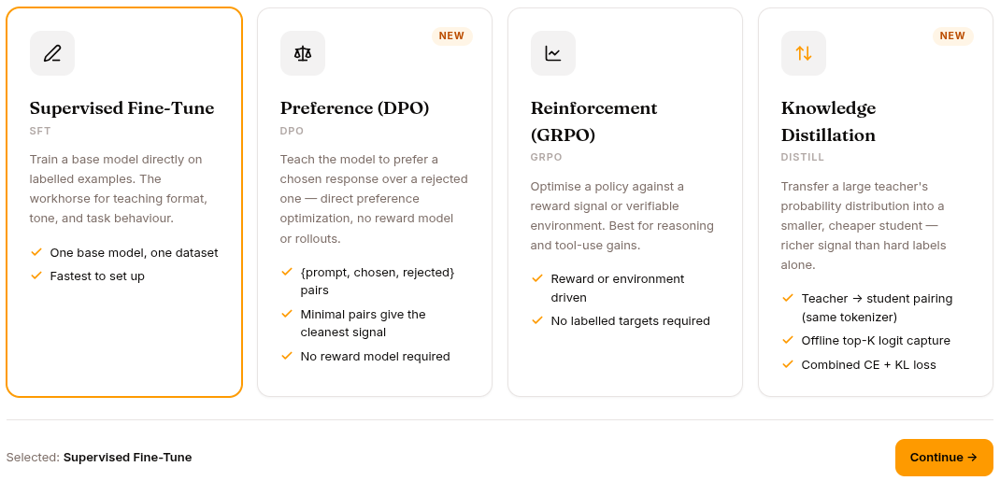
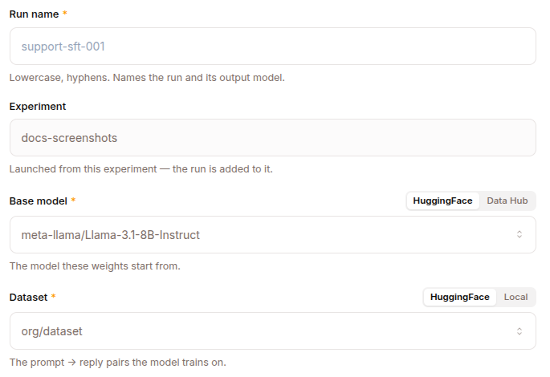
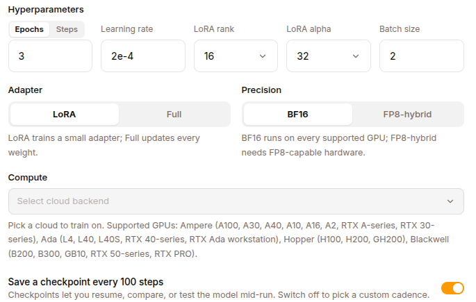
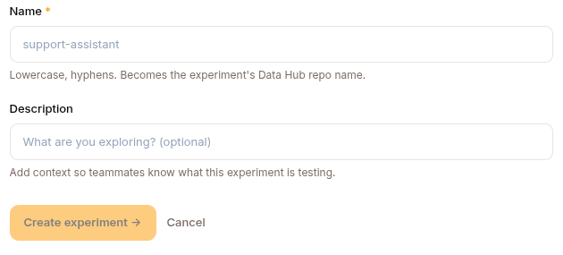

The Training page launches fine-tuning runs. Four methods can be created and started — **SFT**, **DPO**, **GRPO** and **DISTILL** — and the method picker offers exactly those four. SFT and GRPO are documented in depth below.

> **Studio vs. the engine.** Pretraining (PT) and full-parameter fine-tuning are handled directly by the `surogate` engine CLI (`surogate sft` / `surogate grpo` and friends) and are not exposed in the Studio training pipeline. `PPO` exists in the API schema but is rejected at run-create time with *"PPO not yet supported"*.

**DPO** and **DISTILL** both ride the SFT path rather than having a pipeline of their own: DPO is an SFT config plus a `loss: {type: dpo}` block over `{prompt, chosen, rejected}` rows, and DISTILL is an SFT config plus a `distillation:` block naming a teacher model. Run-create rejects either one if that block is missing.

## The methods



### SFT — Supervised Fine-Tuning



Standard supervised fine-tuning from labeled trajectories. Most common path.

Configuration:

```
Method: SFT
Base model: qwen2.5-coder-7b (a HF model id, or a Data Hub repo@ref)
Dataset: my-conversations-2026q1 (a local Dataset, or an HF dataset id)
Training parameters (carried in the run's config):
  - Epochs / max steps
  - Learning rate
  - Batch size
  - Precision: BF16 | FP8 | NVFP4
  - Adapter: lora / qlora (set lora + lora_rank in config), or full
Compute:
  - Backend: dstack (kubernetes / cloud) or Modal
  - Accelerators: e.g. GPU:1, H100:8
  - Spot instances + region (optional)
```

The adapter choice (LoRA / QLoRA rank, or full) is not a dedicated form field — it's carried in the run's free-form `config` dict alongside the rest of the trainer settings, so the launcher can pass it straight through to the trainer.

Use when:

- You have a dataset of (input → expected output) pairs
- You want a model that mimics the patterns in your data
- The base model gets the right structure but wrong details



### GRPO — Group Relative Policy Optimisation

Reinforcement learning from rewards. Newer, more complex.

Configuration:

```
Method: GRPO
Base model: ...
RL Mode: Environment | RULER
Environment: (Environment mode) — a registered environment with deterministic rewards
RULER judge: (RULER mode) — a dataset of prompts + a system prompt, scored by an LLM judge
GPU blocks: inference_blocks (vLLM) + trainer_blocks (+ judge_blocks for a colocated judge)
Other RL hyperparameters
```

Use when:

- You have a clear reward signal (math correctness, code compiles, ...)
- The desired behaviour can be measured, not just imitated
- You want exploration beyond your training data

#### RL Modes

The backend resolves exactly two GRPO reward paths:

- **Environment** — the run points at a registered verifiers environment (`config.environment_id`) that computes deterministic rewards. Example: math problems where correctness is verifiable.
- **RULER** — an LLM judge scores each rollout. The dialog supplies a dataset of prompts plus a system prompt (`config.ruler_task_args`), which the platform wires into a built-in `ruler_task` environment. The judge can be **external** (your own OpenAI-compatible endpoint + API key) or **colocated** (a vLLM judge that runs on the training fleet and consumes its own GPU blocks). Good for subjective rewards (helpfulness, tone).

## Training run lifecycle

Creating a run and launching it are **two separate steps**: `POST /api/training-runs` records a queued run (and validates the request), then `POST /api/training-runs/{id}/start` submits it to compute. This lets you create a run, tweak its config, and only then launch.

```
1. Create        Click NEW RUN, fill the form → a queued run is recorded
2. Start         Click START → pre-start validation runs, then GPUs are provisioned
3. Run           Training executes (5min to days depending on dataset + model size)
4. Monitor       Logs, metrics, rollouts, checkpoints via the run detail page
5. Complete      Final model lands in Models page as a new entry
6. Optional      Activate as an expert via the expert lifecycle
```

Two guardrails run at these boundaries:

- **Plan-tier gating (402).** If the project's plan doesn't include training, both create and start return `402` with an "upgrade in Settings → Billing" message.
- **Pre-start validation (422).** START runs the same validator that drives the frontend's Start button; if the config has errors (missing GPU blocks, unset dataset, etc.) it returns `422` and the run stays queued.

### Experiments and the Data Hub



Every run belongs to an **experiment**, and each experiment maps to a repo in the Data Hub. Individual runs are **branches** in that repo — the platform creates the experiment repo on first use and a per-run branch at create time, then commits the run's artifacts (checkpoints, metrics) to that branch as training progresses.

## Run detail page

| Tab | What it shows |
|---|---|
| **OVERVIEW** | Status, dataset, base model, hyperparameters, ETA, current epoch |
| **LOGS** | Training log output (archived server-side, so it survives the GPU being released) |
| **METRICS** | Train loss, eval loss (if eval split), learning rate, throughput — from `GET /api/training-runs/{id}/metrics` |
| **ROLLOUTS** | (GRPO only) Periodically-sampled rollouts with prompt, completion, reward, and advantage — from `GET /api/training-runs/{id}/rollouts` |
| **CHECKPOINTS** | Per-epoch model snapshots |
| **OUTPUT** | The final trained model with its endpoint when serving starts |

## Stopping a run

STOP button on the run detail page (`POST /api/training-runs/{id}/stop`). This aborts the upstream dstack or Modal job and marks the run cancelled. Partial training is lost; checkpoints already committed are preserved. A failed or cancelled run can be started again from its detail page — the restart wipes prior metrics/logs/rollouts so the retry's series don't collide with the previous attempt.

## RL Environments

For GRPO Environment mode, you need a registered environment. The Hub has an `Environments` repo type for these.

An environment is a Python class implementing:

```python
class MyEnvironment:
    def reset(self) -> Observation:
        ...

    def step(self, action) -> tuple[Observation, Reward, Done, Info]:
        ...

    def compute_reward(self, trajectory) -> float:
        ...
```

The platform ships several built-in environments (math, code-execution, multi-step planning). Custom ones live in `tenant-{org_id}/shared/agents/environments/`.

🚧 The RL Environments page in the UI shows an empty "No environments yet" sidebar in current builds; this surface is partially wired.

## REST API

Runs live under `/api/training-runs`; experiments under `/api/experiments`. Create and start are separate calls, and there is no `/cancel` — use `/stop`.

| Method | Endpoint | Purpose |
|---|---|---|
| `GET` | `/api/training-runs` | List runs |
| `GET` | `/api/training-runs/{id}` | Run detail |
| `POST` | `/api/training-runs` | Create (queued) — `402` if the plan lacks training |
| `POST` | `/api/training-runs/{id}/start` | Launch — `422` if the config fails validation |
| `POST` | `/api/training-runs/{id}/stop` | Stop / abort |
| `GET` | `/api/training-runs/{id}/metrics` | Metrics series |
| `GET` | `/api/training-runs/{id}/rollouts` | GRPO rollouts (prompt / completion / reward) |
| `GET` | `/api/experiments` | List experiments |
| `POST` | `/api/experiments` | Create an experiment (provisions its Hub repo) |

## What's next

[Evaluations](/develop/features/evaluations/) for testing what you trained.
