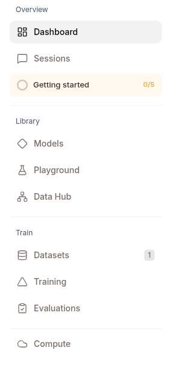
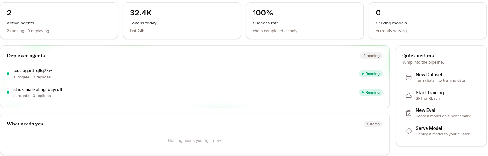

For designing agents, writing skills, training experts, running evaluations, integrating via API, and deploying on your own cluster. Flip to **Work mode** in the navbar if you only need to chat with deployed agents and watch sessions.

## How the platform is built



Surogate is built on open-source components you can run and inspect yourself:

| Repo | Role | License |
|---|---|---|
| [`invergent-ai/surogates`](https://github.com/invergent-ai/surogates) | Agent runtime — harness loop, sessions, sandbox, MCP, governance, channels, memory, tools | AGPL-3.0 |
| [`invergent-ai/surogate`](https://github.com/invergent-ai/surogate) | Training framework — the SFT/RL engine behind the expert models you own | Apache-2.0 |
| [`invergent-ai/surogate-hub`](https://github.com/invergent-ai/surogate-hub) | Artifact versioning store — "Git for data" for skills, datasets, and models | Apache-2.0 |

When you deploy an agent at `<slug>.cloud.surogate.ai`, the platform wraps the runtime image and binds your config to it. The runtime is what's actually running inside the container.

This documentation focuses on the platform surface — what you can do through `ops.surogate.ai`. For runtime internals, see the [runtime architecture reference](/develop/reference/runtime-architecture/).

## The builder loop



```
       ┌─────────────────────────────────────┐
       │                                     │
       ▼                                     │
┌──────────┐    ┌──────────┐    ┌──────────┐ │   ┌──────────┐
│  BUILD   │ →  │ OBSERVE  │ →  │  TRAIN   │ → │  REDEPLOY  │
│ (config) │    │(sessions)│    │ (dataset │ │   │ (new agent│
│          │    │ & evals) │    │ + train) │ │   │  version) │
└──────────┘    └──────────┘    └──────────┘ │   └─────┬────┘
                                              │         │
                                              └─────────┘
```

Most iteration lives in **build → observe**. Training experts and re-deploying happens weekly to monthly, not daily.

Start at [The builder loop overview](/develop/loop/overview/) for the full cycle, or jump to [Use cases](/develop/use-cases/) for end-to-end recipes.
