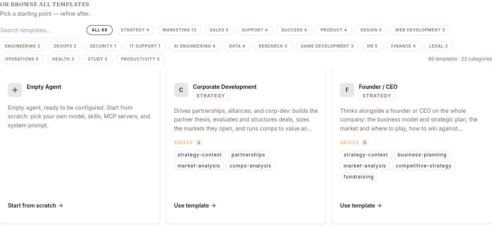

Everything you declare about the agent before users start using it: its identity, its tool envelope, what data it can search, where it's reachable, how governance constrains it.

## Creation paths



| Path | How |
|---|---|
| **Templates → Start from scratch** | The current builds ship an empty template catalog. **Start from scratch** opens the DEPLOY NEW AGENT dialog; fill Display Name / Slug / Description / Model, click CREATE AGENT. |
| **Develop dashboard → Quick Actions → Deploy Agent** | Same dialog, launched from the dashboard. |
| **REST API** `POST /v1/agents` | Programmatic. Useful when cloning an existing agent's config dict. |

Skills, knowledge bases and MCP servers are added afterwards on the **Configure** page; channels on **Publish**.

## The agent's anatomy

When you deploy, you're configuring six things:

```
┌─────────────────────────────────────────────────┐
│           Your Agent (acme-support)              │
│                                                  │
│   ┌────────────┐   ┌────────────┐   ┌─────────┐ │
│   │   Model    │   │  Persona   │   │ Tools   │ │
│   │ (Surogate, │   │ (SOUL.md)  │   │ (allow/ │ │
│   │  HF, etc.) │   │            │   │  deny)  │ │
│   └────────────┘   └────────────┘   └─────────┘ │
│                                                  │
│   ┌────────────┐   ┌────────────┐   ┌─────────┐ │
│   │   Skills   │   │ Knowledge  │   │ MCP     │ │
│   │  (attached)│   │   Bases    │   │ Servers │ │
│   └────────────┘   └────────────┘   └─────────┘ │
│                                                  │
│   ┌────────────┐   ┌────────────┐   ┌─────────┐ │
│   │  Channels  │   │ Governance │   │  Saga   │ │
│   │ Web/Slack/ │   │ (policies, │   │(rollback│ │
│   │   etc.     │   │  egress)   │   │   on)   │ │
│   └────────────┘   └────────────┘   └─────────┘ │
│                                                  │
└─────────────────────────────────────────────────┘
```

### 1. Model

The LLM the agent uses for its main reasoning. Configure in CONFIG → Model. Sources:

- **Surogate default** — the platform's bundled model
- **Local Hub** — a model your team registered in the platform's Models page (see [Models](/develop/features/models/))
- **Hugging Face** — point at a HF repo + revision
- **OpenRouter** — any model OpenRouter serves
- **URL** — any OpenAI-compatible endpoint

The model is the most important single choice. Default Surogate is fine for general purpose; switch when you have specific cost / latency / capability requirements.

### 2. Persona (SOUL.md)

Up to 20,000 characters of markdown injected at the top of every system prompt. Defines:

- **Identity** — who the agent is, who it represents
- **Voice** — formal vs casual, "we" vs "I"
- **Boundaries** — what it does and doesn't do
- **Escalation** — when to defer to humans

What doesn't belong in SOUL.md:

- **Tool instructions** ("when given X, call tool Y") — those are **skills**
- **Step-by-step procedures** — those are **skills**
- **Long lists of facts** — those are **knowledge bases**
- **Secrets** — those go in the **Vault**

Safety: SOUL.md content passes through `scan_context_content` (12 prompt-injection patterns) before injection. Failing entries are stripped.

### 3. Tool allowlist / denylist

Every agent has access to the runtime's built-in tools, but you can narrow the surface:

- **Allowlist** — only the listed tools are available
- **Denylist** — these tools are blocked, even if allowlisted

Deny always beats allow. The full catalogue of 40+ tools lives at [Tool catalog](/develop/reference/tool-catalog/).

Recommended starting points:

| Agent type | Allow | Deny |
|---|---|---|
| Customer support | `web_search`, `kb_search_pages`, `kb_list_pages`, `kb_read_page`, `memory`, `ask_user_question`, `create_artifact` | `terminal`, `process`, `run_coding_agent`, `write_file`, `patch` |
| Data analyst | All (default) | `cron_*` if no scheduling needed |
| Code reviewer | `read_file`, `search_files`, `list_files`, `web_search` | `write_file`, `patch`, `terminal` |
| Internal admin bot | Denylist only — agent needs broad access | Targeted denies (e.g. `delete_*` tools) |

### 4. Attached skills / KBs / MCPs

Three categories of attached resources. The agent's **Configure** page manages all three in their own sections (Skills, Knowledge Bases, MCP Servers).

- **Skills** — reusable prompt-based behaviours (markdown files). See [Skills & Tools](/develop/features/skills-and-experts/).
- **Knowledge Bases** — curated document corpora. See [Knowledge Bases](/develop/features/knowledge-bases/).
- **MCP Servers** — external system connectors. See [MCP & Vault](/develop/features/mcp-and-vault/).

### 5. Channels

Where users reach the agent. **Publish → Channels** section. Web is always on; Slack, Telegram, Website widget toggle on/off with credentials. See [Agents](/develop/features/agents/) for per-channel config.

### 6. Governance & Saga

Built into CONFIG:

- **Web & browser egress** — glob-domain allow/deny rules for the URLs `web_extract` and `browser_navigate` may open (not the terminal, `web_search`, or MCP — restrict those by denying the tool or detaching the server).
- **EU AI Act transparency** — the AI-disclosure toggle and level (`basic` / `enhanced` / `full`); the disclosure is shown as a web banner and posted as the first message on messaging channels.
- **Saga** — automatic multi-step rollback. When ON, tool calls are sequential and a failed step compensates the completed steps in reverse order. Opt-in (`saga.enabled: true`). See [Reference → Saga](/develop/features/agents/). Only shown where the deployment sets `saga_ui_enabled`.
- **Allowed/Denied tools** — see above.

These are policy-engine-enforced on **every tool call** and **frozen per wake** — mid-turn prompt injection cannot weaken governance, while policy edits still reach live sessions on their next wake.

## Deploy the agent

When the config looks right:

1. Click **DEPLOY** (for a new agent) or **SAVE** (for an existing one).
2. New agent: status `deploying` → `running` in 10-90 seconds.
3. Existing agent: changes apply to **new sessions** immediately; in-progress sessions keep their old config.

The agent gets a URL `https://<slug>.cloud.surogate.ai`.

## Verify

Before declaring the build done:

1. Click **CHAT** at the top of the agent detail (Develop mode) — or **New chat** in the left nav (Work mode). Send 3-5 representative queries.
2. Open the resulting sessions. EVENTS tab. Check:
   - Did the LLM understand the query?
   - Did it call the right tools?
   - Did skills load when expected?
   - Did the KB return relevant content?
3. If anything's off → back to config.

## What's next

You've built. Now: [Observe phase](/develop/loop/observe/) — watching what actually happens.
