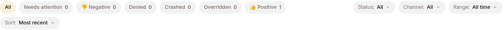

Sessions are your source of truth. Every conversation, tool call, LLM response, and governance decision is in the event log. This chapter is about reading that data with intent.

## Where to look, by symptom

| Symptom | Where in the session detail |
|---|---|
| Agent didn't call a tool you expected | SKILLS tab — did the skill load? If yes, the LLM didn't pick it. Tighten `trigger` or `description`. |
| Agent called the right tool but got junk back | TOOLS tab — inspect args + result. Often the KB content or MCP server response is the problem, not the agent. |
| Agent crashed | METADATA tab — `harness.crash` flag. Almost always platform-side; safe to retry. |
| Tool was denied | POLICIES tab — `policy.denied` events with reason. Either the allowlist needs adjusting or the agent tried something off-policy. |
| Agent looped indefinitely | METADATA → iteration count maxed out. Review the last few `llm.response` events in EVENTS for repetition. |
| Saga rolled back | METADATA → `saga.compensated` flag. The `saga.step_failed` event names the failing step. |

## Filter, don't scroll



The Sessions list supports filter chips and a search box; both compose into URL params so you can bookmark filtered views.

- **By quality flag** — chips for Denied / Overridden / Crashed / 👍 / 👎
- **By status** — Active / Completed / Failed / Archived
- **By agent** — left rail
- **Full-text** — title / ID / model

Combine them: "show me sessions from `customer-support-bot` in the last 7 days where saga compensated AND the user thumb-downed" is one URL.

## Programmatic access

For ongoing automation, query the REST API:

```bash
# List sessions matching filters
GET /v1/sessions?agent_id=<uuid>&flag=thumbs_down&since=2026-04-01

# Read the event log as JSON (no server-side type filter — select client-side)
GET /v1/sessions/{id}/events/poll?after=<last_id>&limit=50

# Live tail via SSE
GET /v1/sessions/{id}/events?after=<last_id>
```

The API channel returns the same data as the UI's EVENTS tab. See [Event types](/develop/reference/event-types/) for what each event payload contains.

## Regression testing

There is no one-click replay. Build the regression loop out of the pieces that exist:

1. Keep a "regression set" of 10-50 thumbed-down sessions — the 👎 filter is exactly this list.
2. Turn it into a dataset (**Dev → Sessions** → select → **Add to dataset**), or an eval benchmark from that dataset.
3. Before any major change, re-run the benchmark against the new config and compare scores.

See [Evaluations](/develop/features/evaluations/) for the scoring half. For a single conversation, start a fresh session and ask the same question — an existing session keeps the config it started with.

## Capture signal as a dataset

When you've identified sessions worth using for training or evaluation:

1. Sessions list → filter to your candidate set.
2. Datasets → **NEW DATASET** → source type "From Conversations" → set filters.
3. Dataset row appears in the Hub as a versioned repo.

Datasets feed [Training](/develop/loop/train/) and [Evaluations](/develop/features/evaluations/). See [Datasets](/develop/features/datasets/) for the source types and formats.

## What's next

[Train phase](/develop/loop/train/) — using observed signal to improve.
