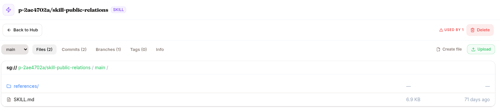

Config changes are cheap. Model changes are slightly more involved. The runtime is built so neither drops traffic.

## What kind of change am I rolling out?

| Change | Mechanism | Downtime |
|---|---|---|
| SOUL.md edit | Save CONFIG | None — applies to new sessions |
| Attach / detach skill | Click ATTACH/DETACH | None — applies to new sessions |
| Attach / detach KB | Click ATTACH/DETACH | None — applies to new sessions |
| Attach / detach MCP server | Click ATTACH/DETACH | None — but new MCP sessions need a security re-scan if the server changed |
| Tool allowlist / denylist | Save CONFIG | None — reaches live sessions on their next wake |
| Web & browser egress rules | Save CONFIG | None — reaches live sessions on their next wake |
| Channel toggle (Slack on/off) | Save CHANNELS | Seconds — the adapter pod's connection cycles |
| Model swap | Save CONFIG → Model | New sessions use new model. Existing sessions finish on old model. |
| Expert endpoint swap | `POST /v1/skills/{name}/activate` with new endpoint | None — base LLM picks up the new endpoint immediately |
| Helm chart change (advanced) | Helm upgrade | Pod cycle (~30-60s per pod) |

The **per-wake freeze** is the key safety property: the governance gate is composed once per wake and frozen for that wake, so nothing that happens mid-turn (including prompt injection) can weaken protection. Governance edits are projected into the agent's runtime config with a version bump and a cache invalidation, so a live session picks up the new policy at its **next wake** — no coordinated rollout needed.

## Hub versioning

Every artifact (skill, KB, dataset, model, environment) is a Hub repo. That means:

- Every change has a **commit** with author + message
- You can roll back to a previous tag (`v0.2.0` → `v0.1.0`)
- Branches let you test before merging to `main`
- You can see the diff between any two versions

For skills: when you PUBLISH, you tag a version. The agent uses the tagged version, not `main` — so editing the skill in `main` doesn't immediately roll out.

## Roll back a skill version

If a new skill version regresses:

1. Open the agent → KNOWLEDGE & TOOLS → click the attached skill.
2. Click **Change version** → pick the previous tag.
3. Save. New sessions use the older version.

Same mechanism for KBs and MCP servers — pick a previous tag if available.

## Roll back a model

For the agent's main model: CONFIG → Model → switch back to the previous selection. For an expert: re-activate with the previous endpoint URL.

## Traffic

There is nothing to scale for an agent. Agents run on the platform's shared runtime, which serves every agent on demand, so an agent has no replicas, CPU or memory to set. Only [model deployments](/develop/features/models/) have replicas.

## STOP / START

Three reasons to STOP an agent:

- Pausing for maintenance: you want new sessions refused while you work on it
- Freeing a slot: a stopped agent doesn't count toward your plan's limit on running agents
- End of trial: you're winding down

STOP turns the agent off. Sessions in flight finish; new ones are refused with a "stopped" error. All config (skills, KBs, MCPs) stays attached.

START turns it back on, so new sessions are accepted again. It is refused when the project is already at its plan's limit for running agents or for workspace storage.

## DELETE

The DELETE button on the agent detail. A pre-flight check warns you:

- How many attached skills will be detached
- Any in-flight synthetic runs targeting this agent (cancel them first)
- Whether end-users on this agent will lose access

CANCEL is focused by default — you have to deliberately click DELETE.

DELETE tombstones the agent. Sessions are kept for audit; the URL stops responding. Slug is freed (you can reuse it later if you want).

## Multi-tenant rollout

If your tenant has multiple agents that share a skill or KB (the skill is at the org-DB layer, the KB is attached to several agents): updating that shared resource affects all of them on the next session.

To gate the rollout per-agent: clone the skill or KB, give each agent a unique copy, then update one at a time.

## What's next

You've completed one loop. Either:

- Loop back to [Observe phase](/develop/loop/observe/) with the new version, or
- Dig into a specific feature: [Agents](/develop/features/agents/), [Skills & Experts](/develop/features/skills-and-experts/), [Knowledge Bases](/develop/features/knowledge-bases/), [MCP & Vault](/develop/features/mcp-and-vault/), [Models](/develop/features/models/), [Datasets](/develop/features/datasets/), [Training](/develop/features/training/), [Evaluations](/develop/features/evaluations/), or
- Jump to [Use cases](/develop/use-cases/) for end-to-end multi-step recipes.
