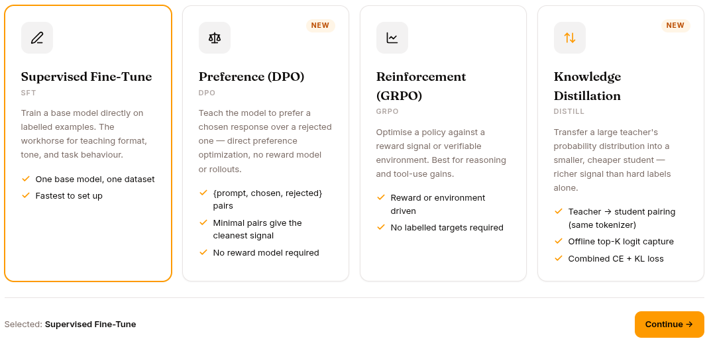

You have a corpus of marked sessions. Now use them to make the agent better.

## Two paths

### Path 1: Prompt iteration (cheap, fast)

The 90% case. You're updating:

- **SOUL.md** — the persona. Tone, scope, escalation rules.
- **Skills** — what the agent knows how to do. Add new ones, update triggers / content / examples.
- **Knowledge bases** — what the agent knows. Add new sources, fix incorrect ones.
- **Tool allowlist / denylist** — what the agent can do.
- **MCP servers** — which external systems are connected.

This is the fast loop. Edit, save, start a new session, verify. Total cycle time: minutes.

### Path 2: Expert fine-tuning (expensive, slow)

The 10% case. You're training a **task-specialised model** on successful trajectories and pointing the agent at it.

Use when:

- The same task happens often (>100 times/week)
- The base LLM gets it wrong often enough to be a problem
- You have ≥100 good examples in your session log
- You have a way to host a fine-tuned model (vLLM, Anthropic, OpenRouter, etc.)

See [Skills & Experts](/develop/features/skills-and-experts/) for the full lifecycle.

## The expert training pipeline

Six steps, three of them outside the platform:

```
1. Define     (inside the platform)
   SKILL.md with type: expert, status: draft

2. Collect    (platform → file)
   POST /v1/skills/{name}/collect
   → JSONL of successful trajectories

3. Train      (your fine-tuning pipeline)
   Use OpenAI fine-tuning, Unsloth, Axolotl, etc.

4. Activate   (platform)
   POST /v1/skills/{name}/activate with endpoint URL
   → status: active

5. Monitor    (platform)
   GET /v1/skills/{name} for expert_stats
   → POST /v1/skills/{id}/retire when the success rate stops justifying it

6. Retrain    (collect → train → activate cycle)
```

The collect step produces an OpenAI fine-tuning JSONL with the platform's prompt-template structure. Compatible with most fine-tuning APIs.

Filter on tainted sessions: by default, sessions with `policy.denied`, `harness.crash`, `saga.compensated`, or `expert.override` are excluded — they don't contaminate the training set.

## Datasets

The platform's **Datasets** page sits between observation and training. A dataset is a versioned (Hub) corpus you can:

- Build from session conversations
- Upload as a CSV / JSONL
- Generate synthetically (teacher / judge / worker pattern)
- Build from prior expert training trajectories

Each dataset has up to five tabs:

- **OVERVIEW** — counts, status
- **SAMPLES** — preview rows
- **CONFIGURATION**: the recipe it was built from (shown only when one was recorded)
- **PIPELINE** — DAG of how this dataset was built
- **REPOSITORY** — the underlying Hub repo, with branches, commits, and tags

For details on each source type, see [Datasets](/develop/features/datasets/).

## Training runs



The **Training** page handles fine-tuning runs. Two methods:

| Method | What it is | When |
|---|---|---|
| **SFT** (Supervised Fine-Tuning) | Standard fine-tune from labeled trajectories | Most cases — you have good/bad examples |
| **GRPO** (Group Relative Policy Optimisation) | Reinforcement learning from rewards | When you have a clear reward signal — math problems, code that compiles, …) |

GRPO has an additional **RL Mode** picker:

- **Environment** — deterministic reward functions (math correctness, code compilation)
- **Agent** — model-judged reward
- **RULER** — runtime rule-based reward

See [Training](/develop/features/training/) for the full configuration.

## Evaluations

After you've trained: run an evaluation to confirm improvement.

The platform ships 40 built-in benchmarks across 9 categories (reasoning, language, knowledge, coding, safety, chat, instruction, agent, vision). Plus a **Custom Benchmark** builder for scoring one of your own datasets.

Each evaluation produces:

- Per-benchmark score for the candidate model
- Comparison to a baseline (the previous version, the base LLM)
- Per-sample drill-down for the failures
- A versioned report you can share

A common pattern: gate every new expert deployment on a side-by-side eval. Don't activate unless the new version beats the old by N%.

## What's next

[Redeploy phase](/develop/loop/redeploy/) — rolling out the changes.
