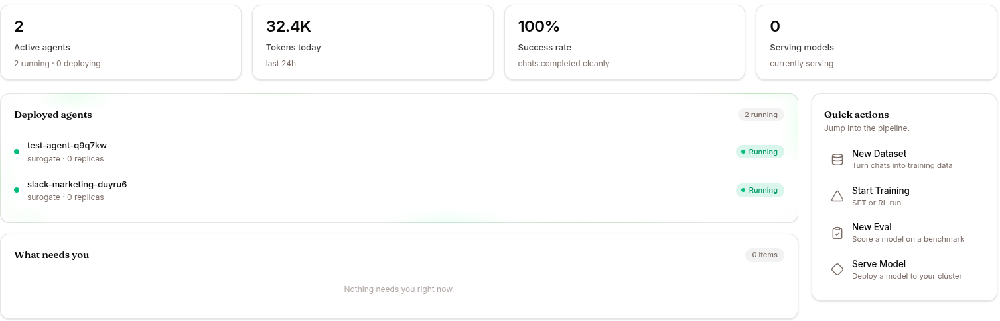

Deploy a custom agent with attached skill + KB + scoped tool envelope, then call it from a Python script. **~15 minutes.**

This walks the full build → expose surface — UI for design, REST API for integration. If you only need the operator workflow, [Work mode → Quickstart](/work/quickstart) is faster.

## 1. Write a skill

**Library → Skills & Tools → NEW SKILL** (see [Skills](/develop/features/skills-and-experts/); Develop mode has no nav entry for it, so open `/studio/skills`):

```markdown
---
name: triage-incident
description: Classify an incident report and produce a structured triage card
trigger: triage, classify incident, alert, priority, severity
tools: [read_file, web_search]
---

When given an incident report, output ONLY a JSON object with:
- severity: "P1" | "P2" | "P3" | "P4"
- category: short string (e.g. "auth", "database", "ml-inference")
- summary: one sentence, under 80 chars
- suggested_owner: team name or "unassigned"
- next_step: one short imperative sentence

Examples:
Input: "API responses timing out for 12 customers, started 5min ago"
Output:
{"severity": "P1", "category": "api-availability",
 "summary": "API timeouts affecting 12 customers since 5min ago",
 "suggested_owner": "platform-oncall", "next_step": "Check API gateway health"}

No prose outside the JSON.
```

Click **SAVE** → **PUBLISH** as `v0.1.0`.

The skill is now versioned in the Hub at `p-{project}/skill-triage-incident` with `v0.1.0` as its first tag.

## 2. Compile a knowledge base

**Library → Knowledge Bases → NEW KNOWLEDGE BASE**:

- Name: `incident-runbooks`
- Language: English (or the language of your documents)
- **CREATE**

Add sources (`SOURCES → ADD SOURCE`): drop in 3–10 markdown files that describe your incident-response procedures.

Click **COMPILE**. Wait until status flips to `active`. Open the wiki from the **Wiki pages** card on the Overview tab (see [Browsing the wiki](/work/library/knowledge-bases/#browsing-the-wiki)) and search it for a typical question to confirm the curator extracted what you need.

## 3. Deploy an agent

In Develop mode, open **Agents** in the left nav → **DEPLOY AGENT** at the top of the list. Fill the dialog:

- **Display Name** — `Incident Bot`
- **Slug** — `incident-bot` (becomes `incident-bot.cloud.surogate.ai`)
- **Description** — `Triage incoming incidents, ground answers in runbooks`
- **Model** — leave as `Surogate`

Click **CREATE AGENT**. Wait for status `running`.

(From Work mode the equivalent path is Templates → **Start from scratch** → same dialog.)

## 4. Configure it

In Develop mode, with the agent selected, open the **KNOWLEDGE & TOOLS** tab in the detail panel:

- **+ ATTACH SKILL** → `triage-incident@v0.1.0`
- **+ ATTACH KNOWLEDGE BASE** → `incident-runbooks`

Then open the **CONFIG** tab → **Tool Access** section:

- **Allowed**: `kb_list_pages`, `kb_read_page`, `read_file`, `web_search`, `create_artifact`
- **Denied**: `terminal`, `process`, `run_coding_agent`, `write_file`, `patch` (this agent shouldn't be running code)

Open **CONFIG** → **SOUL.md**:

```markdown
# Incident Triage Bot

You are an incident-triage assistant for the platform team. You return
structured triage cards via the `triage-incident` skill, and ground
recommendations in the `incident-runbooks` knowledge base.

When users describe an incident, ALWAYS:
1. Output a triage card (via `triage-incident`)
2. Search `incident-runbooks` for the closest matching runbook
3. Include a one-line link to the runbook in your response

Never invent an oncall name. If you don't know who owns it, write
"suggested_owner": "unassigned".
```

**SAVE CONFIG**. New sessions pick up the changes.

## 5. Smoke-test from the UI



Click **CHAT** → paste an incident description:

> *"PagerDuty firing — 'auth-service' returning 502 to 30% of requests for the last 10 minutes."*

Confirm in the EVENTS tab:

- The skill triggered (you'll see `skill.invoked` for `triage-incident`)
- `kb_list_pages` / `kb_read_page` fired against `incident-runbooks`
- The response is structured JSON + a runbook reference

If not, check SKILLS tab — did the skill load? Are the triggers specific enough? Iterate.

## 6. Get a service-account token

For programmatic access, ask your admin for a service-account token via:

```bash
curl -X POST https://ops.surogate.ai/v1/admin/service-accounts \
  -H "Authorization: Bearer $ADMIN_JWT" \
  -d '{"org_id": "<your-org-uuid>", "name": "incident-pipeline"}'
```

Returns the token **once** as `surg_sk_...`. Store it; you can't retrieve it again. Tokens are valid only on `/v1/api/*` routes — which covers the SSE event stream but not the JSON `/events/poll` route, and not the inbox.

## 7. Call the agent from Python

```python
import os, time, requests, json

TOKEN = os.environ["SUROGATE_SA_TOKEN"]
BASE = "https://ops.surogate.ai/v1/api"

H = {"Authorization": f"Bearer {TOKEN}"}


def triage(incident_text: str, alert_id: str) -> dict:
    # Submit the prompt. The agent comes from the token, so there is no
    # agent field; `metadata` is free-form passthrough stored on the session.
    r = requests.post(
        f"{BASE}/prompts",
        headers=H,
        json={
            "prompt": f"Triage: {incident_text}",
            "idempotency_key": alert_id,
            "metadata": {"source": "pagerduty-webhook"},
        },
    )
    session_id = r.json()["session_id"]  # 202 Accepted

    # Poll for completion
    while True:
        s = requests.get(f"{BASE}/sessions/{session_id}", headers=H).json()
        if s["status"] in ("completed", "failed"):
            break
        time.sleep(3)

    # Read the answer off the SSE stream — the LAST llm.response is the
    # user-visible one; earlier ones narrate before a tool call.
    answer, etype = None, None
    with requests.get(f"{BASE}/sessions/{session_id}/events", headers=H, stream=True) as r:
        for line in r.iter_lines(decode_unicode=True):
            if line.startswith("event:"):
                etype = line.split(":", 1)[1].strip()
                if etype in ("session.done", "stream.timeout"):
                    break
            elif line.startswith("data:") and etype == "llm.response":
                answer = json.loads(line.split(":", 1)[1])["message"].get("content") or answer
    return json.loads(answer)  # the skill returns a JSON card


card = triage("API responses timing out for 12 customers since 5min ago", "pd-8891")
print(card)
# {'severity': 'P1', 'category': 'api-availability', ...}
```

`idempotency_key` is a **body field**, not a header. Replaying the same key for the same org returns the original session with `deduplicated: true` instead of running the work twice — send your webhook's own id and retries are free. See [Sessions → API channel sessions are different](/develop/features/sessions/#api-channel-sessions-are-different) for the traps in that flow.

## What you've built

- A **versioned skill** in the Hub (rollback-able)
- A **compiled KB** the agent searches at runtime
- A **scoped agent** with a tight tool envelope and explicit persona
- A **programmatic interface** via service-account token + REST

That's a real production-shape integration. From here you can:

- Pull thumb-downed sessions into a [dataset](/develop/features/datasets/) and [evaluate](/develop/features/evaluations/) future agent versions
- Promote the skill to an [expert](/develop/features/skills-and-experts/) once you have ≥100 successful trajectories
- Add an MCP server to talk to PagerDuty, Linear, your data warehouse, etc. — see [MCP & Vault](/develop/features/mcp-and-vault/)
- See [Use cases](/develop/use-cases/) for richer recipes (A/B evaluation, synthetic data, Saga rollback flows)
