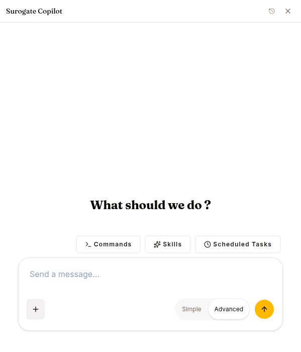

The Copilot drives the platform itself on your behalf. Press **⌘+/** (Mac) or **Ctrl+/** anywhere in `ops.surogate.ai`. For the operator's introduction, see [Work mode → Copilot](/work/tools/copilot).

This chapter covers what builders should know that operators don't need: where it slots into automation, what it can and can't do, and the safety pattern that wraps destructive operations.

## What the Copilot does for you

It exposes the platform's tools as natural-language commands. Instead of clicking through CONFIG / KNOWLEDGE & TOOLS / channels, you describe what you want and the Copilot calls the corresponding tools. There are over 100 of them (served by the ops MCP server at `/api/copilot/mcp`). The Copilot's agent definition lists exactly the tools below, and a tool not on that list is not shown to the model. The areas, with the main tools in each:

| Area | Main tools |
|---|---|
| Agents | `list_agents`, `get_agent`, `create_agent`, `update_agent`, `start_agent`, `delete_agent`, plus env vars, scaling and `attach_` / `detach_` for skills, MCP servers and knowledge bases |
| Skills | `list_skills`, `get_skill`, `create_skill`, `update_skill`, `delete_skill`, `import_skill_from_workspace`, plus tools for the skill's files |
| Knowledge bases | `create_knowledge_base`, `create_kb_source`, `add_workspace_file_to_kb`, `compile_knowledge_base`, `get_kb_compile_status`, `read_kb_wiki_page`, and others for sources, wiki pages and deletion |
| MCP servers | `list_mcp_servers`, `register_mcp_server`, `update_mcp_server`, `delete_mcp_server`, `list_composio_toolkits` |
| Sub-agents | `list_sub_agents`, `get_sub_agent`, `create_sub_agent`, `update_sub_agent`, `delete_sub_agent` |
| Programs | `get_programs_overview`, `create_journey`, `add_journey_step`, `simulate_journey`, `activate_journey`, `get_journey_funnel`, and others for journeys, WhatsApp templates and forms, escalations |
| People and team | `find_people`, `add_person`, `enroll_person`, `message_person`, `get_person_timeline`, `set_team_member`, and others for program settings, Telegram start links and Slack lookups |
| Monetize and landing page | `get_monetize`, `create_plan`, `update_plan`, `update_monetize_settings`, `get_landing_page`, `update_landing_page`, and others for replacing and deleting plans |
| Inbox and insights | `list_inbox`, `update_inbox_item`, `get_agent_insights`, `get_user_reports`, `find_sessions` |
| Datasets | `list_datasets`, `get_dataset`, `create_dataset`, `delete_dataset`, `upload_dataset_from_workspace` |
| Models and training | `list_models`, `get_model`, `deploy_model`, `stop_serving`, `list_training_runs`, `get_training_run`, `list_experiments`, `start_training`, `cancel_training`, `list_environments` |
| Workspace | `get_current_project`, `list_my_projects`, `search`, `recent_failures` |
| Documentation | `search_docs`, `read_doc`, `list_docs`, `read_guide` |

Besides those, it can use a few built-in tools: `ask_user_question`, `create_artifact` (for plans, documents and tables), `todo`, and the sandbox file and terminal tools (`read_file`, `write_file`, `patch`, `search_files`, `list_files`, `terminal`), which let it read documents you attach in chat. Its browser tools are switched off.

### Looking things up

`search_docs` ranks sections of the product documentation. Its top results carry the matching section's text, so most answers need no second call. `read_doc` reads a page or one section of it by path, and `list_docs` lists every page. The documentation is a bundled snapshot of the Work and Develop pages, so it can lag the live site. When you ask from a Studio page that has a doc, the page tells the Copilot which doc covers it. Pages without one give no doc hint.

`find_sessions` finds conversations by what was said in them. With no agent named it searches the current project's agents; with an agent named, only that agent. Either way you need the editor or owner role on the project (or to be a platform admin); a viewer gets no results. `search` looks across resources by name and ID in the current project, or in every project you are a member of.

### Build guides

For each kind of build the Copilot has a playbook: `build-agent`, `build-skill`, `build-knowledge-base`, `build-sub-agent`, `connect-mcp`, `build-program`, `build-dataset`, `run-training` and `deploy-model`. It opens the guide with `read_guide` before building, along with the checklists and templates the guide cites. The loop is interview, inspect, plan (as an artifact you approve), build in dependency order, read each piece back, summarise with links and a test script. Its instructions forbid creating or updating an agent's prompt before an interview and an approved plan.

The three ML guides cover what the tools allow. `build-dataset` uploads one workspace file of up to 50 MB with `upload_dataset_from_workspace`; `create_dataset` only registers an empty record, so the guide forbids using it for training data. `run-training` starts SFT, DPO and distillation runs with `start_training`. `deploy-model` starts and stops serving an entry already on Models and switches an agent onto it.

## How it asks before acting

Two mechanisms apply.

**It asks in the chat.** The Copilot's instructions have it ask with `ask_user_question` before spend and risky changes: `start_training`, `deploy_model`, `compile_knowledge_base`, any `delete_*`, `scale_agent` to a higher count, `start_agent` on an `error` agent, `set_agent_env_vars`, `update_agent` on `policy` or `browser_enabled`, `register_mcp_server` with `stdio`, and overwriting a skill or sub-agent. This is an instruction to the model. The tools themselves do not check for it.

**An unanswered question is not an answer.** A cancelled `ask_user_question` (for example [when nobody answers](/develop/reference/tool-catalog/#when-nobody-answers)) is neither a yes nor a no, for an interview question, a plan approval or a confirmation alike, and the instructions forbid acting on it. If a message or step arrived meanwhile, the Copilot deals with that first and asks again only for what is still missing; otherwise it says in one line that it is waiting and stops, without asking again in that turn.

**The tool refuses without `confirmed=true`.** For actions that message people, start or stop what they receive, spend money or change who can do what, the tool takes a `confirmed` argument. Without it, the tool changes nothing and returns `needs_confirmation` with the action. The Copilot then asks you, quoting the action (and the exact text, for a message), and calls again with `confirmed=true` only after your yes. These tools are:

- `activate_journey`, `pause_journey`, `delete_journey`, `remove_journey_step`, `send_journey_test`, `create_whatsapp_template`
- `enroll_person`, `update_person_enrollment` (status changes), `manage_person_contacts` (add, confirm, remove), `message_person`
- `set_team_member`, `remove_team_member`, `update_program_settings` (team, senders, destinations)
- `create_plan`, `update_plan`, `replace_plan`, `delete_plan`, `update_monetize_settings` (when changing the mode)

An approved plan does not cover these. Each one needs its own yes.

## What the Copilot won't do

- **It has no browser tool.** By design it works from the platform's own tools, not the open web. It is not a research agent.
- **Its instructions have it guide you, not act, for secrets, keys and workspace billing.** It links the page and explains the steps: connecting channels that need credentials, creating or revoking API keys and webhook secrets, Stripe Connect onboarding, workspace billing and plan changes, and inviting members. This is an instruction, not a missing tool: `set_agent_env_vars` can write an agent's environment variables, which carry channel keys, and the Copilot is instructed to ask you first and never echo secret values back.
- **Models beyond starting, stopping and redeploying are Studio work.** `deploy_model` starts a model, and on one that is running or starting it stops it and starts it again. No tool adds, edits, scales or deletes a model, merges or promotes an adapter, or publishes a run to the Hub; the instructions have it say where in Studio each is done.
- **No Data Hub tools.** It can't browse or change repositories, branches, tags or files; it links [Data Hub](/develop/features/hub/) and explains from its doc.
- **No RL environments or GRPO.** `start_training` refuses GRPO and PPO, and no tool on the Copilot's list creates an environment. It walks the user through the Training page's **Environments** tab and the new-run form, and can list the project's environments.
- **No evaluation tools.** It sends the user to [Evaluations](/develop/features/evaluations/) or the run page's **Evaluate** button.
- **It does not decide governance approvals.** Those stay in the Inbox.
- **It can't make images or videos.**

## Programmatic equivalents

Every Copilot operation maps to a REST API endpoint, except the docs and guide tools (`search_docs`, `read_doc`, `list_docs`, `read_guide`), which read the documentation and build guides bundled with the Copilot. If you're building automation, prefer the API directly: the Copilot is for interactive use, not headless pipelines. See the API reference sections under each feature ([Agents](/develop/features/agents/), [Skills & Experts](/develop/features/skills-and-experts/), [Datasets](/develop/features/datasets/), etc.).

## Failure modes you'll see

**401 "Invalid base LLM token"** — the platform's default LLM credential isn't provisioned for your tenant. Admin-side fix.

**Copilot returned `{error: ...}` and gave up** — by design. It won't retry blindly on errors. Read the error, fix the underlying issue, re-ask.

## Keyboard shortcuts

- **⌘+/** / **Ctrl+/** — open the drawer
- **Esc** — close
- **Enter** — submit
- **Shift+Enter** — newline

The drawer's header has a history menu (clock icon) — switch between past Copilot conversations, rename them, or start a new chat. Each conversation is its own session and resumes where you left off.
