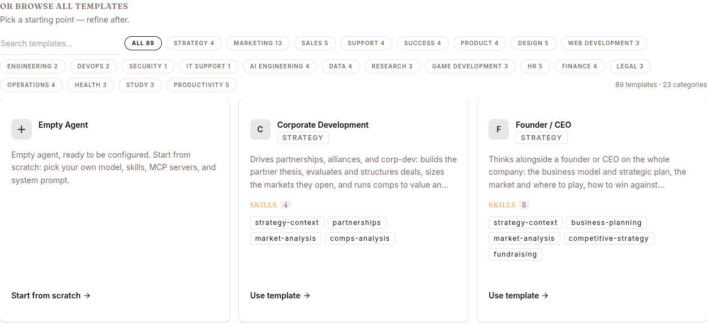
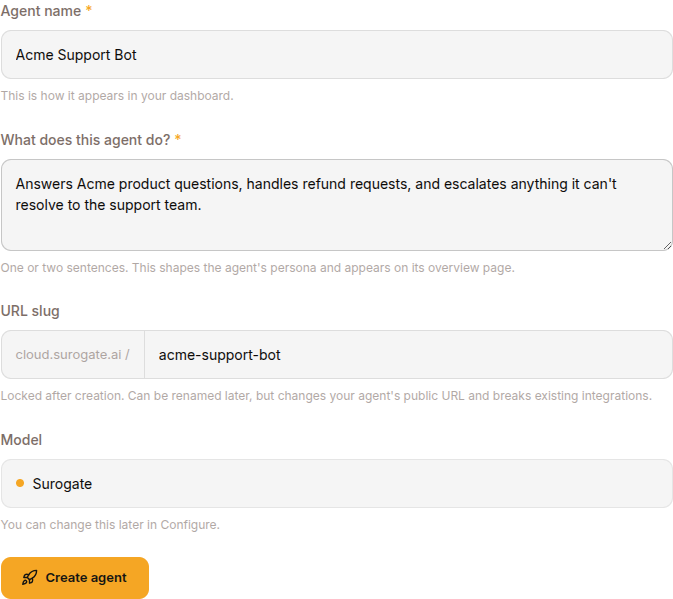

The **Templates** page is a Work-mode surface (`ops.surogate.ai/work/templates`). In Develop mode the equivalent is the **DEPLOY AGENT** button on the Agents page — same dialog, same fields. Develop mode has no separate templates page.

The catalog ships a few dozen ready-made agents across categories like strategy, marketing, sales, support and engineering, each arriving with its own skills already attached. Two ways in:

1. **Describe what you need** at the top of the page — the catalog narrows to what fits, or take one of the quick starts.
2. **Browse all templates**, filtered by category, and take **Use template** on the one you want.

To start with nothing attached, take **Start from scratch** on the **Empty Agent** card.

**Use template** creates the agent straight away — there is no confirmation step, so pick deliberately.

## The create-agent form

**Start from scratch** opens a form instead:

| Field | Notes |
|---|---|
| **Agent name** | Human-readable name (e.g. `Acme support bot`) |
| **What does this agent do?** | One or two sentences. Seeds the agent's persona and shows on its overview page. |
| **URL slug** | Auto-derived from the name. Used in URLs (`<slug>.cloud.surogate.ai`). Locked after creation. |
| **Model** | Defaults to `Surogate`. Switch later from Configure. |

Click **CREATE AGENT**. Status moves `deploying` → `running` in 10-90 seconds. Once running, switch to the agent's Configure page to attach skills, knowledge bases and MCP servers, and its Publish page for channels.

## When no template fits

Start from the **Empty Agent** card and let the **Configure** page walk you through the same attachments a template would have brought (Skills → Knowledge Bases → MCP Servers), with channels and end-users on **Publish**.

If you find yourself deploying the same shape repeatedly, clone an existing agent's config via the REST API rather than retyping the form.

## REST API

| Method | Endpoint | Purpose |
|---|---|---|
| `POST` | `/v1/agents` | Create an agent (same effect as the dialog) |
| `GET` | `/v1/agents/{id}` | Read a full config to clone from |
| `PATCH` | `/v1/agents/{id}` | Apply a config dict produced from a cloned source |

## What's next

[Build phase](/develop/loop/build/) for the post-create workflow. [Use cases](/develop/use-cases/) for end-to-end recipes.
