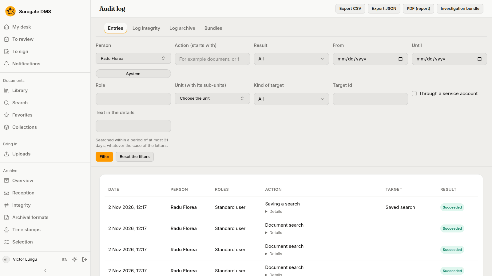
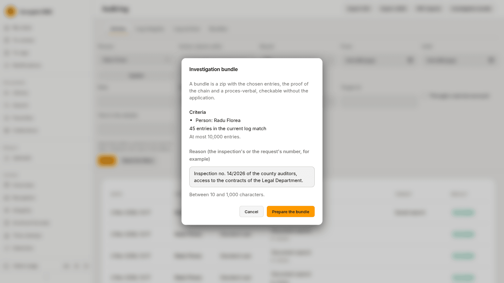

For auditors and administrators who consult the audit log: what it records, how to filter and export it, and how to prepare an investigation bundle.

## What it records

The log records actions on documents (opening, downloading, changing, moving, signing, deleting), searches, administration and the DMS's own work such as building a package. Each line has a date, the person and their roles, the action, the target and the result: **Succeeded**, **Refused** or **Failed**. Actions of the DMS itself show the system as the person. What you type into a search is kept for 12 months; the text of the search is not kept after the month is archived.

## Entries

**Administration** › **Audit log** opens on the **Entries** tab. Filter by **Person**, by the start of the **Action**, by **Result**, by **From** and **Until** dates, by **Role**, by **Unit (with its sub-units)**, by **Kind of target** and **Target id**, by actions **Through a service account**, or by **Text in the details**. A search of the text covers at most 31 days. **Filter** applies them and **Reset the filters** clears them.

Each line has **Details** with the values that changed. **Export CSV**, **Export JSON** and **PDF (report)** save what the filters show.

## Other tabs

- **Log integrity** shows whether the log's checks found a mismatch.
- **Log archive** lists the months of the log that were archived.
- **Bundles** lists the investigation bundles prepared.

## Investigation bundle

**Investigation bundle** prepares a zip with the entries that match your filters (at most 10,000), the proof that the log was not altered and a proces-verbal, which an inspector can check without the application. Write the **Reason**, such as the inspection's or the request's number, between 10 and 1,000 characters, and press **Prepare the bundle**.

## A document's own log

A document's last tab, **Audit log**, shows the entries about that document to people who may consult the log.
