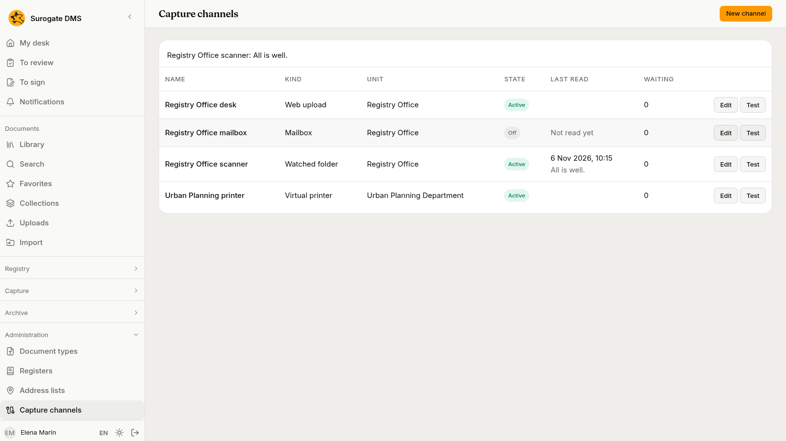
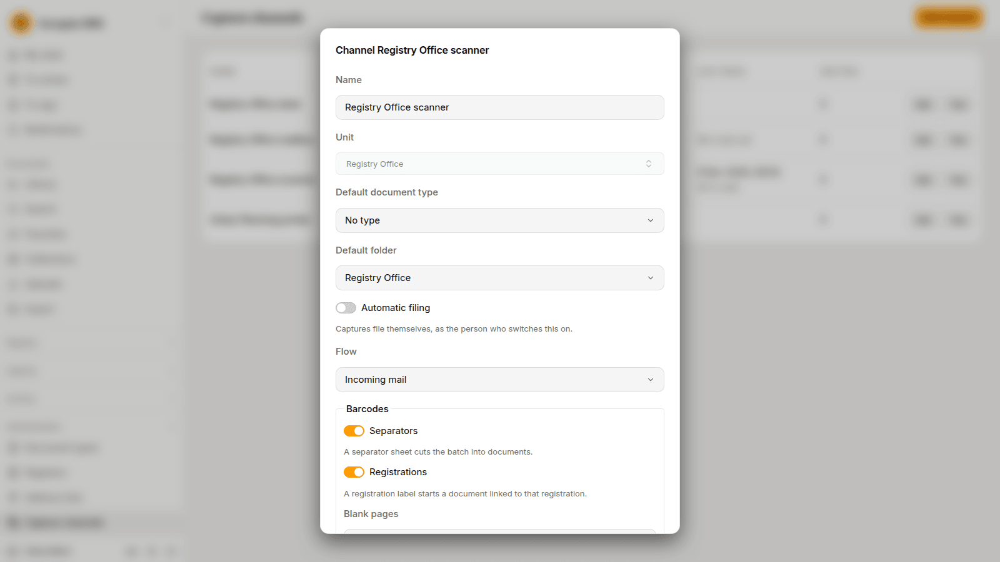
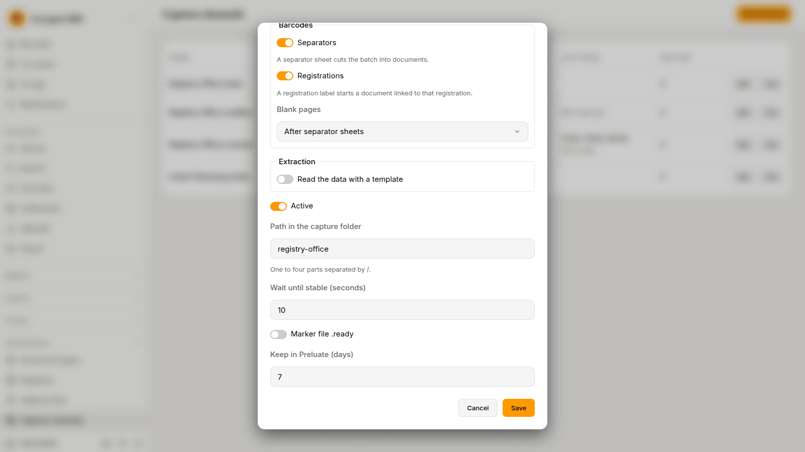
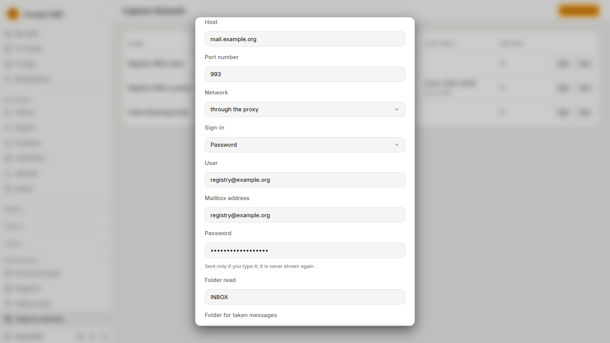

For administrators who set up where captures come from: a web upload channel, a scanner's watched folder, a mailbox and a virtual printer, and the settings each one has.

## The Capture channels page

**Administration** › **Capture channels** lists the channels of the units. You see it when you hold **Manage capture** for the whole institution; see [Roles and permissions](/dms/reference/roles/). A person's own channels, **My captures** and **My printer**, are not listed here. Holding **Manage capture** lets you see every channel's state. It does not let you see the captures.

The columns are **Name**, **Kind**, **Unit**, **State** (**Active** or **Off**), **Last read** and **Waiting**, the number of captures of the channel that wait to be processed. **Last read** says "Not read yet" until a folder or a mailbox has been read, and then the time and how the read ended. **New channel** makes a channel, **Edit** changes one and **Test** tries it.

**Test** says in a sentence what it found, for example "Registry Office scanner: All is well." A channel that is off is not tested. The sentences that report a problem, and what to do about each:

| Sentence | What to do |
|---|---|
| The folder does not exist in the capture folder. | Make the folder, or correct the **Path in the capture folder**. |
| The path of the folder is not allowed. | Use one to four parts separated by `/`, each starting with a letter or a digit. |
| The server has no access to the folder. | Ask your operator to give the DMS access to the shared folder. |
| The channel has too many captures waiting; reading resumes when the queue empties. | Have the captures of the channel processed. |
| Signing in to the mailbox failed; check the user and the password. | Correct the **User** and the password, or the secret of Microsoft 365. |
| The mail server does not answer. | Check the **Host**, the **Port number** and the **Network**. |
| The certificate of the mail server is not trusted. | Add the **CA certificate (PEM)** of the server. |
| The DMS network does not allow the mail server. | Ask your operator to allow the server. |
| The folder of the mailbox does not exist. | Correct the **Folder read**. |
| Messages cannot be moved to the folders for taken and rejected messages. | Correct the two folder names, or give the mailbox the right to make folders and move messages. |

## Settings every channel has

Choose **New channel**, then the **Kind of channel**. The kind cannot be changed afterwards, and neither can the unit.

| Setting | What it does |
|---|---|
| **Name** | A name no other channel of the units has, whatever the case and the accents. |
| **Unit** | The unit whose people process the captures of the channel. They need **Process captures** and **Access to documents with personal data** in that unit. |
| **Default document type** | The type offered for each part. It is optional. |
| **Default folder** | The library folder offered for each part. It is optional, and it must be a library folder. |
| **Automatic filing** | The channel files its captures by itself into the default folder. The hint says "Files as {person}.": the documents are filed as the person who switched it on, with that person's access at the moment of filing. If that person loses the right, the capture waits. |
| **Flow** | The [capture flow](/dms/admin/capture-flows/) the captures of the channel run, among the flows that are switched on, or **No flow**. |
| **Active** | Whether the channel takes new files. A channel that is off takes none. |

A channel with a flow runs the steps of the flow, with the settings of those steps. The **Barcodes** and **Extraction** sections of the channel apply to a channel with no flow. They are described [below](#barcodes-and-extraction).

## Web upload

A **Web upload** channel is the destination offered on the page **New capture**. People choose it in **Destination** and send files to the unit. Its only own setting is **One document by default**: whether the files of a capture make one document unless the person chooses otherwise. See [Capturing documents](/dms/work/capture/#send-a-capture).

## Watched folder

A scanner writes finished files into a shared folder. The DMS takes each file once and makes a capture of it. Your operator connects the shared folder to the DMS and gives the scanner the right to write there. Ask your operator which folder is yours.

| Setting | What it does |
|---|---|
| **Path in the capture folder** | The folder to watch, as one to four parts separated by `/`. Two channels cannot watch the same folder, or one inside the other. |
| **Wait until stable (seconds)** | A file is taken when its size and time have not changed for this long. Raise it above the longest pause your scanner makes while it writes. |
| **Marker file .ready** | When it is on, a file `scan.pdf` is taken only when a file `scan.pdf.ready` lies beside it. Use it when your scanner can write such a marker. |
| **Keep in Preluate (days)** | The DMS moves each file it took into a folder it makes inside the watched folder, called Preluate, and keeps it there for this many days. |

Files that a scanner or an office program is still writing are left alone, and so are folders inside the watched folder. A file that is too large is moved to a folder called Respinse, with a note beside it that says why. The DMS makes both folders itself. Do not write in them.

A folder that cannot be read is tried again after a while. **Last read** shows how the last try ended.

## Mailbox

When your institution has it, a channel can read a mailbox. The DMS signs in to the mailbox over IMAP, takes the new messages and makes a capture of each one. Ask your administrator of the mail server for the values below.

| Setting | What it does |
|---|---|
| **Host**, **Port number** | The mail server. The port is 993 unless you change it. |
| **Network** | **through the proxy** or **direct**. Your operator tells you which one reaches your server. |
| **Sign-in** | **Password**, with the **User**, the **Mailbox address** and the password; or **Microsoft 365**, with the **Tenant ID**, the **Client ID** and the **Client secret**. |
| **Folder read** | The mail folder to read, `INBOX` unless you change it. |
| **Folder for taken messages**, **Folder for rejected messages** | Where a message goes after the DMS made a capture of it, and where it goes when it could not. The DMS makes them if they are missing. |
| **Every (minutes)** | How often the mailbox is read. |
| **What becomes a document** | **The attachments** (each attachment is a part), **The message**, or **The message and its attachments**. |
| **CA certificate (PEM), if the server has no public one** | Needed only when the server's certificate comes from an authority the DMS does not know. |

The password and the client secret are never shown again once saved. The field stays empty, and **Set** beside it says one is held. What you type there replaces it. Nothing typed leaves it as it is.

One message is one capture. A message the DMS cannot open, such as an encrypted one, makes a capture that waits and says why. For Microsoft 365, the mailbox must be set up for the application in Microsoft's own administration pages. Check Microsoft's current instructions with the person who runs your Microsoft 365.

## Virtual printer

A **Virtual printer** channel gives a unit a printer that any program can print to. What is printed becomes a capture of the unit. The only own setting is the **Location**, which the people who add the printer to their computers see.

When you make the channel, and each time you choose **Renew the address** in its **Edit** dialog, the dialog shows the address of the printer once, in two forms: the first for macOS and Linux, the second, which starts with `https`, for Windows. Copy them at once and give them to the people who add the printer. The address is the only credential of the printer: anyone who has it can print to it. If it is lost or leaks, choose **Renew the address**. The old one stops working at once, and the printer must be added again.

People add the printer as [My printer](/dms/work/capture/#my-captures-and-my-printer) does: the steps for Windows, macOS and Linux are the same. A unit's printer files into the inbox of the unit, **To process**. A person's own printer is theirs and its captures are in **My captures**.

## Barcodes and extraction

The channel form ends with two sections that apply to a channel with no flow. A flow has the same settings in its own steps.

**Barcodes** has three settings. They are described fully in [Separator sheets and registration labels](/dms/admin/separator-sheets/).

- **Separators**: a separator sheet cuts the batch into documents.
- **Registrations**: a registration label starts a document linked to that registration.
- **Blank pages**: which blank pages are left out: **After separator sheets**, **All** or **None**.

**Extraction** reads the data of a form with a [capture template](/dms/admin/capture-templates/).

- **Read the data with a template** switches it on.
- **Template**: **Automatic**, or one template that is active and published.
- **Required**: a capture that no template fits stops and waits for a person.
- **Validation by a person**: **Never**, **When it does not conform** or **Always**. A part with a handwritten field is always checked by a person.

## Before real use

Do this once for each channel on the real equipment, before the first real batch.

1. Choose **Test** on each channel and read the sentence.
2. For a scanner, scan a long batch and check that no capture holds only half of it. If one does, switch on **Marker file .ready** or raise **Wait until stable (seconds)**.
3. For a mailbox, send it a message with two attachments and check that two parts appear.
4. For a printer, add it on a Windows, a macOS and a Linux computer, print a long document and check the pages and their order.
5. Print the separator sheets, scan a test batch with one sheet upside down, and check that every document starts on the right page. See [Separator sheets and registration labels](/dms/admin/separator-sheets/).
6. Try each template on a filled test form, and each flow on test captures, before you switch them on. See [Capture templates](/dms/admin/capture-templates/) and [Capture flows](/dms/admin/capture-flows/).
