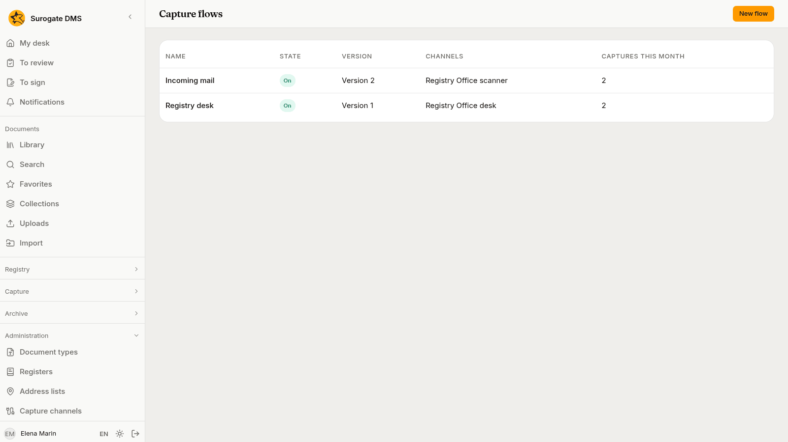
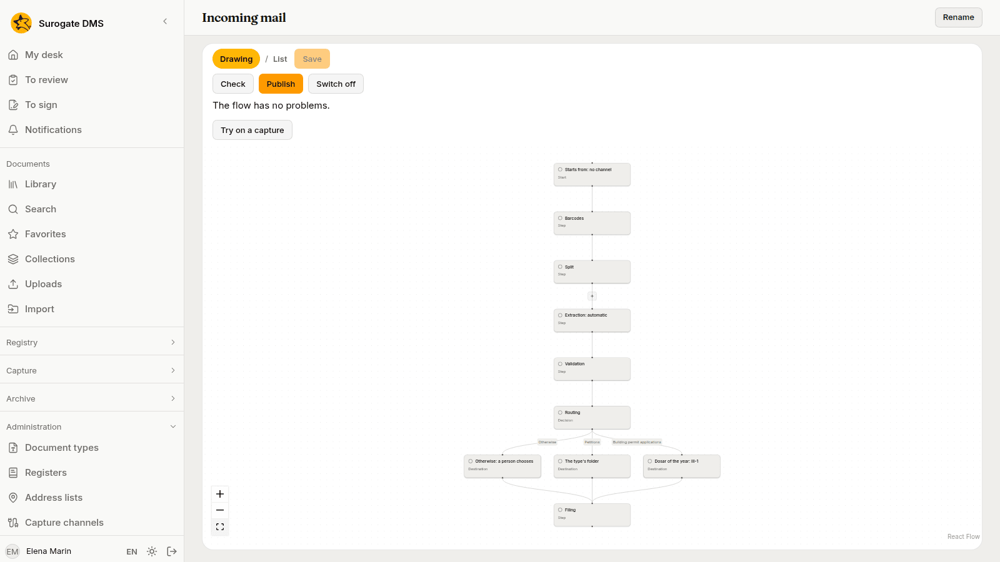
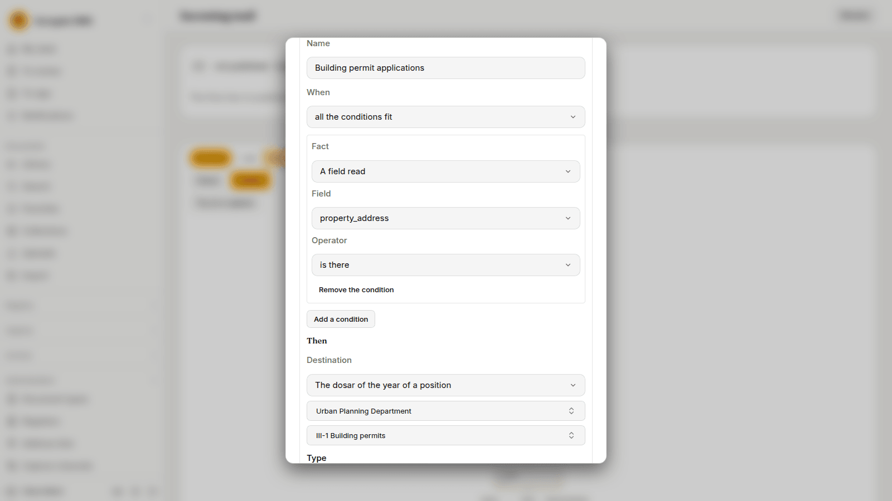
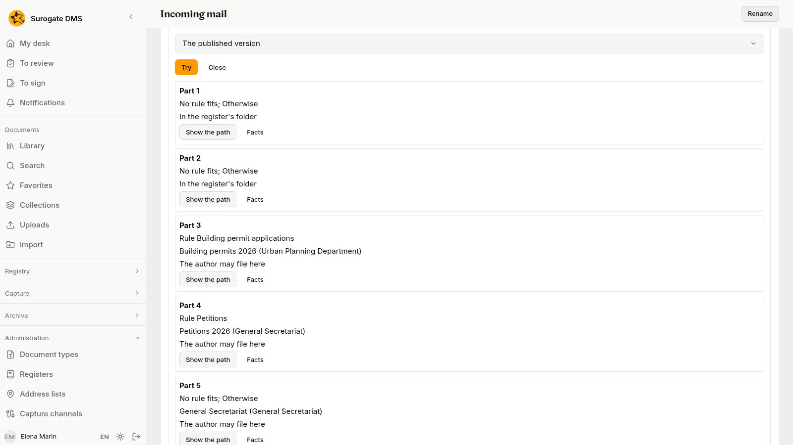
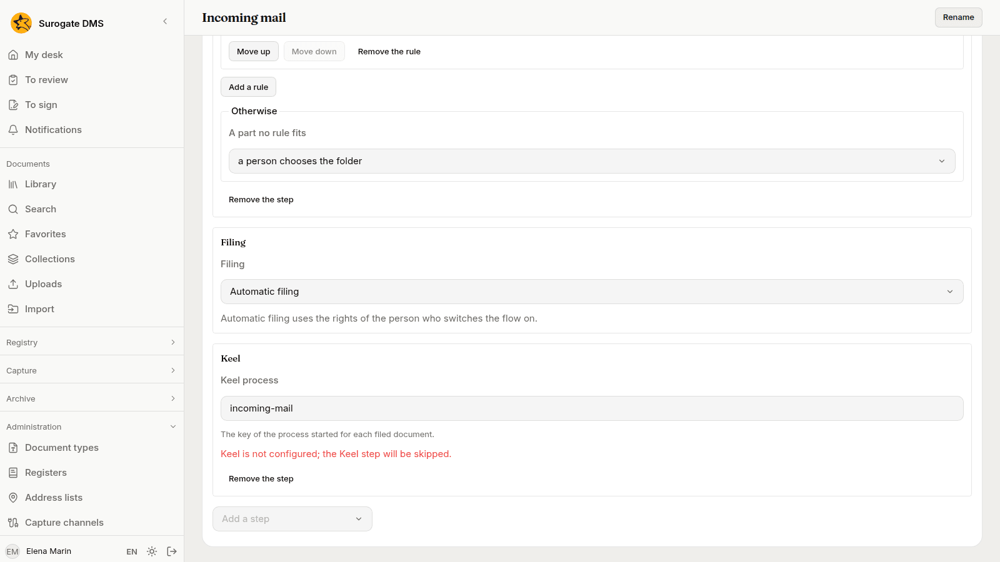

For administrators who decide what happens to a capture: the steps a channel's captures run, the rules that send each part to a folder, how to check and publish a flow, and how to try it before it files anything.

## What a flow is

A **capture flow** is the line of steps that the captures of a channel run. It has one fork: the **routing rules**, which send each part to a folder, give it a type and a title, and fill in some of its data. A flow cuts a batch, reads it, routes the parts and files them. It is not a workflow. What happens to a document after it is filed, such as approvals and deadlines, runs on Keel; see [Workflows](/dms/work/workflows/).

You make flows in **Administration** › **Capture flows**. You need **Manage capture** for the whole institution.

A channel names one flow in its **Flow** setting; see [Capture channels](/dms/admin/capture-channels/#settings-every-channel-has). A channel with no flow runs its own settings. A capture keeps the version of the flow it started with: a new version changes the captures that arrive afterwards, not the ones already waiting.

## The Capture flows page

The page lists the flows with their **Name**, **State** (**On** or **Off**), **Version**, **Channels** and **Captures this month**. A flow that has not been published says "not published".

- **New flow** opens **New capture flow**. Write the **Name** and a **Description** and choose **Create**. The new flow has the two steps every flow has, **Split** and **Filing**, with **A person files**.

Choose a flow to open it. On its page, **Rename** changes the name and the description, and a table lists each published version with its **Note**, **Published by** and **Published on**. The flow can be shown in two ways, chosen with **How the flow is shown**: as a **Drawing**, with a box for each step and a fork at the rules, or as a **List**. They show the same flow.

## Steps

A flow has these steps, each at most once and always in this order. **Split** and **Filing** are in every flow. Choose **Add a step** to add another, and **Remove the step** in its panel to take one out.

| Step | What it does | Its settings |
|---|---|---|
| **Barcodes** | Reads separator sheets and registration labels. | **Separators**, **Registrations**, **Blank pages**; see [Separator sheets and registration labels](/dms/admin/separator-sheets/). |
| **Split** | Cuts the files into parts. | **Documents**: **As the capture says**, **One document** or **One document per file**. |
| **OCR** | Reads the text of the pages. | None. |
| **Extraction** | Reads the data of each part with a [capture template](/dms/admin/capture-templates/). | **Template** (**Automatic** or one template) and **Required**. |
| **Validation** | Asks a person to check what was read. | **Validation by a person**: **Never**, **When it does not conform** or **Always**. |
| **Routing** | Chooses the folder, type, title and data of each part by rules. | The rules and **Otherwise**, see below. |
| **Filing** | Files the parts. | **Filing**: **Automatic filing** or **A person files**. |
| **Keel** | Starts a Keel process for each filed document. | The **Keel process**. |

**Extraction** reads the text of the pages by itself, so a flow that has it needs no **OCR** step. In a flow without **Extraction**, add **OCR** when the text of the pages should be read before filing.

With **A person files**, nothing is filed by rule: the capture waits in **To process** and a person files it. With **Automatic filing**, the rules file the documents as the person who switches the flow on, with that person's access worked out again at each filing. The screen says "Automatic filing uses the rights of the person who switches the flow on." If that person loses the right to file in a unit, the captures that would go there wait.

## Rules

Choose **Routing** and then **Add a rule**. The rules are tried in order for each part, and the first that fits takes the part. **Move up** and **Move down** change the order, and **Remove the rule** deletes one.

A rule has these parts.

- **Name**, shown on the part that the rule takes: Rule “{name}”.
- **When**: **all the conditions fit** or **any condition fits**.
- Conditions. Choose **Add a condition**, then a **Fact**, then an **Operator**, then the value. For **A field read**, also choose the **Field**. **Remove the condition** takes one out.
- **Then**: what to do with the part, see [Where a part goes](#where-a-part-goes).

A condition looks at one fact about the part.

| Fact | Of | Operators |
|---|---|---|
| **The channel** | The channel the capture came by. | is, is one of |
| **The separator sheet** | The sheet that started the part. | is, is one of, is missing, is there |
| **The registration** | Whether the part is linked to a registration. | is missing, is there |
| **A barcode** | The text of a code on the part that is neither a registration's nor a sheet's. | is, starts with, matches (a regular expression) |
| **The template** | The template the part was read with. | is, is one of, is missing, is there |
| **The type** | The document type of the part so far. | is, is one of, is missing, is there |
| **A field read** | The value of a field of the template, with a person's correction. | is, contains, starts with, is one of, is greater than, is less than, is missing, is there |
| **The conformity** | Whether the data conform to the template: **conforming**, **not conforming** or **confirmed by a person**. | is |
| **The sender's domain** | What follows the @ in the sender of a message. | is, is one of |
| **The message's subject** | The subject of a message. | contains |
| **The file name** | The name of the part's file. | matches (a pattern with * and ?) |

Texts are compared without regard to case, accents or the amount of white space. **is greater than** and **is less than** compare numbers and dates, and are false for anything else. A fact the capture does not have makes the condition false, **is missing** included: a sender and a subject belong to messages only, and a step that did not run on a capture, such as the codes of a message that holds no pictures, leaves its facts unknown. A step that ran and found nothing leaves the fact empty, and **is missing** then holds.

## Where a part goes

**Then** and **Otherwise** can set the destination, the type, the title and the data of a part.

- **Destination** is **A library folder**, **The dosar of the year of a position** (choose the **Unit** and the **Position**), **The type's folder**, or **No new folder**. With the dosar of the year, the rule finds the open dosar of the position for the current year among the folders of the unit. If the unit has no such dosar open, the capture waits and says so.
- **Type** is the document type the part gets.
- **Title** is a text for the part. The screen says "{field:cheie}, {date}, {channel} can be used." Write the key of a field of the template in place of `cheie`: `{field:property_address}` stands for the value of that field. `{date}` stands for the day the capture was received, and `{channel}` for the name of the channel. The title has between 1 and 300 characters.
- **Data** are values of fields of the type. Choose **Add a datum**, write the key of the type's field in **The type's field** in place of the `cheie1` the screen suggests, and choose whether the value comes **written here** or **from the field** of the template. **Remove** takes one out.

**Otherwise** says what happens to a part no rule takes, under **A part no rule fits**: **a person chooses the folder** (the capture waits and says "No rule of the flow fits part {n}; choose the folder."), or **goes to a destination**.

Two things win over the folder of a rule, as they do for any filing. A part linked to a registration is filed in the folder of its register. A type that has its own default folder is filed there. The check warns about the second. What a person set on a part is never changed by a rule.

## Check

Choose **Check**. It saves your edits and reads the flow step by step and rule by rule. It says "The flow has no problems." or lists the problems. A mark on the step or the rule in the drawing, and a line beside it in the list, show where each one is.

Errors stop you from publishing and switching on. Warnings do not.

| Problem | What it says | Kind |
|---|---|---|
| **Unknown step** | The step {name} is not installed on this server. | Error |
| **Steps out of order** | The steps run in their order, each at most once; Split and Filing are required. | Error |
| **Wrong settings** | The step {name} is not filled in correctly, and what is wrong. | Error |
| **Template off** | The template chosen is not in use. | Error |
| **Unknown field** | The field {key} is in no template of the Extraction step. | Error |
| **Wrong destination** | The destination is not a library folder or no longer exists. | Error |
| **You may not file there** | You may not file in the unit {unit}; automatic filing would use your own rights. | Error |
| **Wrong Keel key** | The Keel process name has 1 to 200 printable characters, no spaces. | Error |
| **Rule never applies** | The rule {rule} never applies: a rule before it always fits. | Warning |
| **The type's folder wins** | The type {type} has its own default folder; the document goes there, not to the rule's destination. | Warning |
| **Dosar closed** | The destination's dosar is closed. | Warning |
| **Keel off** | Keel is not configured; the Keel step will be skipped. | Warning |
| **Two processes** | The destination folder already starts the process {process} for every document; two processes would start. | Warning |

## Publish and switch on

Your edits are a **draft**. **Save** keeps them. **Discard the draft** deletes the saved draft, and the flow keeps its last published version.

1. Choose **Publish**. In **Publish the flow**, write a **Note** if you want one and choose **Publish**. If the flow is on and files automatically, and you are not the person it files as now, the dialog says "Automatic filing will use your rights." Whoever publishes a flow that is on, with automatic filing, becomes the person it files as.
2. Choose **Switch on**. Channels can now be given the flow, and **Apply a flow** offers it. If the flow files automatically, the dialog says "Automatic filing will use your rights." Publishing and switching on both run the check for you and refuse when it finds an error.
3. In **Capture channels**, open each channel that should run the flow, choose the flow in **Flow**, and **Save**.

**Switch off** stops channels from being given the flow and stops **Apply a flow** from offering it. It says "Channels can no longer be given this flow and Apply a flow no longer offers it; captures started with it go on." A channel whose flow is switched off runs its own settings again for new captures, its own **Automatic filing** included, until the flow is switched on.

## Try on a capture

**Try on a capture** runs the flow on a capture of the inbox, whether it waits or is filed, without changing anything. Choose the **Capture**, choose **Trying** **The draft** or **The published version**, and choose **Try**.

For each part it says which rule takes it ("Rule {name}", or "No rule fits; Otherwise"), the folder and unit it would go to, and whether "The author may file here". If the part would wait, it says "Waits at {step}: {reason}". If a step did not run on that capture, it says "The steps {steps} did not run on this capture." **Show the path** marks on the drawing the steps the part passes. **Facts** lists the facts the rules saw. They are personal data, so the try is for people who manage flows and may also work the capture.

## The Keel step

When your institution has Keel, the **Keel** step starts one Keel process for each document the flow files. The **Keel process** is the key of the process. Only the identifiers of the document, its folder, the capture and the flow are sent to Keel. No title, field value or file name is sent. Keel reads the document through its own account.

Without Keel, **Check** warns "Keel is not configured; the Keel step will be skipped." The documents are filed, and no process starts. If a start rule of the destination folder already starts the same process, **Check** warns about **Two processes**. See [The Keel integration](/dms/admin/keel-integration/).

## Before real use

1. Draw the flow and choose **Check** until it has no error.
2. Choose **Try on a capture** with three real captures of each channel that will run the flow, and compare what it says with what a person would file.
3. Check that the person who will switch the flow on may file in every unit the rules send parts to.
4. **Publish** the flow, **Switch on** the flow, and give it to the channel.
