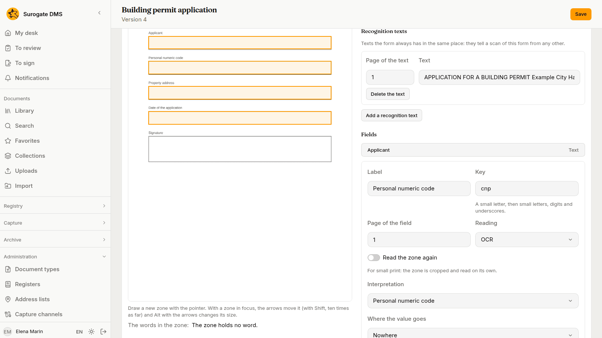
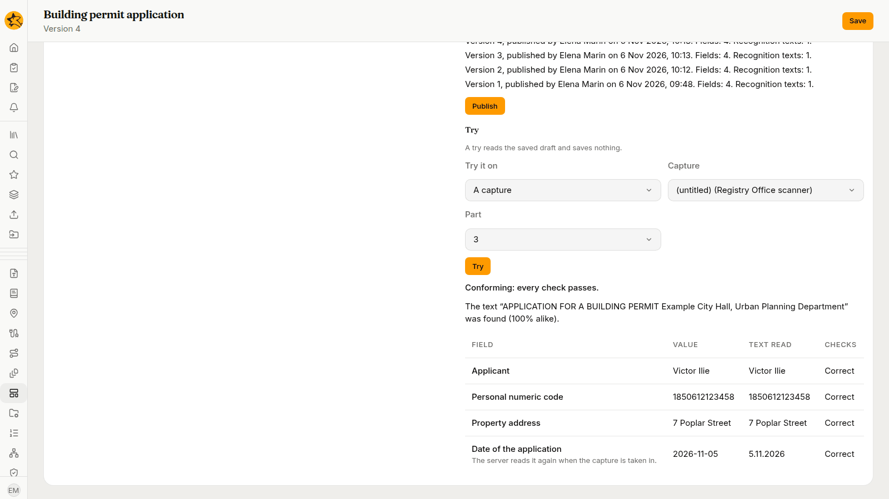

For administrators who teach the DMS to read a form: how to draw the zones of a blank form, say how each value is read and checked, try the template on a capture, and publish it.

## What a template does

A **capture template** describes one kind of form: where each value lies on the page, how the text there is read, what is made of it, which field of the document it fills, and which checks it must pass. A capture that is read with a template gets its title and its metadata from the form. A person looks at what does not conform before the document is filed; see [Checking the data read from forms](/dms/work/capture-validate/).

You make templates in **Administration** › **Capture templates**. You need **Manage capture** for the whole institution. The list shows each template's **Name**, **Document type**, **Version** and **Active** state. A template that has not been published says "Not published".

## Make a template

1. Choose **New template**.
2. Write the **Name**, a **Description** and choose the **Document type** whose fields the values of the form will fill. The name must differ from every other template's, whatever the case and the accents. The description and the type are optional.
3. Choose **Create**. The page of the template opens.

On the page, **Save** keeps your changes as the **draft**. **Active (offered when a template is chosen)** switches the template on and off: a template that is off is not offered, and no capture is read with it. If someone else saved first, **Save** is refused and the page offers **Read the template again**, which drops what you typed.

The type of a template that has been published cannot be changed.

## The sample and the zones

A template page shows the **Sample** on the left and the settings on the right. Choose **Upload the sample** and send a **blank** form, as a PDF or a picture. The page says "Upload a blank form, a PDF or a picture, at most 20 MB and 10 pages. A filled form would keep personal data in the template." Never send a filled form: the template, and with it the sample, is kept.

After you send the sample, the page says "The sample is still being read." until its words are ready.

To place a zone, choose a field or a recognition text in the list on the right, then draw a rectangle on the page with the pointer. The page says "Choose a field or a recognition text, then draw its zone on the page." With a zone in focus, the arrow keys move it, Shift makes the move ten times as large, and Alt with the arrows changes its size. Under the page, **The words in the zone:** lists the words the DMS read there. The page says "The zone holds no word." when the zone is empty, as on a blank sample.

## The form, recognition texts and the code

- **Pages of the form** is how many pages the blank form has. A part with fewer pages is not chosen automatically for this template.
- **When a part does not conform** is **Waits for a person** or **Is filed with a mark**. It decides only where the channel or the flow does not already ask a person; see [How a template is chosen](#how-a-template-is-chosen).
- **Recognition texts** are texts the form always has in the same place. They tell a scan of this form from any other. Choose **Add a recognition text**, write the **Text**, choose its **Page of the text**, and draw its zone. **Use the text found** fills the text with the words the DMS read in the zone. A scan matches when each recognition text is found in its zone, allowing for the small mistakes a reading makes.
- **The code on the first page starts with** is for a form that carries a bar code. Leave it empty if the form has no code that sets it apart.

## Fields

Choose **Add a field** for each value to read. **Delete the field** removes one.

| Setting | What it does |
|---|---|
| **Label** | The name a person sees on the part. |
| **Key** | A short name for the field: a small letter, then small letters, digits and underscores. Each field has its own. Flows use the key to refer to the field. |
| **Page of the field** | The page of the form where the field lies. |
| **Reading** | **OCR**, for printed text and for text typed in, or **Handwriting**, see [below](#handwriting). |
| **Read the zone again** | For small print: the zone is cut out and read on its own. It takes longer. |
| **Interpretation** | What is made of the text, see the table below. |
| **Where the value goes** | **Nowhere**, **The document's title**, or a field of the document type. |

**Interpretation** has seven choices.

| Choice | Reads | Settings |
|---|---|---|
| **Text** | The text, with its spaces collapsed. | **Letters**: **Unchanged**, **Capitals** or **Small**; **Longest length**. |
| **Date** | A date written with dots, slashes or hyphens, such as 5.11.2026 or 2026-11-05, or a day, the name of a month and a year. | None. The value is kept as year, month and day. |
| **Number** | Digits with a decimal sign and thousands separators. | **Decimals**. |
| **Amount** | A number and a currency word or sign. | **Decimals** and the **Currency** to take when the text names none. |
| **Personal numeric code** | The 13 digits of a CNP. | None. |
| **Tax code** | The digits of a CUI, with or without the letters RO before them. | None. |
| **Value from a list** | The text, matched to the closest value of a list. | **List**: **The field's choices**, **The organisation's units** or **A list of my own**, with **The values, one per line**. |

When the text cannot be read as asked, the part says so in words: "The text read is not a date.", "The text read is not a number." or "The text read does not match."

**Where the value goes** offers only fields of the document type that fit the interpretation: a date goes into a date field or a text field, a number into a number field or a text field, and so on. **The document's title** takes text only, at most 300 characters. A template whose field does not fit its target cannot be published.

## Checks

A field can have checks. Choose **Add a check** and one of these.

| Check | Passes when | Message on the part when it fails |
|---|---|---|
| **Required** | The field has a value. | The field is required. |
| **Matches a pattern** | The whole text fits the **Pattern**. | The value does not have the required form. |
| **Length** | The length of the text is between **Least** and **Most**. | The value does not have the required length. |
| **Range** | A number, an amount or a date lies between **Least** and **Most**, both included. Dates are written yyyy-mm-dd. | The value is not in the required range. |
| **Control digit** | The control digit of a CNP or a CUI is right. | The control digit of the CNP does not match. |
| **Equal to another field** | The value equals that of the **Field** you choose. | The value is not the same as that of another field. |
| **One of the values** | The value is one of **The values, one per line**. | The value is not one of those allowed. |

A check on an empty optional field is skipped. A part **conforms** when every check of every field passed, and does **not conform** when one failed. A part read with no template is not judged. A pattern is matched against the whole text. Some forms of pattern, such as a reference to an earlier group, are not accepted, and the page says so when you save.

## Try

Choose **Try**. The page says "A try reads the saved draft and saves nothing." Under **Try it on**, choose **The sample**, or **A capture** and then the **Capture** and the **Part**, and choose **Try**.

**Result of the try** says whether the part conforms: "Conforming: every check passes." or "Not conforming: at least one check fails." It says how each recognition text matched, for example "The text “APPLICATION FOR A BUILDING PERMIT Example City Hall, Urban Planning Department” was found (100% alike).", and it lists for each field the **Value**, the **Text read** and the **Checks**. A field read as handwriting, or read again from the zone, shows "The server reads it again when the capture is taken in." because the page of a try cannot run those readings. Try the template on a filled test form of the institution, and on the blank sample, before you publish.

## Publish and versions

Choose **Publish** to make the saved draft the next version of the template. It must be saved first: the page says "Save the changes before publishing: the saved draft is what is published." If the draft has a problem, **Problems with the draft** lists each one with its place: a form with no field, a field on a page the form lacks, a target the type does not have, a value that does not fit its target, or a check that does not suit the interpretation.

**Versions** lists each one: "Version {n}, published by {name} on {date}. Fields: {fields}. Recognition texts: {anchors}." A version never changes and is never deleted. A capture keeps the template and the version it was read with, and a part read again with the same template keeps the values a person typed.

## How a template is chosen

For each part, the DMS takes the first of these that gives a template:

1. The template the channel names in **Extraction** › **Template**, or the template the flow's **Extraction** step names. If you leave **Automatic**, this step gives none.
2. The template the part's separator sheet profile names, or the one a person chose on the part.
3. A template whose **The code on the first page starts with** fits a code on the first page of the part.
4. A template that is active and has recognition texts, all of which are found on the pages of the part.

If two templates fit, the capture waits and says which two. Staff choose one on the part with **Choose the template** and then **Try again**. If none fits, the capture waits when **Required** is on, and otherwise the part is read with no template. If the channel names a template that is off or has no version, the part waits whatever a person chose, until the channel names another one or the template is switched on again.

Whether a person is asked about a part that does not conform depends on two settings together. The **Validation by a person** of the channel or the flow decides first: **Always** asks about every part, **When it does not conform** asks about the parts that fail, and only with **Never** does the template's **When a part does not conform** decide. A part with a handwritten field is always asked about.

## Handwriting

When your institution has it, a field with **Handwriting** as its **Reading** is read by a model that your institution connects. Only a picture of the field's zone is sent to the model. The rest of the page, the file name and the other fields are not sent. A person always checks the value, and it shows "read by machine" until a person types it. Your institution sets a daily limit for these readings. When the reading is not set up, or fails, or the limit is reached, the capture waits and the person fills the field in; see [Processing captures](/dms/work/capture-inbox/#when-a-capture-waits). Try it on a filled test form of your institution before you rely on it. How well a model reads handwriting varies, which is why a person always checks.
