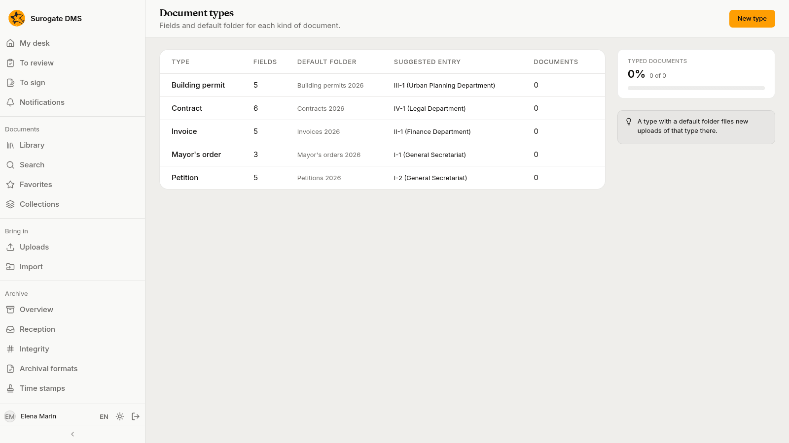
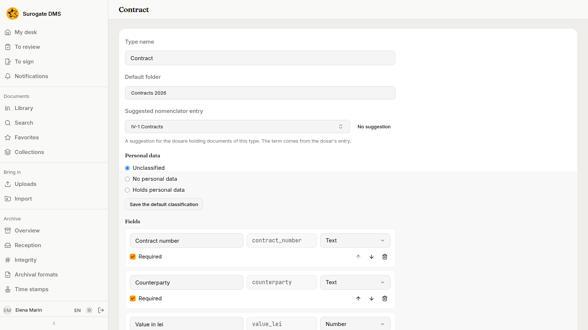
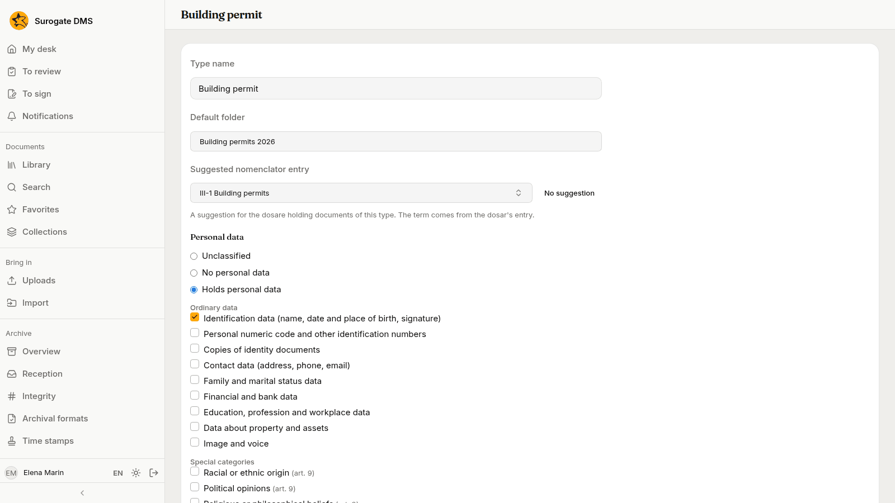

For administrators who hold the permission to manage document types: what a type is, how to make one and what it can and cannot change once documents use it.

## What a type is

A **document type** lists the fields a document of that type has, the folder its documents are filed in by default, the nomenclator entry its dosare probably have and its personal-data defaults. **Administration** › **Document types** lists the types with their **Fields**, **Default folder**, **Suggested entry** and how many **Documents** use them.

## Make or change a type

Press **New type**, or open a type to change it.

| Part | What to enter |
|---|---|
| **Type name** | The name people see. Two types cannot have the same name. |
| **Default folder** | Optional. A document filed with this type goes to this folder. |
| **Suggested nomenclator entry** | Optional. The entry of the edition in force that the dosare holding documents of this type probably have. |
| **Personal data** | The default classification: **Unclassified**, **No personal data** or **Holds personal data**, with categories and a purpose. |
| **Fields** | **Add a field** adds a row. |

### Fields

Each field has a **Field label**, a **Field key** (the name its values are stored under, proposed from the label), a **Kind of value** and **Required**. The kinds are **Text**, **Long text**, **Number**, **Date**, **List of options** (write the options one per line), **Person**, **Unit** and **Yes or no**. The arrows move a field up or down and the bin removes it.

## Default folder

A document filed with a type that has a default folder goes to that folder, and changing a document's type to one with a default folder moves the document there.

## Changing a type that has documents

Renaming a type, changing labels, turning **Required** on or off, adding fields, reordering them and adding options are always allowed. The DMS refuses to remove a field that documents have a value for, to change the kind of such a field, or to remove an option a document holds. To retire a field, leave it. Documents already filed are not looked at again when you change a type: if you make a field required, they stay readable and keep their state, and the value is asked for the next time someone saves their metadata or validates them.

A type cannot be deleted.
