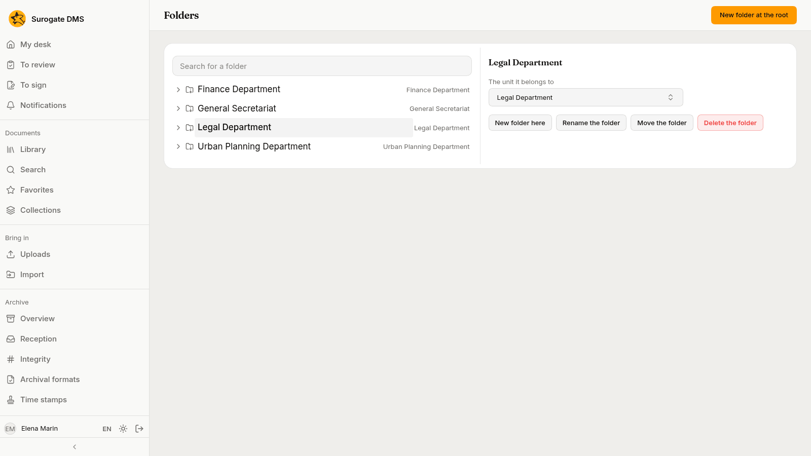
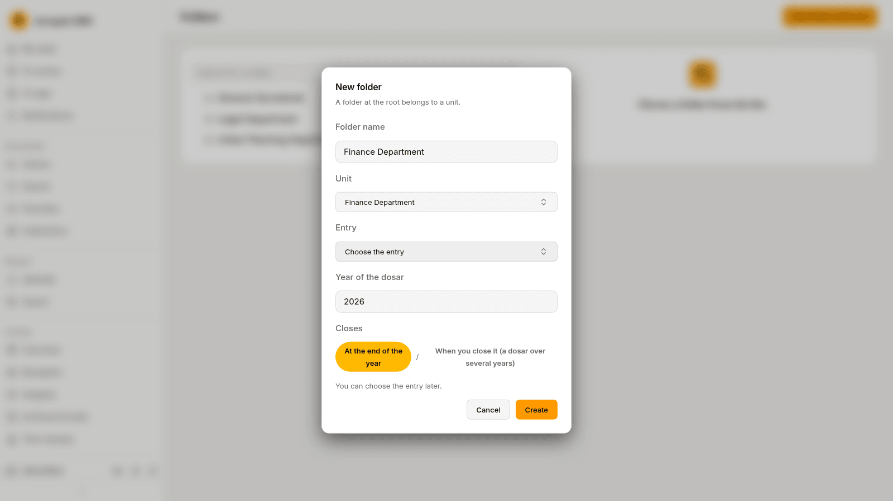
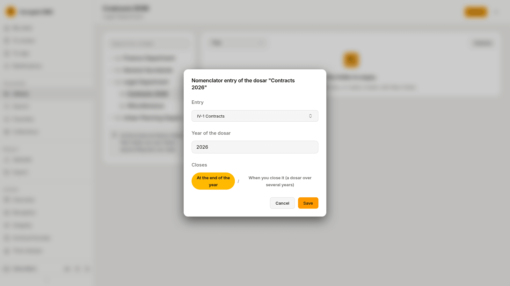
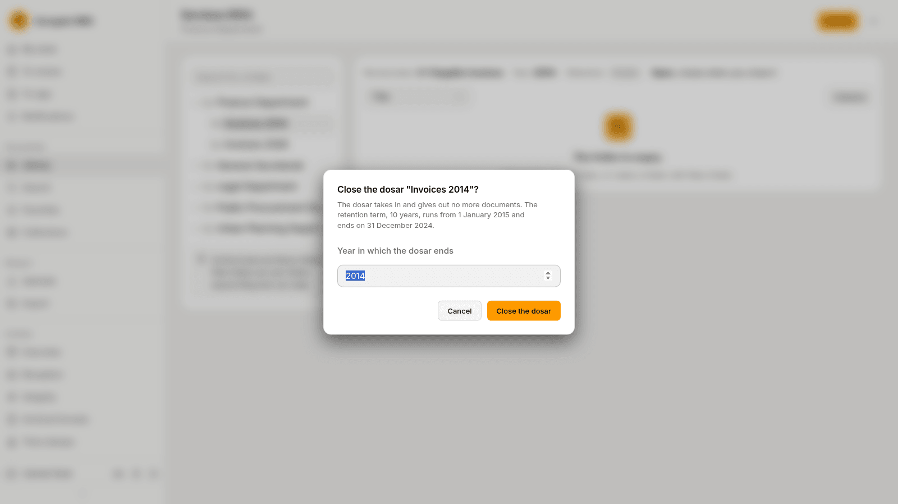

For administrators who manage folders: making the root folders of the library and the dosare inside them, setting a dosar's entry, and closing and reopening dosare. Library folders belong to units; their dosare carry the retention terms.

## The Folders page

**Administration** › **Folders** shows the tree of library folders on the left. Choose a folder and the panel **The chosen folder** shows the unit it belongs to and the buttons **New folder here**, **Rename the folder**, **Move the folder** and **Delete the folder**.

**New folder at the root** makes a folder at the top level. A folder at the root belongs to a unit: choose it under **Unit**. Inside a library folder you make dosare: give the **Folder name**, choose the **Entry** of the nomenclator, the **Year of the dosar** and when it **Closes**. You can leave the entry for later.

## A dosar's entry

On a folder's page in the library, **Folder actions** › **Choose the nomenclator entry** (or **Change the nomenclator entry**) sets the dosar's entry. **Entry** lists the entries of the edition in force, **Year of the dosar** is its year, and **Closes** is **At the end of the year** (a yearly dosar) or **When you close it (a dosar over several years)**.

A dosar's entry gives its documents their retention term. Documents in a folder without an entry have no term yet; the Archive overview lists such dosare.

## Close and reopen a dosar

A yearly dosar closes by itself at the end of its year. A dosar over several years is closed by hand: **Folder actions** › **Close the dosar**, and type the **Year in which the dosar ends**. A closed dosar takes in and gives out no documents, and its retention term runs from the year after its end year.

**Reopen the dosar** asks **Why you reopen it** and opens the dosar again; until you close it again its term has no end year.

## Open next year's dosare

On the **Nomenclator** page, **The dosare of {year}** makes the yearly dosare of the next year from those of this year, with their entry from the edition in force, and **Open the dosare of {year}** does it. Document types with a default folder move to the new dosar on 1 January.
