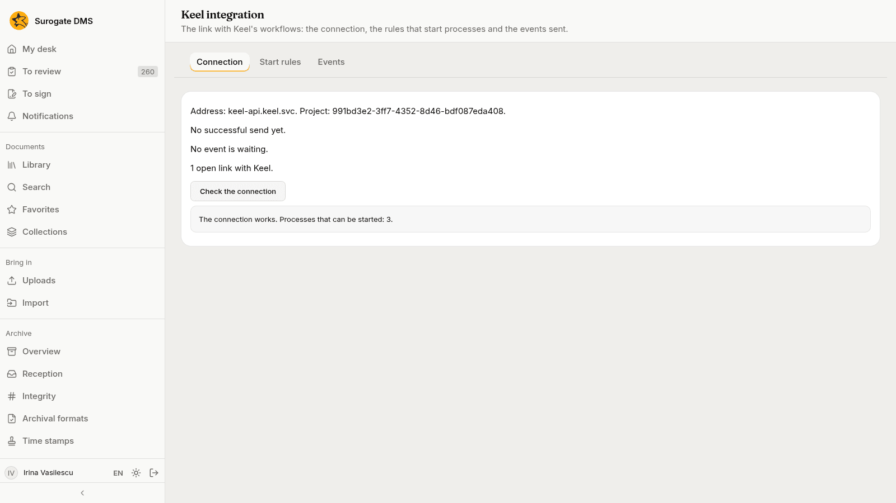
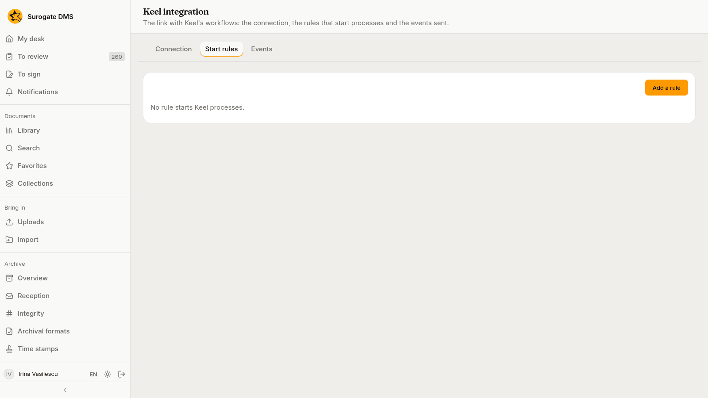
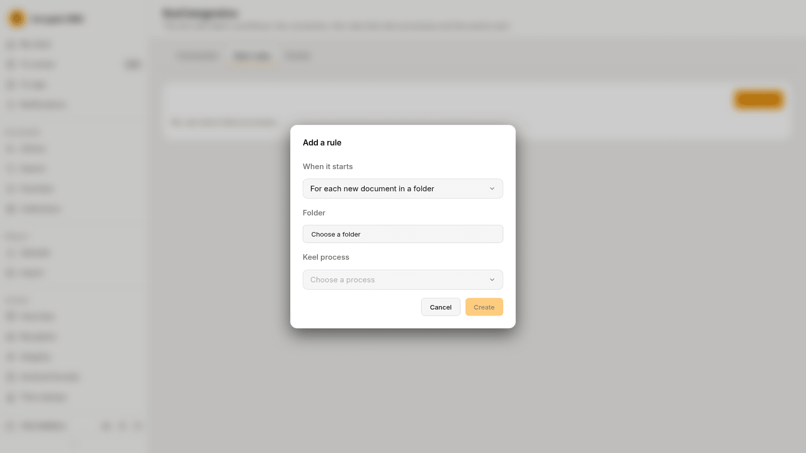
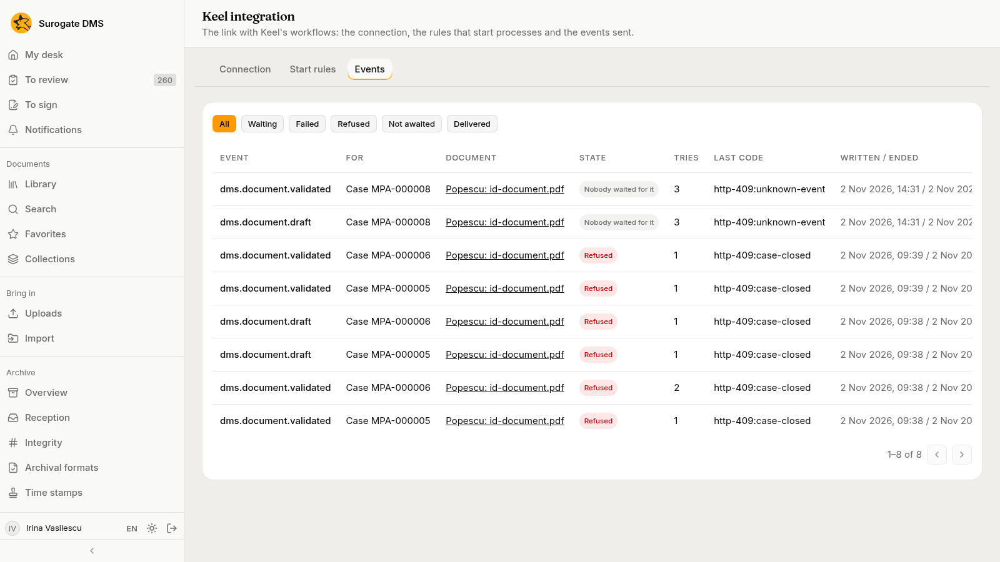

For administrators: the page **Keel integration** shows the link between the DMS and Keel, the rules that start Keel processes when documents arrive, and the events the DMS sends to Keel.

[Keel](/keel/) runs the processes and cases of your institution, and the DMS keeps the documents. The two are linked: a flow in Keel can read and move documents, and the DMS tells the flows that hold a document when something happens to it. What colleagues see of this is described in [Workflows and cases with Keel](/dms/work/workflows/).

## Who can open the page

**Administration** › **Keel integration** is in the menu for people who manage people, who manage the selection, or who manage folders in some unit. What each of them sees:

| Tab | Who sees it |
|---|---|
| **Connection** | People who manage people |
| **Start rules** | Everyone who may open the page. Each rule offers only the actions its reader may take |
| **Events** | People who manage people |

## The Connection tab

The tab answers one question: is the DMS talking to Keel?

- **Address** and **Project** name the Keel the DMS talks to and the project of your institution in it.
- **Last successful send** shows when Keel last accepted an event, or "No successful send yet".
- A line says why sending waits, when it does: "Keel did not answer the last send; trying again at …", or "Keel refused the DMS key … Sending is stopped until …". The DMS tries again by itself.
- **Events waiting** and **failed events** count what has not reached Keel yet and what was given up. See the **Events** tab.
- **Open links with Keel** counts the cases and processes that hold documents now.
- **Check the connection** asks Keel which processes the DMS may start. The answer reads "The connection works. Processes that can be started: 3." or "Keel answered with an error: …".

If the page says that sending events to Keel is not configured, nothing goes to Keel from the DMS. Ask the people who run your installation to connect it. A flow in Keel can still reach the DMS.

## The Start rules tab

A **start rule** makes the DMS start a Keel process by itself. There are two kinds:

- **For each new document in a folder**. When a document is filed in that library folder, or in a personal folder inside it, the process starts and holds the document from the start. A bulk import never starts processes.
- **When a dosar's retention term ends**. Once a day the DMS finds the dosare that the [Selection](/dms/archive/selection/) page lists as candidates and starts the process for each one, once for each rule, dosar and year in which the term ended.

### Add a rule

Press **Add a rule**, choose **When it starts**, choose the **Folder** for the first kind, choose the **Keel process** from the list that Keel offers, and press **Create**. When Keel cannot be asked, the dialog lets you type the name of the process as Keel writes it.

You need the permission to manage folders over the unit of the folder for a rule on a folder, and the permission to prepare the selection for the whole institution for a retention rule.

### Work with a rule

Each rule reads as a sentence, for example "For each new document in Contracts 2026, the process Loan review starts.", and shows how many processes it started, the time of the last start and the reason when the last attempt was refused.

- **Stop** keeps the rule but starts nothing. **Start** turns a stopped rule on again.
- **Delete** removes the rule, after a confirmation. Processes already started and the links made stay, and their rows on the **Workflows** tab then say "started by a start rule that no longer exists".
- Deleting a folder deletes the rules on it.

## The Events tab

The DMS tells Keel what happens to a document that a case or process holds: a change of state, a new version, a move to another folder, the result of the reception, the deletion of the document, and the end of a signature request that a flow made. An event carries only its name and the case it is for. Keel reads the document through the DMS when it needs more.

The filter above the list shows **All** events or those that are **Waiting**, **Failed**, **Refused**, **Not awaited** or **Delivered**. A row shows the event, the case or process it is for, the document, its state, the tries, the last answer of Keel and when it was written and ended.

| State | What it means | What to do |
|---|---|---|
| **Waiting** | The event has not been sent yet, or Keel did not answer and the DMS tries again later. | Nothing. |
| **Delivered** | Keel took the event. | Nothing. |
| **Nobody waited for it** (filter **Not awaited**) | Keel answered that the flow was not waiting for it. | Nothing: a flow only waits for the events it needs. |
| **Refused** | Keel did not accept it, for example because the case is already closed. | Nothing, as a rule. |
| **Failed** | Keel answered that the event was not valid, or the answer could not be read. | Look at the last code, then press **Send again**. |

**Send again** is on a row that failed, was refused or was not awaited. It writes an entry in the audit log.

## Links over time

Keel does not tell the DMS when a case closes. The DMS asks Keel about the open links from time to time, one case or process at a time. A closed case, or a process that no longer runs, closes its links: they stay on the document page as **Closed** and get no more events. When Keel does not answer, the links stay as they were.

## The audit log

The audit log records a document linked to a Keel workflow, a link removed, a start rule added, changed or deleted, and an event sent again. When a flow acts for a person, the entry is the person's, with the line "Through Keel". See [Audit log](/dms/admin/audit-log/).
