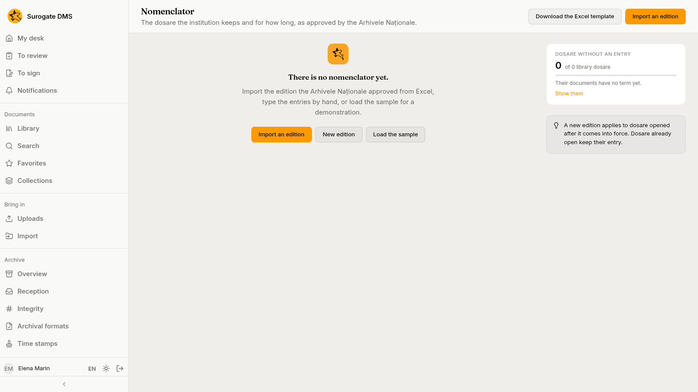
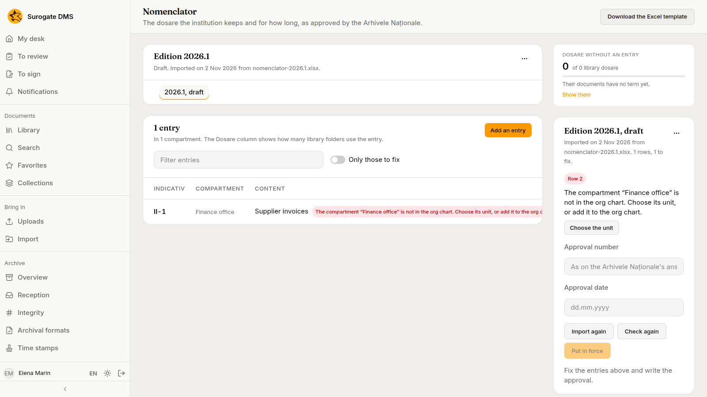
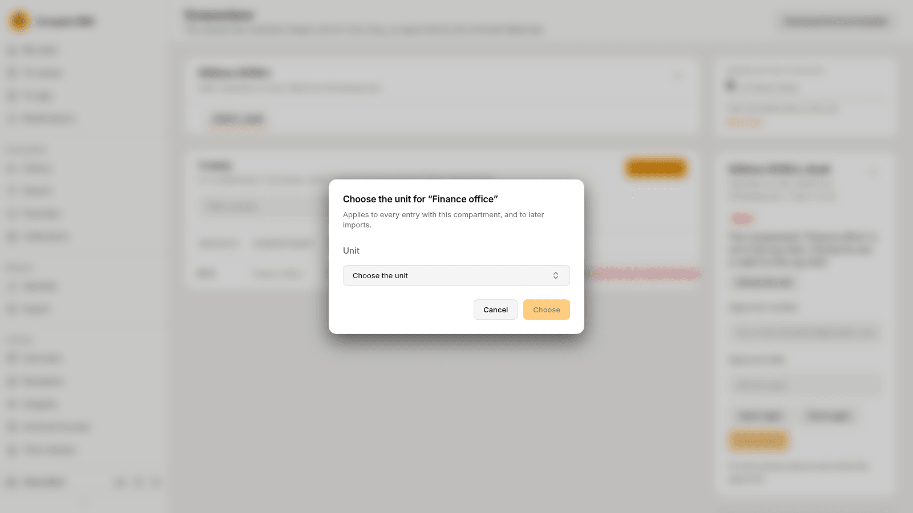
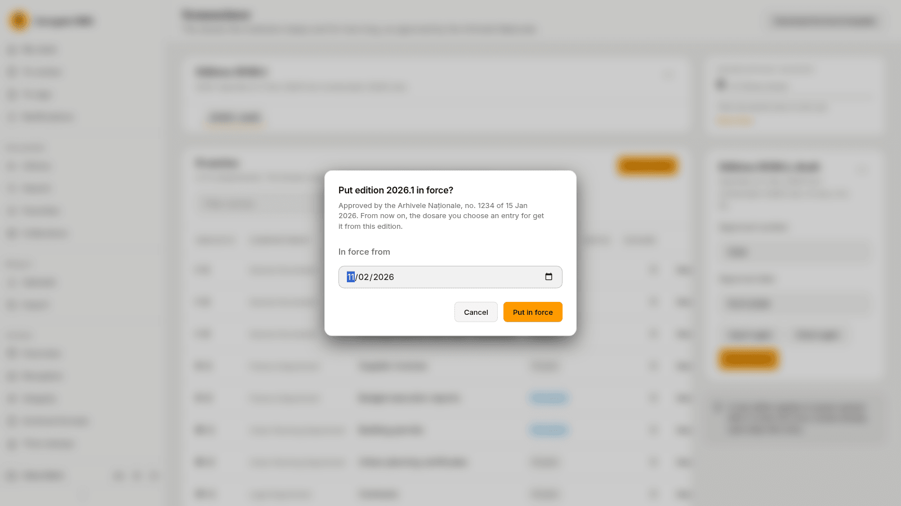
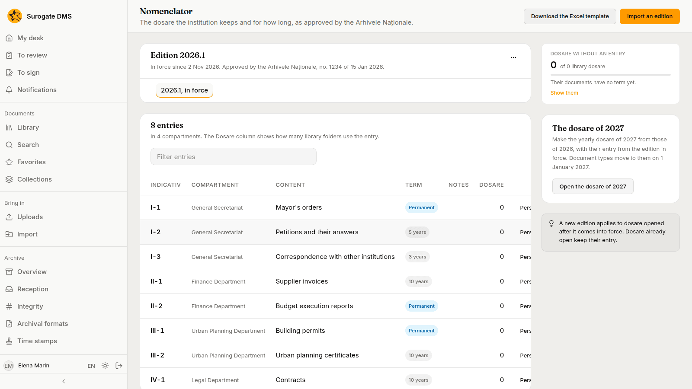

For administrators who manage the nomenclator: importing the edition your National Archives approved, mapping its compartments to units, putting it in force and amending it. People who consult the archive can read the page but not change it.

## What it holds

The nomenclator lists the dosare the institution keeps and for how long, as approved by the Arhivele Naționale. An **edition** is one approved version: **draft** while you prepare it, **in force** while it applies and **superseded** after a newer one is put in force. Each entry has an **Indicativ**, a **Compartment** (a unit), a short **Content**, a **Term** (a number of years or **Permanent**) and **Notes**; the column **Dosare** counts the library folders that use it.

## Import an edition

Download the Excel template with **Download the Excel template**, fill it with the entries of the approved edition, press **Import an edition**, choose the file and give the edition a name. The edition is a draft. The page lists the entries and what needs fixing.

- A compartment that matches no unit of the org chart is listed as a problem. Press **Choose the unit** and choose the unit; the choice applies to every entry with that compartment and to later imports.
- **Only those to fix** shows just the entries with problems. **Check again** checks the draft after changes, and **Import again** replaces its entries with a new file.
- You can **Add an entry**, **Edit** or **Delete** one by hand.

## Put it in force

Fill in the **Approval number** and the **Approval date** (written dd.mm.yyyy) and press **Put in force**. The dialog says what changes and asks for the date it is **In force from**.

From then on, the dosare you choose an entry for get it from this edition. Dosare that have an entry from an earlier edition keep it, and that edition stays in the list as superseded.

## Amend the nomenclator

An amendment is a new edition. Open the edition's **Edition actions** menu and choose **Copy into a new edition**, name it, change the entries and put it in force as above. The confirmation compares it with the edition in force. **Download as Excel** saves an edition, **Change the name and approval** corrects its name and approval, and **Delete the draft edition** drops a draft. Only one draft can exist at a time.

## Personal-data defaults

An entry can carry a default personal-data classification, so documents in its dosare are classified when filed. Use **Personal data** on the entry's row.

## The sample

**Load the sample** loads a demonstration nomenclator. It is for trying the DMS: import the edition your National Archives approved before the archive goes live.
