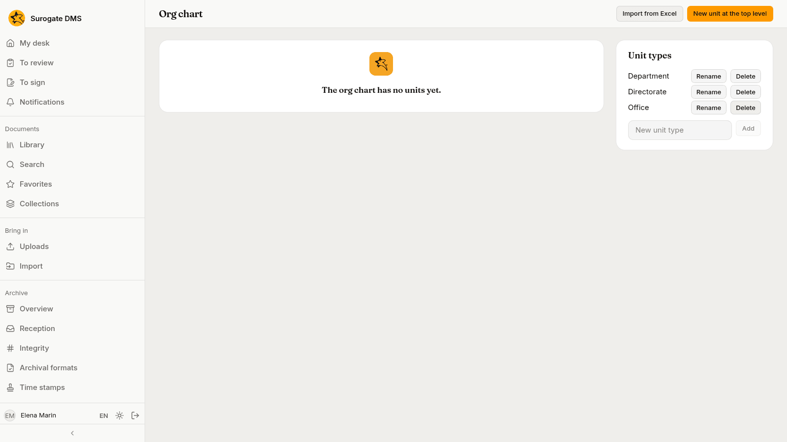
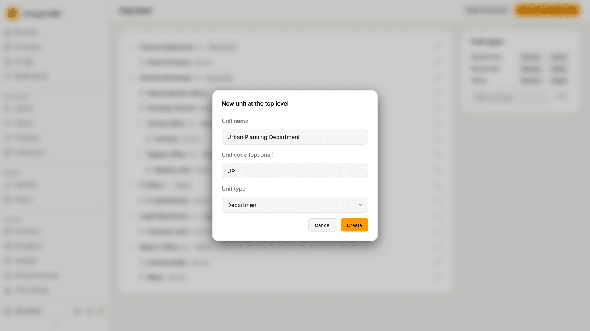
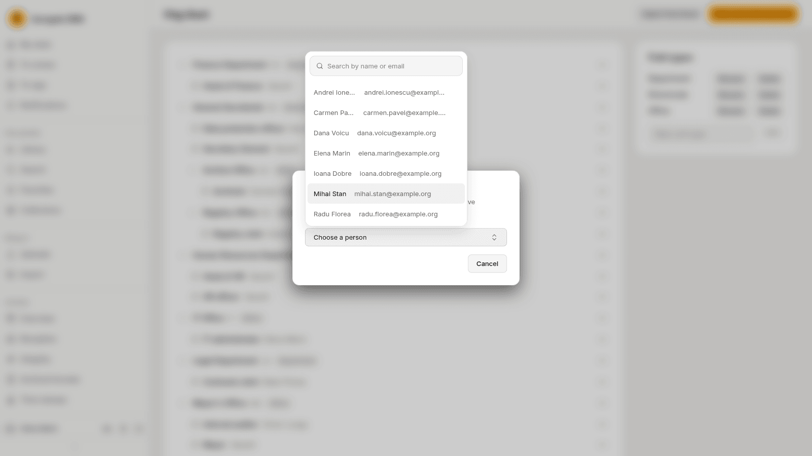
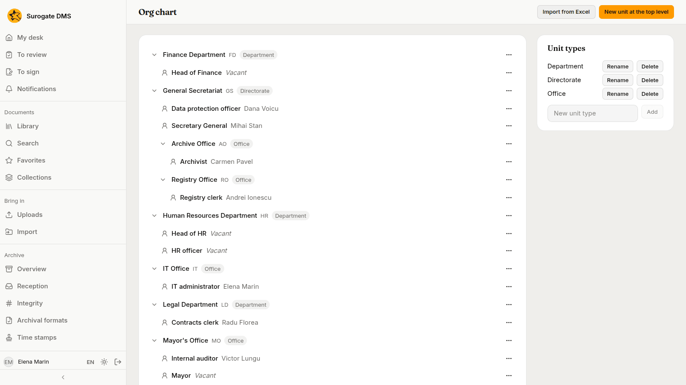
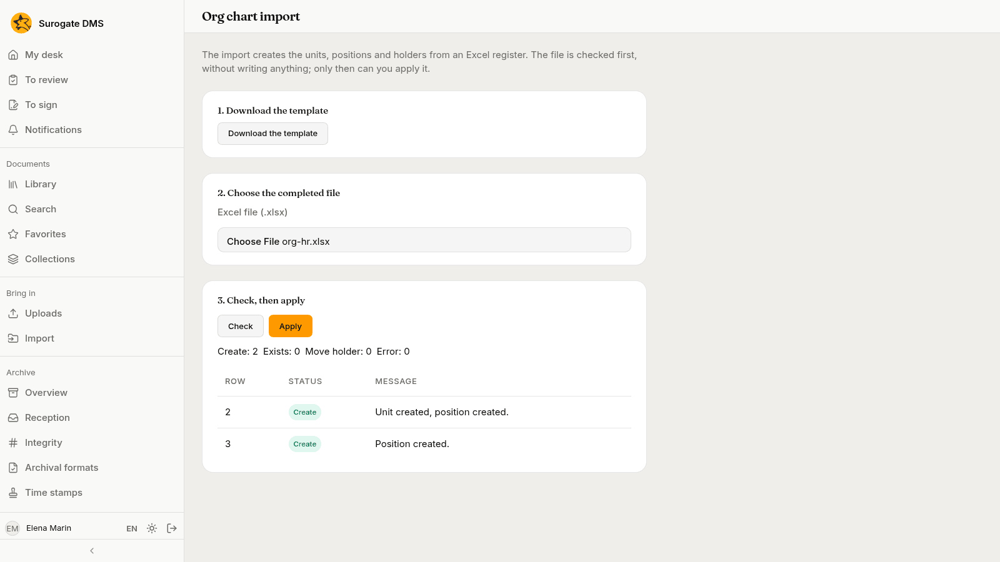

For administrators who hold the permission to manage the org chart: the units, positions and holders of your institution. The org chart decides who holds which grants, because a grant can go to a position or a unit.

## Unit types and units

**Administration** › **Org chart** shows the units as a tree, with their positions. The panel **Unit types** on the right lists the types of unit (for example Directorate, Department and Office) with **Rename** and **Delete**; add one in **New unit type** with **Add**.

Press **New unit at the top level**, give the **Unit name**, an optional **Unit code (optional)** and the **Unit type**, and press **Create**.

The menu on each unit (**Actions for the unit**) lets you **Edit the unit**, **Move the unit…**, add a **New subunit** or a **New position**, and **Delete the unit**. You can also drag a unit onto another to move it, or onto the top of the tree to make it a top-level unit.

## Positions and holders

A position has a title and, at most, one holder. The menu on a position (**Actions for the position**) has **Rename the position**, **Move to another unit**, **Holder…**, **Vacate the position** and **Delete the position**. **Holder…** opens a list of the active people; choose one.

A position nobody holds reads "Vacant". Deleting a unit, a position or a type cannot be undone.

## Import from Excel

**Import from Excel** creates units, positions and holders from a spreadsheet. The page has three steps: **Download the template**, choose the completed file, then **Check** and **Apply**. The check writes nothing; it lists each row as **Create**, **Exists**, **Move holder** or **Error**, with a message, and **Apply** is for when it is right.

## Who gains or loses access

A person's access follows their position: a person who takes over a position gets the grants given to the position and to its unit, and loses them when they leave it. Moving a unit changes what the grants "with its subunits" reach.
