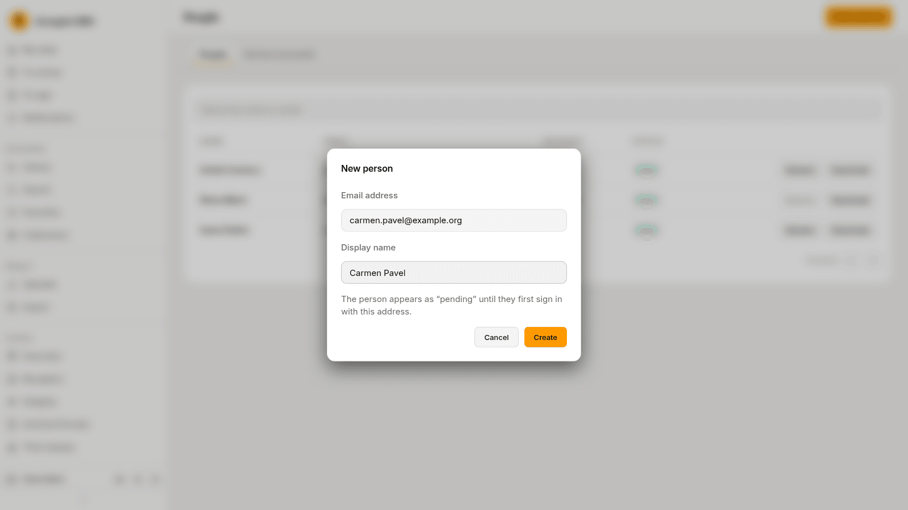
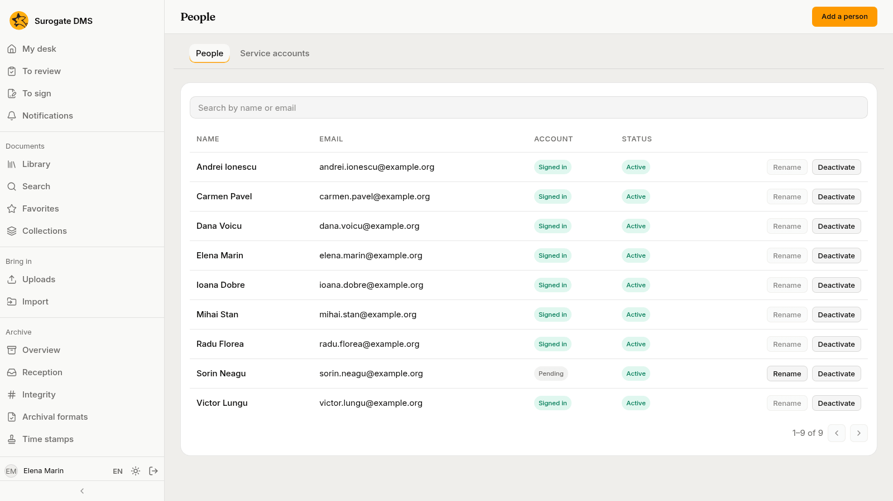

For administrators who hold the permission to manage people: adding people, seeing who has signed in and deactivating accounts. People sign in with the account of your institution's sign-in service; the DMS keeps no passwords.

## Add a person

**Administration** › **People** lists the people with their **Email**, their **Account** (**Signed in** or **Pending**) and their **Status** (**Active** or **Deactivated**). **Search by name or email** finds one.

Press **Add a person**, type the **Email address** and the **Display name**, and press **Create**. The person appears as "Pending" until they first sign in with that address, and the roles you give them in advance work from that moment.

## Change a person

- **Rename** changes the display name of a person who has not signed in yet. The name of a person who has signed in comes from their account and is changed there.
- **Deactivate** stops the person from signing in from their next request; their documents and history stay. **Reactivate** lets them sign in again.

## Roles

People get their roles on **Roles and permissions**, by grants. See [Roles and permissions](/dms/admin/roles/).

## Service accounts

The tab **Service accounts** is for your IT team: the accounts of connected systems.
