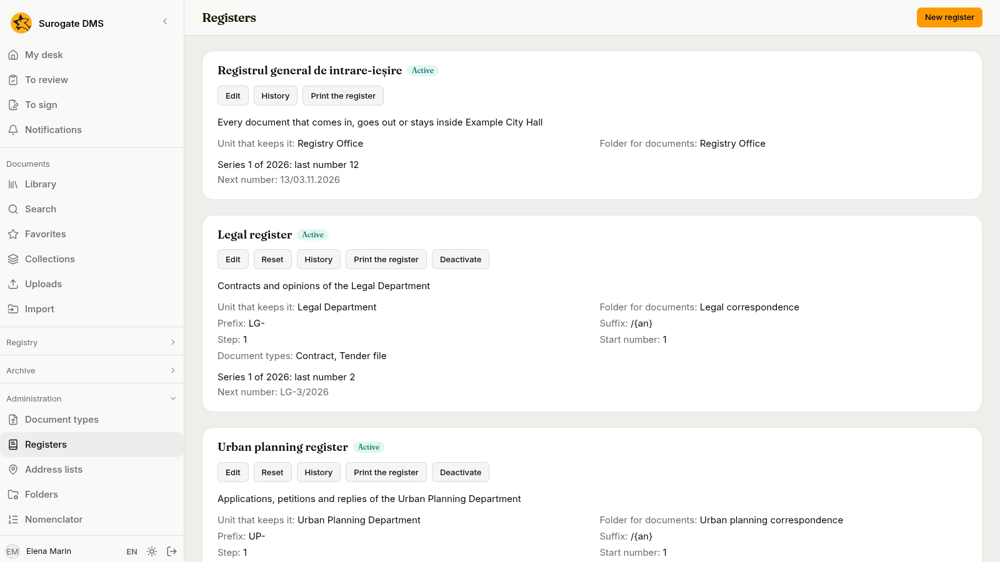
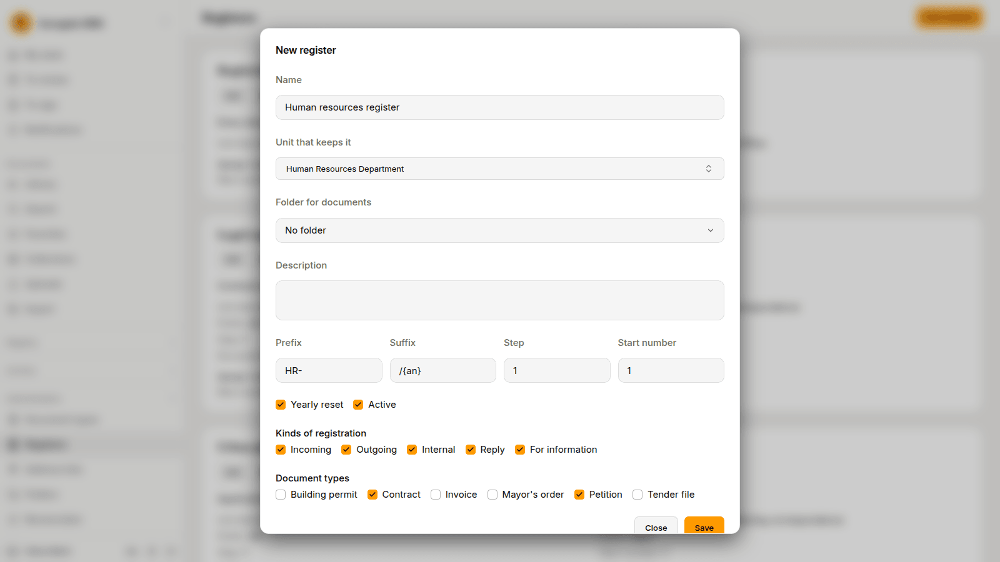
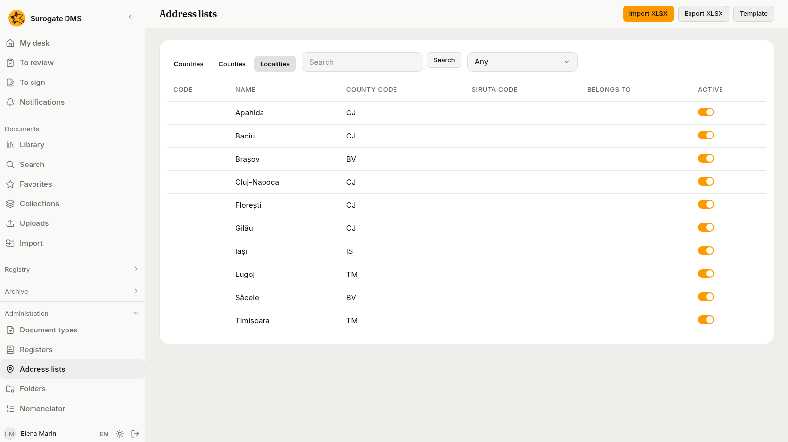
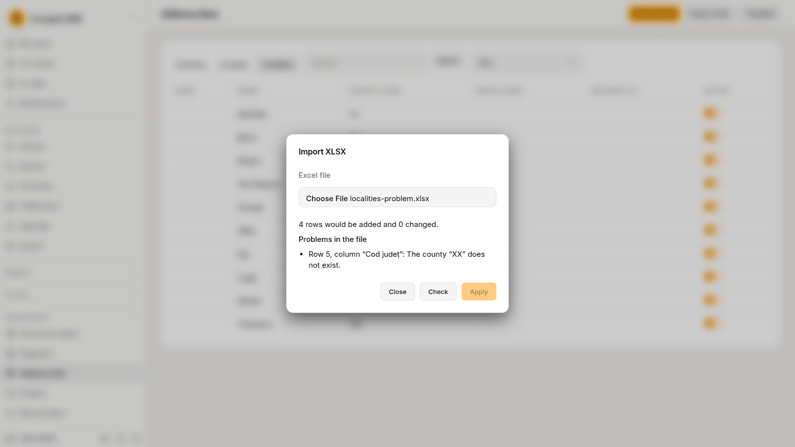

For administrators who set up the registry: the main register and the service registers, how numbers are given and reset, the address lists, who may register and cancel, and what to check before real use.

## The two numbers

Every registration takes a number in the **main register** and, when it is made in a service register, a second number from that register. People register in the [Registry](/dms/work/registry/) and read how a registration works there. This page is about what you set up.

- The **main register** is made with the DMS. There is one for the institution. It cannot be added to, renamed, switched off or deleted, and it has no prefix, suffix or step. Its numbers read as the number in the year and the day it was given: `12/03.11.2026`.
- A **service register** is one you make for a unit, for example a register of the Urban Planning Department. Its number is the **Prefix**, the number and the **Suffix**, with `{an}` standing for the year: with the prefix `UP-` and the suffix `/{an}`, `UP-10/2026`.

A register has no gaps that the DMS made. A number is given when a registration is saved and never again, and a cancelled registration keeps its numbers.

## The Registers page

**Administration** › **Registers** lists the main register first and then the service registers.

Each card says which unit keeps the register, its **Folder for documents**, the **Series** now open with the last number given, and the **Next number**. The buttons are **Edit**, **Reset**, **History**, **Print the register** and **Deactivate** (or **Activate**). The main register has **Edit**, **History** and **Print the register**: in its **Edit** dialog you set the unit that keeps it, its folder and its description. While the current year has given no number, you can also set the start number of that year, which is how an institution moves from a paper register part-way through a year.

### Make a register

Choose **New register**.

| Field | What to write |
|---|---|
| **Name** | A name no other register has, whatever the case and the accents. |
| **Unit that keeps it** | The unit. Whoever holds **Registers documents** in that unit registers in this register. |
| **Folder for documents** | A library folder of that unit or of a unit below it. The files uploaded to its registrations are filed there. |
| **Description** | Free text. |
| **Prefix**, **Suffix** | Up to 20 characters each. `{an}` stands for the year. A prefix or suffix may not put a digit next to the number. |
| **Step** | How much a number grows by, 1 to 1,000. |
| **Start number** | The number the first series starts at, from 1. |
| **Yearly reset** | Whether each year starts a new series. |
| **Active** | An inactive register takes no registration. Registers are never deleted. |
| **Kinds of registration** | The kinds it takes: **Incoming**, **Outgoing**, **Internal**, **Reply**, **For information**. At least one. |
| **Document types** | The types it takes. An active register needs at least one. |

A change of the prefix, the suffix, the step or the start number applies to the next number. A number already given never changes.

If a register has no folder, its registrations take no uploaded files, but they can still link documents that are already in the DMS. A folder that a register names cannot be deleted, and neither can a unit that keeps a register or that a registration names.

### The yearly reset

The main register, and every service register with **Yearly reset**, starts a new series at the first registration of a new year. Nothing runs at midnight: the first registration of the year closes the old series and opens the next from the **Start number**. A register without **Yearly reset** keeps one series until you reset it. **History** lists the series of a register with the year, the numbers, who opened and closed each, when, and why: the first registration, the start of a year or a manual reset.

### Reset a register

**Reset** closes the open series and opens the next from a new **Start number**, with a **Prefix** and a **Suffix** you may change. Write the **Reason**: at least 10 characters. The dialog says at which number the current series closes and which number the next registration will get.

Two refusals protect the numbers. "The new series would repeat numbers given in 2026 (the highest: 10). Change the prefix or the suffix, or start from a number higher than 10." means the new numbers would be ones already given this year. "The register was reset meanwhile; reload the page." means another administrator reset it first.

### Switch a register off

**Deactivate** stops a register taking registrations. The numbers it gave stay, and **Activate** opens it again.

## Who may register and cancel

Four permissions govern the registry.

| Permission | What it allows |
|---|---|
| **Sees registrations** | Reads the registrations of the registers kept in the units of the grant and those that name those units, opens the unit's list, comments, exports what the person reads and prints a register kept there. |
| **Registers documents** | Registers in the registers kept in the units of the grant, for the types of the grant, corrects those registrations, adds and removes their documents, makes and corrects correspondents and reads the directory. |
| **Cancels registrations** | Cancels a registration of a register kept in the units of the grant. |
| **Manages the registers** | For the whole institution only: makes and changes registers, resets them, sets the main register's unit, folder and start of the year, manages the address lists and deactivates correspondents. |

The built-in role **Registrar** holds **Sees registrations**, **Registers documents** and the permissions to read, upload and comment on documents and to open documents with personal data. The **Archive administrator** holds all four. The **Standard user** and the **Auditor** hold **Sees registrations**. **Cancels registrations** is a permission of its own: give it to the head of the registry with a role of yours. See [Roles and permissions](/dms/admin/roles/).

A person registers in a register when they hold **Registers documents** for the unit that keeps it, or for the whole institution, and for the registration's type. Until the main register has a unit, only a person who holds the permission for the whole institution may register in it. The states a grant lists do not limit the registry permissions: a registration has no state.

## Address lists

**Administration** › **Address lists** keeps the countries, the counties and the localities that the addresses of correspondents are chosen from. The DMS starts with Romania and its counties. The localities and other countries come from an Excel file.

The tabs **Countries**, **Counties** and **Localities** list the rows, with **Search** and, for localities, a county filter. A row has a switch **Active**: switched off, it is no longer offered, and the registrations that name it keep it.

### Import a list

**Template** downloads a workbook with the columns of the import, and **Export XLSX** saves the list you have, in the same columns. Columns are matched by their names, whatever the case and the accents, in any order, on the first sheet, which needs a header row.

| List | Columns |
|---|---|
| Countries and counties | `Cod`, `Denumire` |
| Localities | `Denumire` and `Cod județ`. Optional: `Cod SIRUTA`, `Tip` and `Aparține de`. |

Choose **Import XLSX**, choose the file and **Check**. The dialog says how many rows would be added and changed and lists the problems row by row. **Apply** is available when there are none; a file with a problem changes nothing. Rows the file does not mention stay as they are.

The national statistics institute publishes the list of localities. Check that the file you import has the columns above before the first use.

## What is recorded

Every action has an entry in the audit log: **Registration made**, **Registration consulted**, **Registration corrected**, **Document added to a registration**, **Document removed from a registration**, **Comment on a registration**, **Registration cancelled**, **Registration receipt downloaded**, **Registry search**, **Registry export**, **Register created**, **Register changed**, **Register reset**, **Register printed**, **Labels printed**, **Correspondent created**, **Correspondent changed**, **Correspondent consulted**, **Address changed** and **Address lists imported**. The entries hold ids, codes and counts, never a description, a note, a name, a CNP, a CUI or an address. **Registry search** is written only for a list that looks a person up by CNP, CUI or name.

## Before real use

1. In **Registers**, set the unit and the folder of the main register.
2. Make the service registers, each with its unit, its kinds, its document types and its folder.
3. Grant **Registrar** in the unit of each register, and give **Cancels registrations** to the head of the registry.
4. Import the localities.
5. Register a few real correspondents. A CNP or a CUI that the DMS refuses although it is right is a fault to report to the people who support the installation.
6. Print a receipt, read its QR code with the scanner you will use and see that the registration opens.
7. Choose the label stock, print a label of a test registration, stick it on a letter, scan the letter as a capture (see [Capturing documents](/dms/work/capture/)) and see that the part is linked to the registration. See [Print labels](/dms/work/registry-lists/#print-labels).
