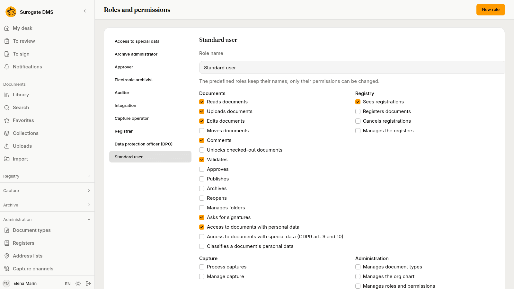
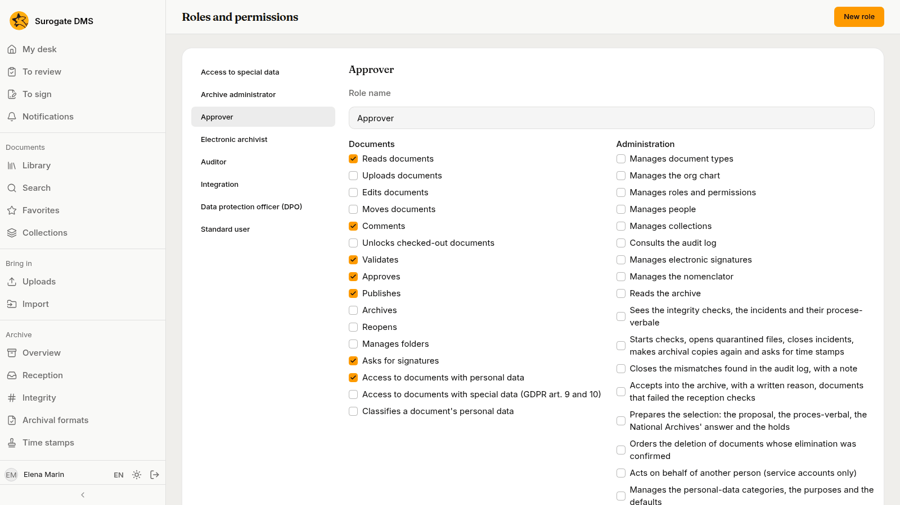
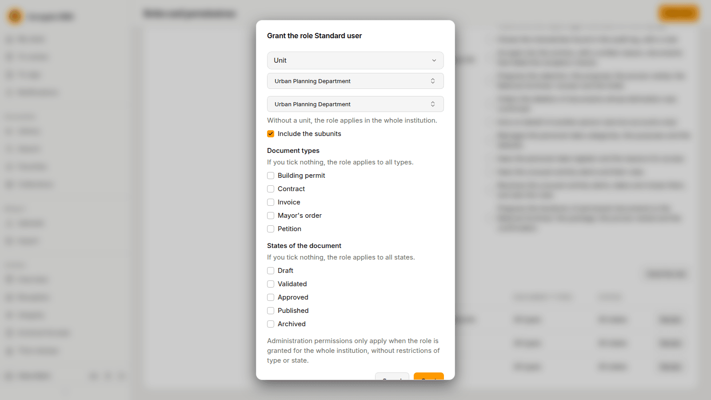
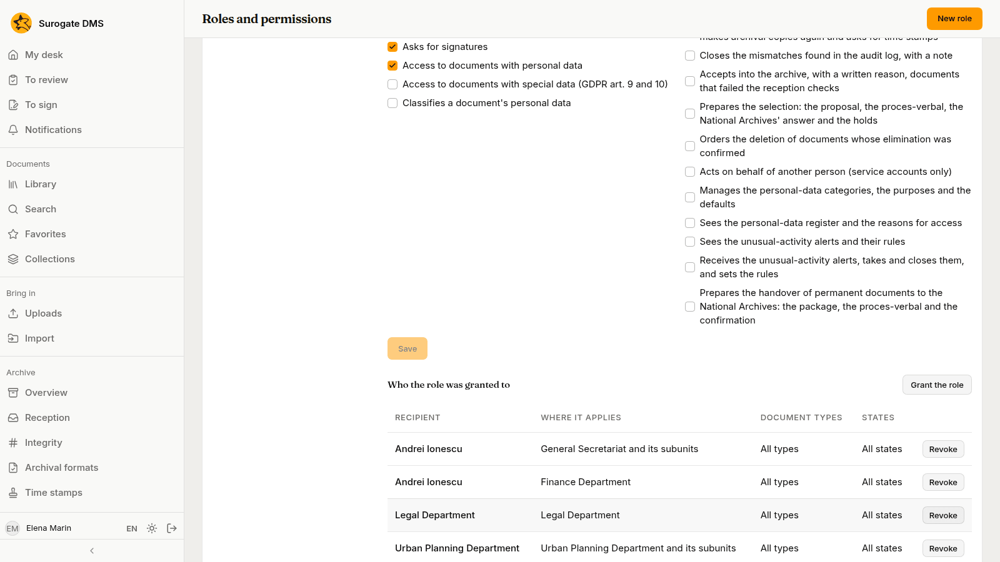

For administrators who hold the permission to manage roles and permissions: what a role is, how to make one and how to grant it to a person, a position or a unit.

## Roles

A **role** is a set of permissions. **Administration** › **Roles and permissions** lists the roles on the left: the built-in ones (**Access to special data**, **Archive administrator**, **Electronic archivist**, **Auditor**, **Integration**, **Capture operator**, **Data protection officer (DPO)**, **Registrar** and **Standard user**) and any you made. The built-in roles keep their names; only their permissions can be changed. Choose a role to see its permissions, in the groups **Documents** and **Administration**.

### Make a role

Press **New role**, type a **Role name** and press **Create**. Then tick the permissions the role holds and press **Save**.

## Grants

A role does nothing until it is **granted**. Choose the role and press **Grant the role**:

1. **Type of recipient**: a **Person**, a **Position** (whoever holds it) or a **Unit** (everyone who holds a position in that unit).
2. Choose the recipient.
3. **The unit it applies to**: leave it empty to apply in the whole institution, or choose a unit and tick **Include the subunits**.
4. Under **Document types** and **States of the document**, tick the types and states the role applies to. If you tick nothing, it applies to all.
5. Press **Grant**.

Administration permissions apply only when the role is granted for the whole institution, without restrictions of type or state.

**Who the role was granted to** lists the grants with the recipient, where it applies, the types and the states; **Revoke** removes one.

## How grants add up

What a person may do is the sum of all grants that reach them. In the demo city hall, Andrei Ionescu holds Standard user for the General Secretariat and its subunits and again for the Finance Department, and the role Access to special data for the General Secretariat. Radu Florea holds Standard user through the unit Legal Department, because he holds a position in it. Mihai Stan holds the custom role Approver through the position Secretary General, for the whole institution.

See [Built-in roles](/dms/reference/roles/) for what each built-in role may do.
