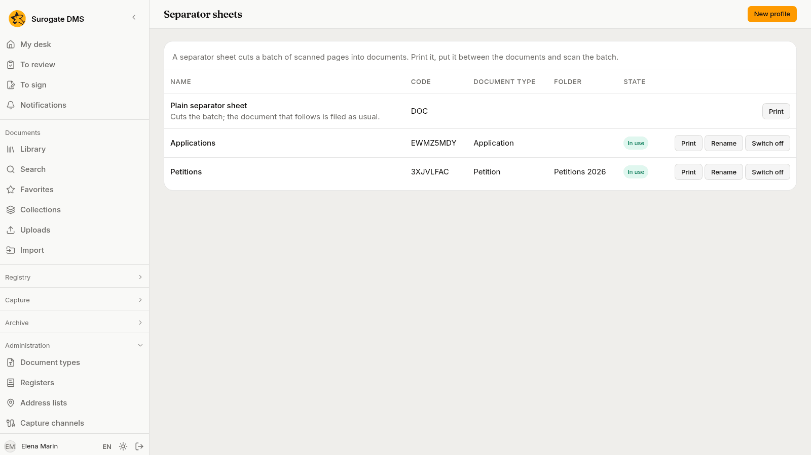
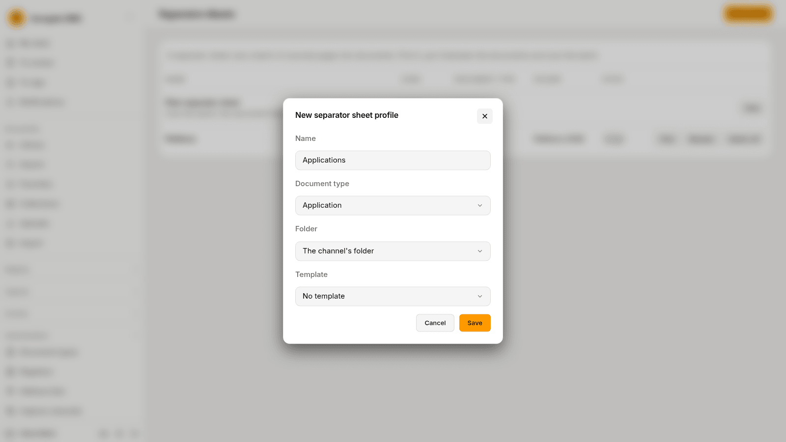
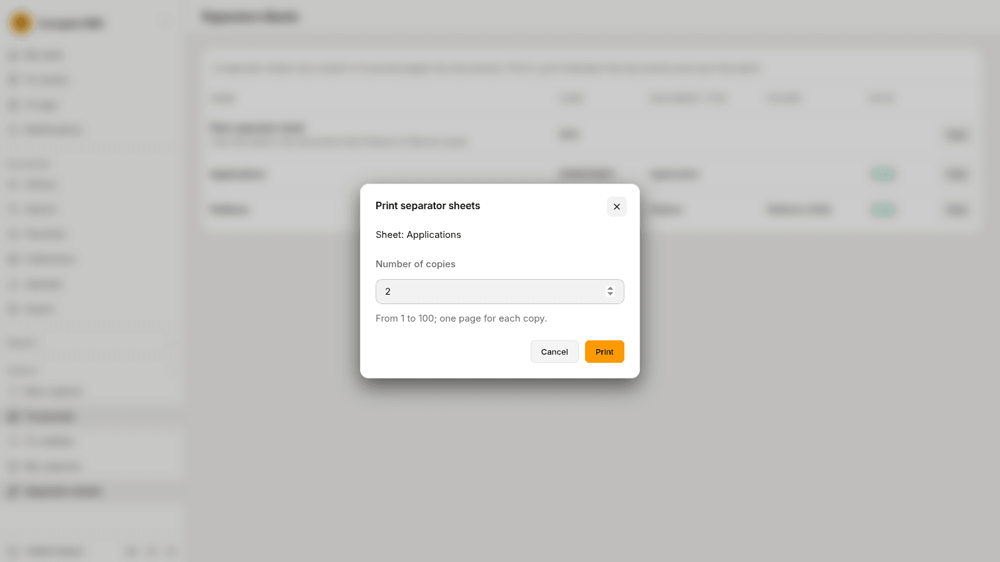

For administrators who prepare a scanned stack to be cut into documents: how the DMS cuts a batch by the codes on its pages, how to make and print separator sheet profiles, and what stops a capture.

## How a batch is cut

A scanner reads a stack of paper as one batch. Two kinds of printed code on the pages tell the DMS where one document ends and the next begins.

- A **separator sheet** is a page you put between two documents. The DMS leaves the sheet out of the documents. The page after it starts a new part.
- A **registration label** is a label you stick on the first page of a letter that was registered. The page keeps its place in the document. It starts a new part and links it to its registration, and the part is then filed in the folder of the register. See [Print labels](/dms/work/registry-lists/#print-labels).

The rules are these.

- A sheet of a **profile** gives the part that follows its type and its folder. The **Plain separator sheet** gives none, so the part keeps the channel's.
- A label right after a separator sheet adds the registration to the part the sheet started.
- A receipt used as a cover sheet and the letter with its label after it make one part, because both name the same registration. Two letters of one registration need a separator sheet between them.
- Pages before the first sheet or label make a part of their own. A capture that holds only separator sheets stops and says that it has no pages.
- When **One document** is off for the capture, each file also starts a part.
- A PDF that carries a signature, or is password protected, is never cut. It is one part, whole. If a code is found in it, the capture stops and says so.
- A page with two different codes of the DMS stops the capture. Split it by hand.
- A bar code or QR code that is not the DMS's own changes nothing. The capture's page lists it as **Other code**.

The codes are read when the capture is taken in. The page of the capture shows what was read; see [Processing captures](/dms/work/capture-inbox/#the-pages-and-their-codes). A channel can switch the reading of sheets and of labels off with its **Separators** and **Registrations** settings; the codes are then still listed and nothing is cut or linked.

## Profiles

**Administration** › **Separator sheets** lists the **Plain separator sheet** and the profiles. A profile is a kind of sheet that says what the document after it is.

The columns are **Name**, **Code**, **Document type**, **Folder** and **State** (**In use** or **Switched off**). Staff who hold **Process captures** see the same page, with the profiles that are in use, and can print the sheets; only you make and change profiles.

### Make a profile

Choose **New profile**.

| Field | What to choose |
|---|---|
| **Name** | A name no other profile has, whatever the case and the accents. It is printed on the sheet. |
| **Document type** | The type of the document that follows the sheet. It is optional. |
| **Folder** | The library folder of that document, or **The channel's folder**. A type that has its own default folder is filed there instead. |
| **Template** | A [capture template](/dms/admin/capture-templates/) that reads the form that follows the sheet, or **No template**. |

Choose **Save**. The page says "The profile was made. The sheet's code is" and the code. The DMS makes the code. It is printed on the sheet in two forms of the same code, so the sheet reads whichever way up it is fed.

The code, the type, the folder and the template of a profile never change, because sheets already printed and lying in a drawer must keep meaning what they said. To change one of them, make a new profile. A profile is never deleted.

### Rename, switch off and switch on

- **Rename** changes only the name. The name on sheets already printed stays as it was.
- **Switch off** asks "Switch the profile off?" and warns that sheets printed with this profile no longer cut captures: a capture that holds one stops, and a person chooses the folder by hand. Staff no longer see the profile in their list.
- **Switch on** puts the profile back to work. Sheets printed earlier cut captures again.

If the type or the folder of a profile is deleted later, the profile keeps cutting. The documents it starts take the channel's folder.

## Print the sheets

Choose **Print** on a row of a profile in use. The dialog **Print separator sheets** names the sheet and asks for the **Number of copies**, from 1 to 100. One page is printed for each copy.

Your browser saves a PDF. The DMS does not keep it. Open it and print it at full size, with no fitting to the page, and do not write on a sheet. The sheet prints its name, its type and its folder, and its fixed words are in Romanian.

## Blank pages

Many scanners scan both sides of a sheet, so the back of a separator sheet comes out as a blank page. The **Blank pages** setting of a channel says which blank pages are left out of the parts:

- **After separator sheets**, the default: the blank back of a separator sheet.
- **All**: every blank page, in any capture.
- **None**: no page is left out.

A page counts as blank when it has no marks beyond the grain of the paper and faint show-through. A page that is left out stays in the captured file, and the capture's page says "Blank page left out". The test was set on generated pages, not on real scans. Try it with your own paper before you rely on **All**.

## Registration labels

A label is printed from a registration, not from this page. Whoever can read a registration prints its label: choose **Print labels** in the Registry list, or **Print the label** on a registration. See [Print labels](/dms/work/registry-lists/#print-labels). A label carries the QR code of the registration, its numbers, the name of the register and the name of your institution. It never carries the name of a correspondent or the title of a document.

## When a sheet or a label stops a capture

A capture that cannot be cut or filed waits and says why. Staff see these on [To process](/dms/work/capture-inbox/#when-a-capture-waits).

| Reason | What it says | What to do |
|---|---|---|
| **Two codes on one page** | Page {n} has two different DMS codes; split the capture by hand. | Choose **Continue without Codes** and split the part by hand, or scan the pages again without the second code. |
| **Separator sheet no longer in use** | The separator sheet on page {n} is no longer in use; choose the folder by hand. | Choose the folder of the part, or switch the profile on. |
| **Signed file with separator sheets** | File {n} is signed and is not split. File it whole, or remove the signature before scanning. | File it whole, or scan it again without the signature. |
| **No pages** | The capture has no pages. | Discard it. |
| **Filing refused** | Part {n} could not be filed, and why. | The registration linked to the part may not exist, be cancelled, or be in a register with no folder. Read the reason on the part. Remove the link with **Remove the link** and the part is filed in the folder it has. |

A link to a registration is made by a label on the page. It cannot be added by hand.
