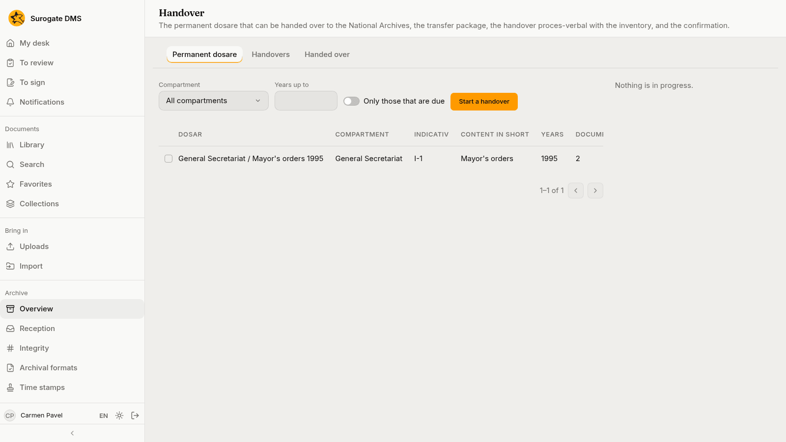
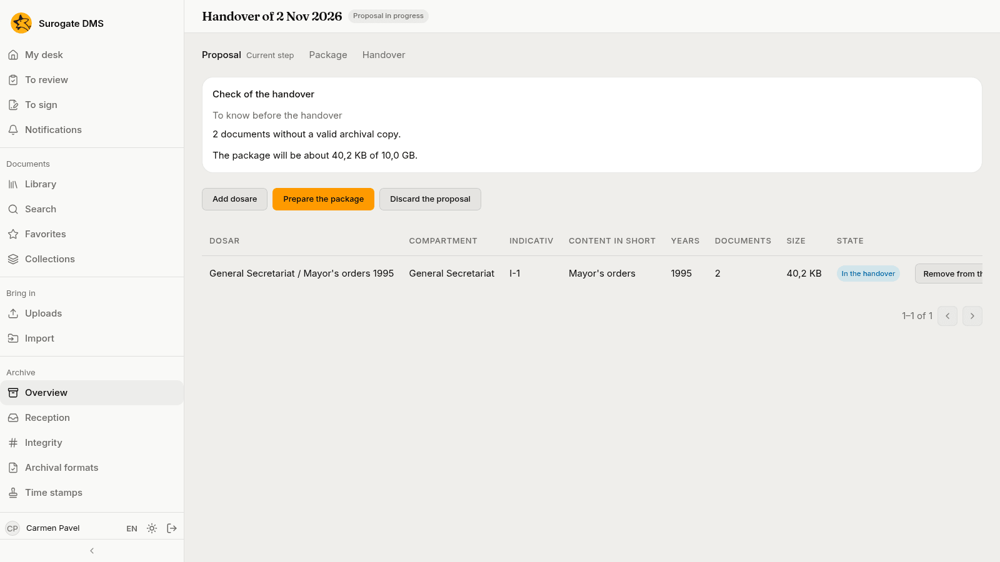
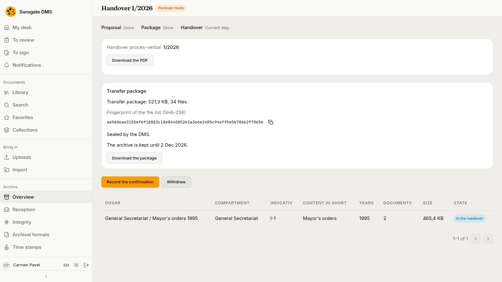
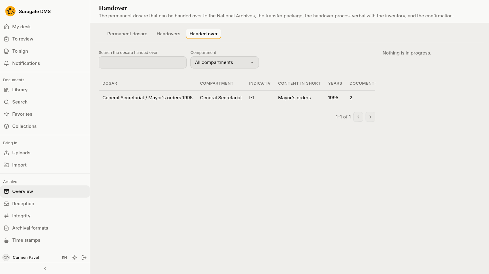

For archivists: handing the dosare kept permanently over to the National Archives: which are due, the proposal, the package, the confirmation and what follows.

## Which dosare are listed

**Archive** › **Handover** has three tabs: **Permanent dosare**, **Handovers** and **Handed over**. The first lists the dosare kept permanently that can be handed over, with their years, documents, size and the year their handover is due, and **Only those that are due** narrows the list.

## The steps

Tick the dosare and press **Start a handover**. A handover has three steps: **Proposal**, **Package** and **Handover**.

1. **Proposal.** The page lists the dosare, with **Add dosare** and **Remove from the handover**. The **Check of the handover** says what stands in the way of the package (a file in quarantine, a held dosar, documents you may not read) and what to know before it (documents without a valid archival copy, a time stamp or a valid signature). **Prepare the package** continues; **Discard the proposal** drops the handover.
2. **Package.** **Prepare the package** asks who hands over, the recipient and who approves. The DMS draws up the handover proces-verbal with the inventory of the dosare and makes the transfer package; this takes from a few minutes to a few hours and you can close the page.
3. **Handover.** When the page says "Package ready", download the proces-verbal and the package, hand them over, and press **Record the confirmation**.

## Record the confirmation

**Record the confirmation** asks what the National Archives decided: received in full, in part or refused, the signed proces-verbal's number and date, who received and the scan. The dosar then moves to the **Handed over** tab, where you can search it.

## The evidence package and the export of a dosar

**Export the dosar** on a folder's **Folder actions** menu prepares a copy of a dosar to download. A document's **Versions** tab has an **Evidence package** for each version.
