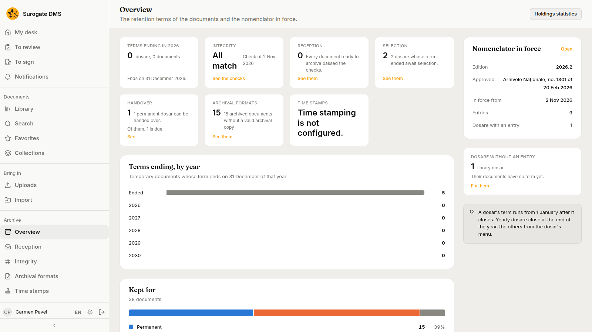
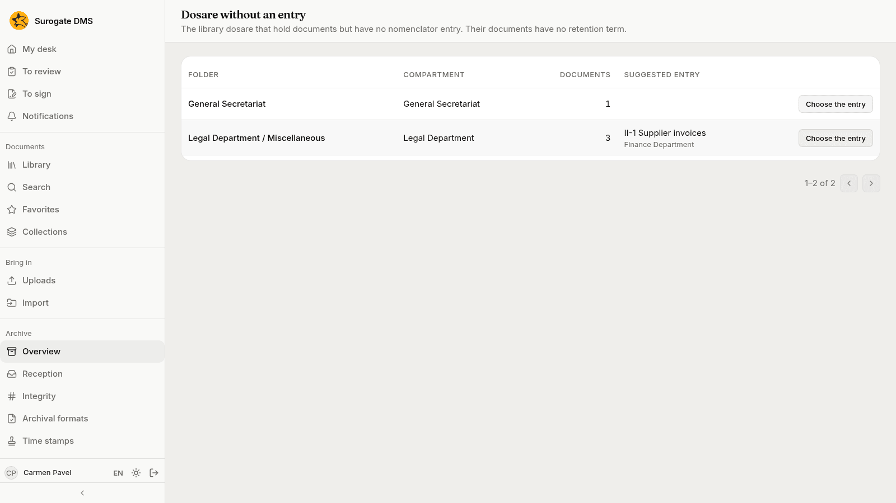

For archivists, administrators and auditors: the first page of the Archive section. It shows how long the institution's documents are kept, what waits for an archivist and which nomenclator is in force.

The **Archive** group appears in the sidebar for people whose roles let them consult the archive: the Archive administrator, the Electronic archivist and the Auditor. Each page in it appears only if you hold its own permission.

## The tiles

| Tile | What it shows |
|---|---|
| **Terms ending in {year}** | The dosare whose retention term ends on 31 December of this year, and their documents |
| **Integrity** | Whether the last check of the stored files found a mismatch, and when it ran |
| **Reception** | Documents ready to archive that failed their checks |
| **Selection** | Dosare whose term has ended and wait for a selection |
| **Handover** | Permanent dosare that can be handed over, and how many are due |
| **Archival formats** | Archived documents without a valid archival copy |
| **Time stamps** | The state of time stamping, or "Time stamping is not configured" |

## The cards

- **Terms ending, by year**: for each year, how many dosare end their term, and **Ended** for those already over.
- **Kept for**: how the documents divide between **Permanent** and **Temporary**, and those with no term yet.
- **Nomenclator in force**: the edition, its approval, the date it came into force and the number of entries.
- **Dosare without an entry**: library dosare that hold documents but have no nomenclator entry; their documents have no term yet.

## Dosare without an entry

**Fix them** opens the list of dosare that have no entry, with the number of documents in each and, where the DMS can tell, a suggested entry. **Choose the entry** opens the dialog where you set it.

