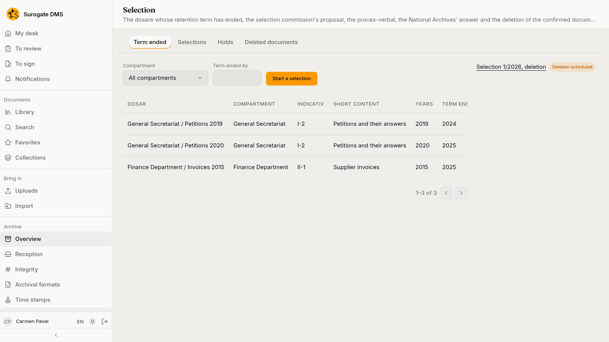
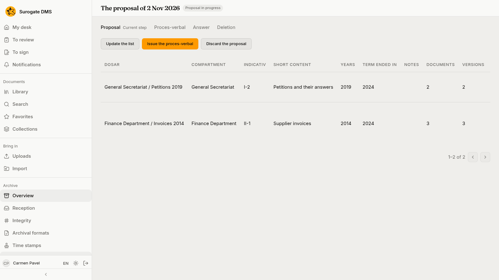
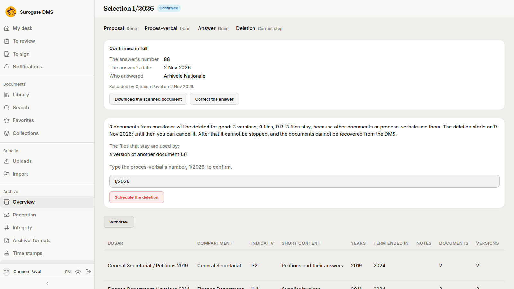
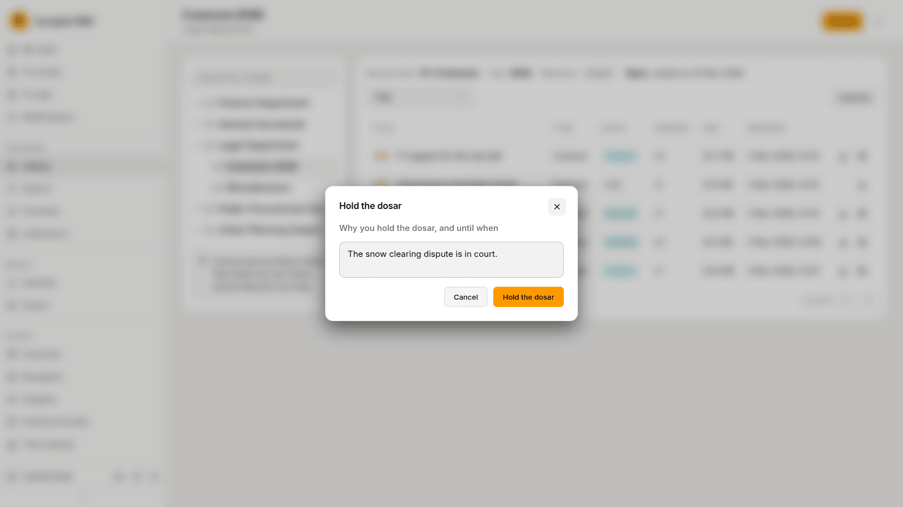

For archivists: finding the dosare whose retention term has ended, proposing them for elimination, the proces-verbal, the answer of the National Archives and the deletion. Nothing is deleted without the answer and a delay of seven days.

## Which dosare are listed

**Archive** › **Selection** has four tabs: **Term ended**, **Selections**, **Holds** and **Deleted documents**.

**Term ended** lists the dosare that are closed, kept for a number of years, whose term ended before this year, that hold a document, are not held and are not in another selection. You can filter by **Compartment** and by **Term ended by**.

## The four steps

**Start a selection** makes a proposal with the dosare listed. A selection has four steps, shown at the top of its page: **Proposal**, **Proces-verbal**, **Answer** and **Deletion**.

| Step | What you do |
|---|---|
| Proposal | Per dosar: **Leave out** (with a reason) or **Propose permanent keeping**. **Discard the proposal** drops it. |
| Proces-verbal | **Issue the proces-verbal**: the commission, its decision and the folder where it is filed. Then **Mark as sent** with the date and a registration number. |
| Answer | **Record the answer**: confirmed in full, in part or refused, with its number, date, who answered and the scan. |
| Deletion | For a confirmed answer, **Schedule the deletion**, after typing the number of the proces-verbal. |

Before you schedule the deletion the page says how many documents will be deleted for good, how many files stay because other documents, time stamps or procese-verbale use them, and which. The deletion starts after seven days; until then **Cancel the deletion** stops it. After that it cannot be stopped, and the documents cannot be recovered from the DMS.

## Holds

A held dosar is not proposed for elimination. **Hold the dosar**, on a row of the **Term ended** tab or on the folder's **Folder actions** menu, asks why you hold it and until when. The **Holds** tab lists the holds, and **Lift the hold** ends one.

## Deleted documents

The **Deleted documents** tab lists what a selection deleted: the document's title, when it was deleted and the proces-verbal that ordered it. The record of a deleted document stays: its folder, its retention term and its versions, without the files.
