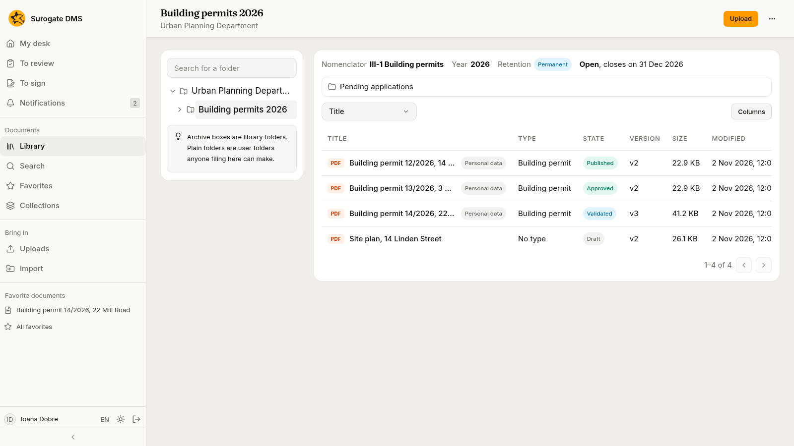
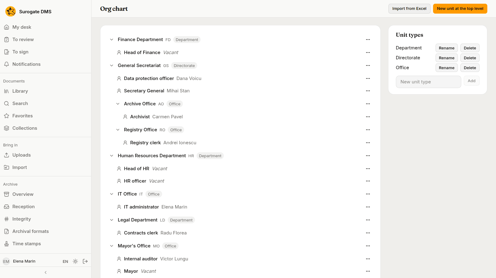
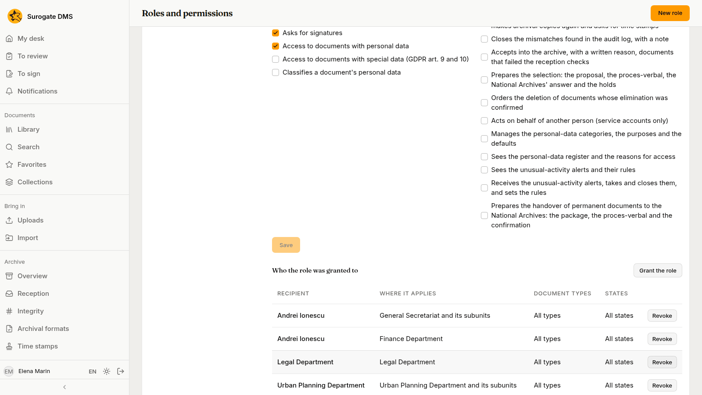
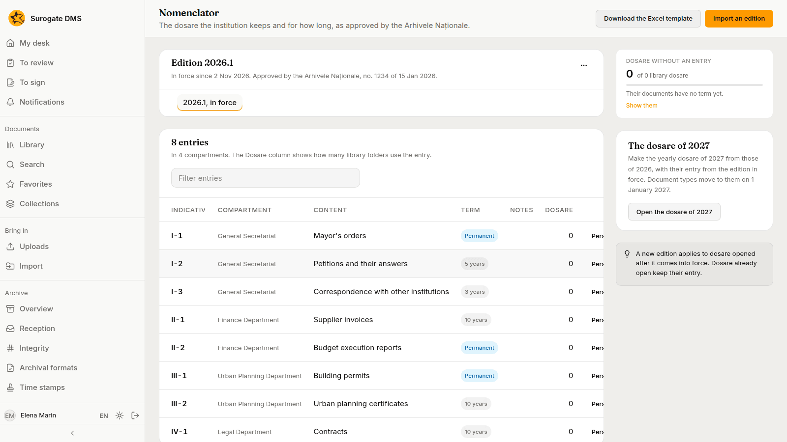
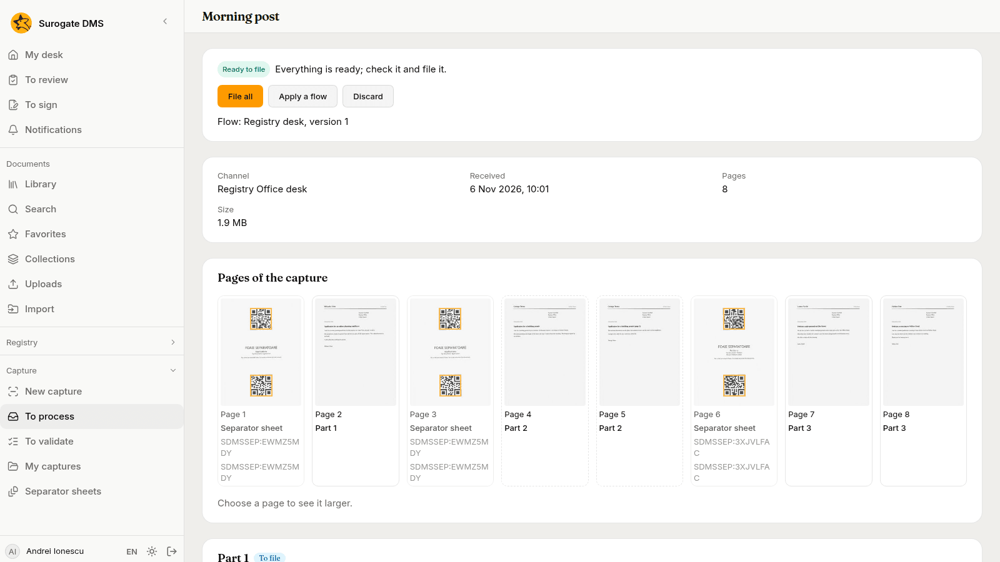

The words this guide uses, in the order a document meets them. Each term has a row in the [Glossary](/dms/reference/glossary/).

## Documents and versions

A **document** is a file with a title, a type, metadata and a state. Uploading a new file to a document makes a new **version**; older versions stay and you can go back to one. See [The document page](/dms/work/document-page/) and [Viewing, editing and versions](/dms/work/versions/).

## Folders

- A **library folder** belongs to a unit of the institution and is made by an administrator.
- A **dosar** is a library folder that carries an entry of the nomenclator, a year and a closing rule. The entry says how long its documents are kept.
- A **user folder** is a plain folder that anyone filing in a library folder can make inside it.
- A **virtual folder** is a saved search shown in the sidebar.

See [The library](/dms/work/library/) and [Folders and dosare](/dms/admin/folders/).

## Types and metadata

A **document type**, such as Contract or Building permit, lists the fields a document of that type has, the folder it is filed in by default and its personal-data defaults. The values a person fills in are the document's **metadata**. See [Document types](/dms/admin/document-types/).

## Units, positions, roles and grants

The **org chart** lists **units** (a directorate, a department, an office), the **positions** in each unit and the **holder** of each position. A **role** is a set of permissions. A **grant** gives a role to a person, a position or a unit, for the whole institution or for one unit. What you may do is the sum of your grants. See [The org chart](/dms/admin/org-chart/) and [Roles and permissions](/dms/admin/roles/).

## The five states

A document is **Draft**, **Validated**, **Approved**, **Published** or **Archived**. Each step has its own button and its own permission. An archived document is read only. See [The life of a document](/dms/work/lifecycle/).

## Retention and the nomenclator

The **nomenclator** is the list, approved by the National Archives, of the dosare an institution keeps and for how long. An **edition** is one approved version of it: it is a draft until an administrator puts it in force, and it is superseded by the next one. Each **entry** has an **indicativ** (its code), a compartment (the unit it belongs to), a short content and a **term**: a number of years or **Permanent**. See [The nomenclator](/dms/admin/nomenclator/).

## Reception and archival copies

When a file arrives, the DMS checks it and, where it can, makes a copy in a format meant to last. A document whose checks fail shows **Not accepted** until an archivist accepts it with a reason. Both are on the **Archive** tab of the document.

## Selection and handover

When the term of a closed dosar has ended, an archivist starts a **selection**: a commission proposes the dosare to eliminate, a **proces-verbal** (plural **procese-verbale**, the signed record of a meeting or an act) is issued, the National Archives answer, and the deletion runs after a delay. Dosare kept permanently are **handed over** to the National Archives instead. See [Selection and deletion](/dms/archive/selection/) and [Handover](/dms/archive/handover/).

## Registrations

The institution's **registry** gives the documents that come in, go out or stay inside a number. A **registration** takes a number in the **main register** and, when it is made in a **service register** kept by a unit, a second one. It names the **correspondent** and the units it concerns, holds the documents, and lends them for reading to those units. The registrations of one exchange form a **thread**.

See [Registering documents](/dms/work/registry/) and [Registers and address lists](/dms/admin/registers/).

## Captures

A **capture** is a batch of pages on its way to becoming documents: a scanned stack, photographs, a PDF, the attachments of a message or a printout. It comes in through a **channel**: a web page, a scanner's watched folder, a mailbox or a virtual printer. The DMS cuts the pages into **parts**, and each part becomes one document.

A **separator sheet** you put between two documents cuts the stack, and a **label** of a registration starts a part linked to that registration. A **capture template** describes one kind of form: where each value lies, how it is read and which **checks** it must pass. A part whose data fail a check is **not conforming at capture**, and a document filed that way carries a mark until someone checks it.

A **capture flow** is the line of steps a channel's captures run, with **rules** that send each part to a folder, a type and a title. A capture waits for a person only when something needs one: a value to check, a folder to choose.

See [Capturing documents](/dms/work/capture/), [Processing captures](/dms/work/capture-inbox/), [Capture channels](/dms/admin/capture-channels/), [Capture templates](/dms/admin/capture-templates/), [Capture flows](/dms/admin/capture-flows/) and the [Glossary](/dms/reference/glossary/).

## Personal data

Some documents hold personal data. They carry a **Personal data** pill; some categories (health data, for example) ask you for a **reason for access** before they open. See [Personal data](/dms/work/personal-data/).
