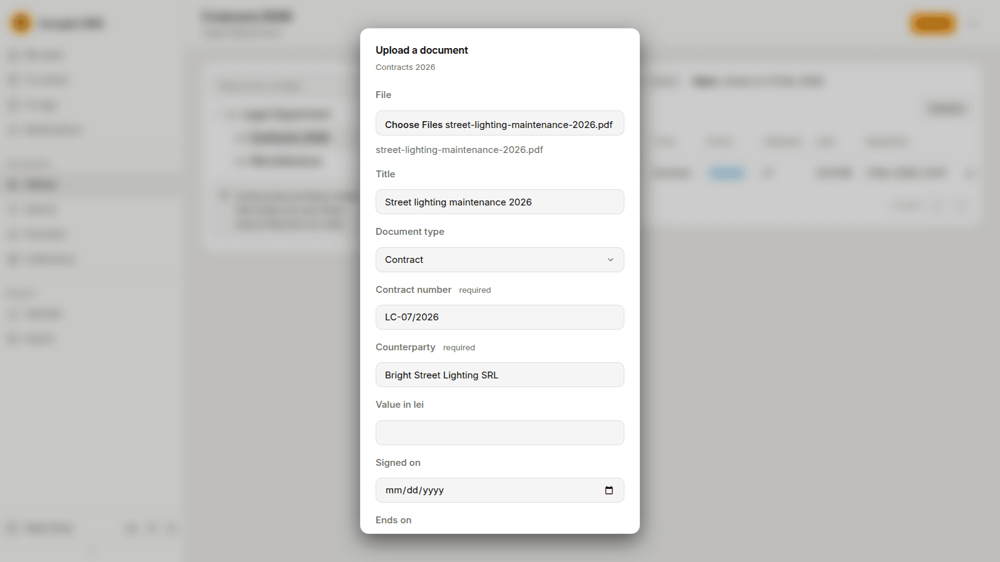
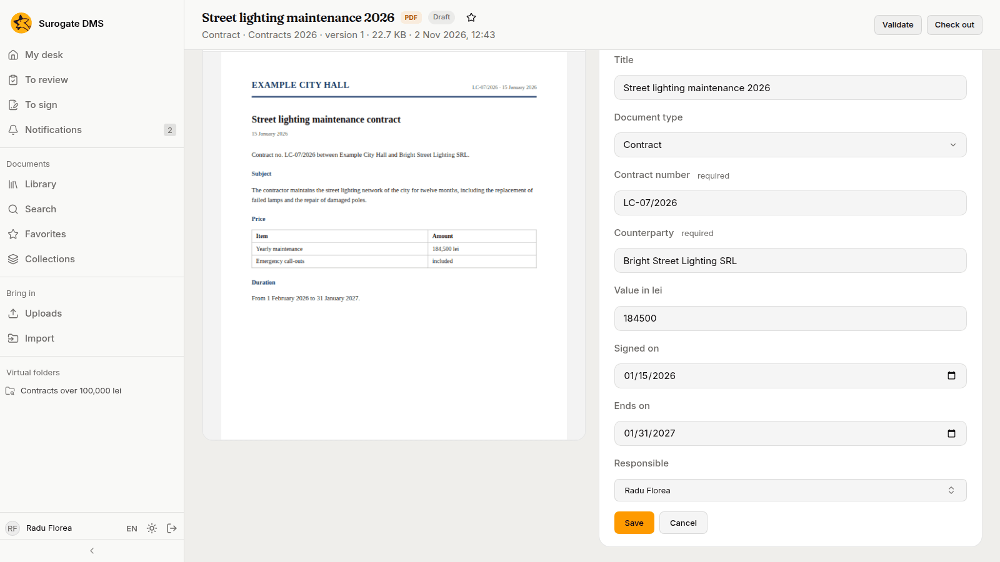
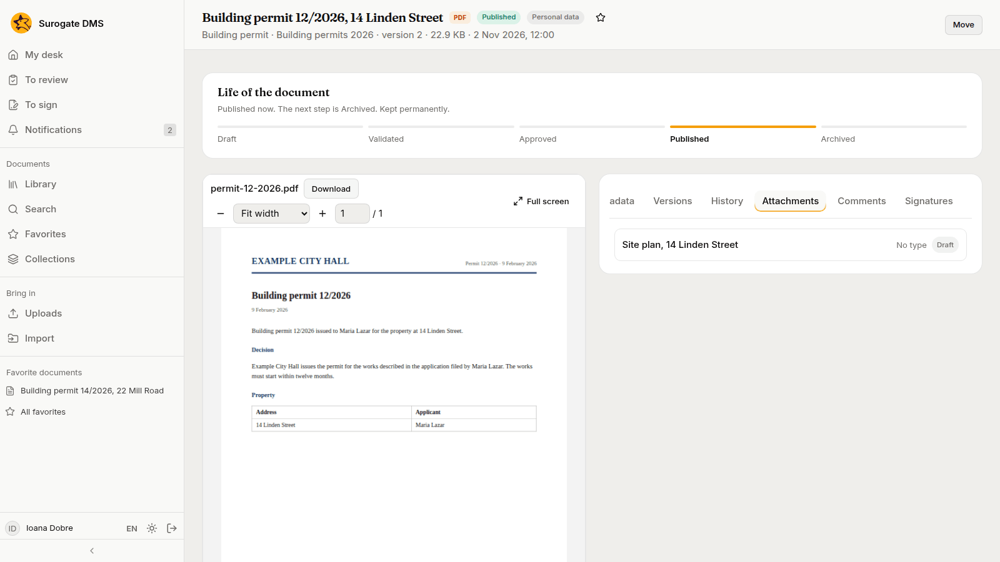
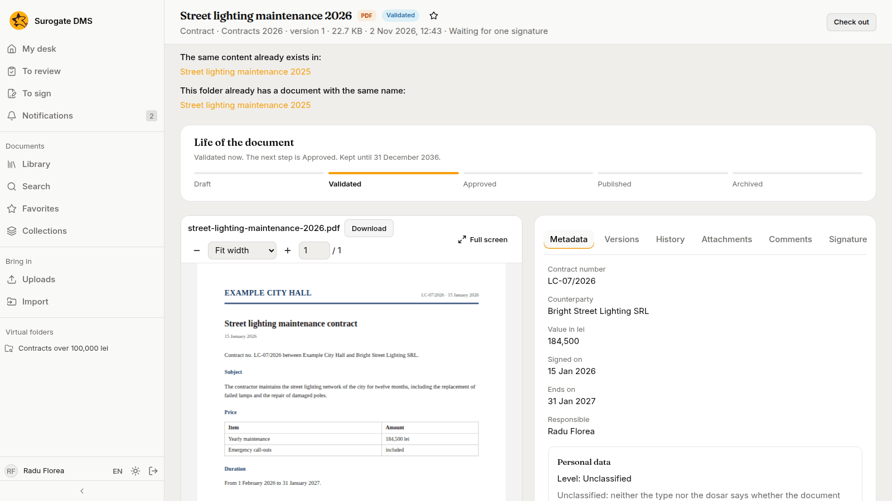
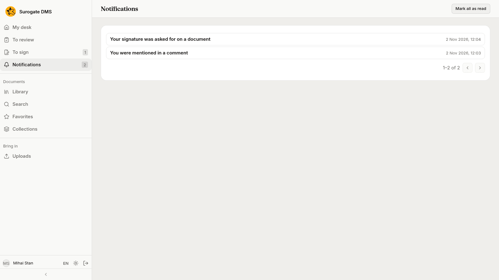
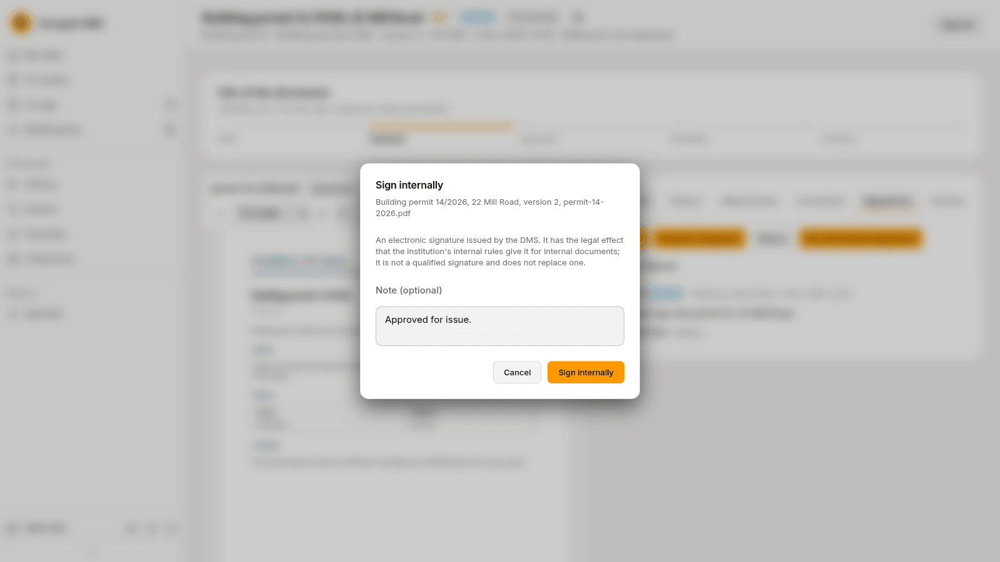
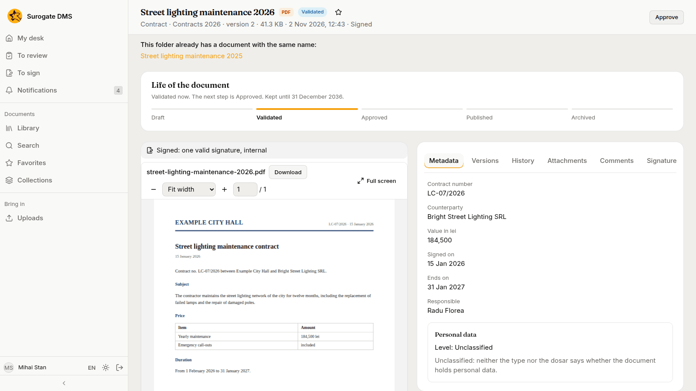
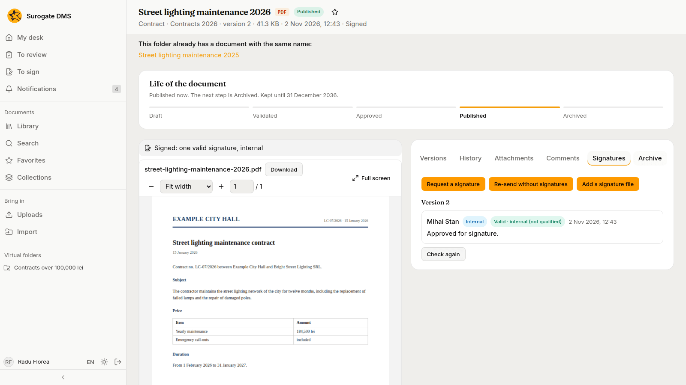

Radu Florea files the street-lighting maintenance contract, attaches its technical annex, validates it and asks the Secretary General to sign it. The Secretary General signs, approves and publishes it. The example is for staff.

The pictures were taken in a demo city hall, Example City Hall, with made-up people and documents.

## What the example does

| Who | Does what |
|---|---|
| Radu Florea, contracts clerk in the Legal Department | Uploads the contract into **Contracts 2026**, fills in its metadata, attaches the annex, validates it and asks for a signature |
| Mihai Stan, Secretary General | Signs the contract internally, approves it and publishes it |

The DMS has no approval workflow of its own. (A flow that spans several people and systems can run in Keel: see [Workflows and cases with Keel](/dms/work/workflows/).) The states, the signing request and the permissions carry the approval: Radu may validate, and only a person who holds the permissions to approve and publish, here Mihai, may take the document further.

## 1. File the contract

Radu opens **Library** › **Legal Department** › **Contracts 2026** and presses **Upload**. He chooses the file, gives it a title, chooses the type **Contract** and fills in the two required fields, **Contract number** and **Counterparty**.

## 2. Fill in the metadata

On the **Metadata** tab Radu presses **Edit** and fills in the value, the dates and the person responsible, then presses **Save**. A **Person** field offers the people of your institution.

## 3. Attach the annex

The technical annex is a document of its own, filed in the same folder and validated. On the contract's **Attachments** tab Radu attaches it. A document takes attachments only while it is a draft or validated, so Radu attaches the annex before the contract is approved. See [The document page](/dms/work/document-page/).

## 4. Validate and ask for a signature

Radu validates the contract and, on the **Signatures** tab, presses **Request a signature** for Mihai, with **Internal allowed**. The page now says "Waiting for one signature".

The DMS may also tell Radu that a document with the same name or the same content exists in the folder. It is a notice; it does not stop him.

## 5. Mihai signs

Mihai finds the request in **Notifications** and on **To sign**, opens the contract, chooses **Sign** › **Internal** and presses **Sign internally**.

## 6. Approve and publish

On the signed contract the button **Approve** is offered to Mihai. After it he can **Publish** it.

Radu sees the contract Published, with its signature.

## What to remember

- A staff member with **Standard user** validates; approving and publishing need their own permissions.
- A signing request asks named people; they sign internally, or with a token when the request allows it.
- See [Signing](/dms/work/signing/) and [The life of a document](/dms/work/lifecycle/).
