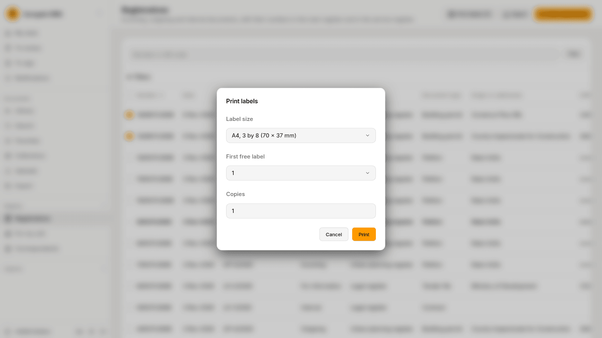
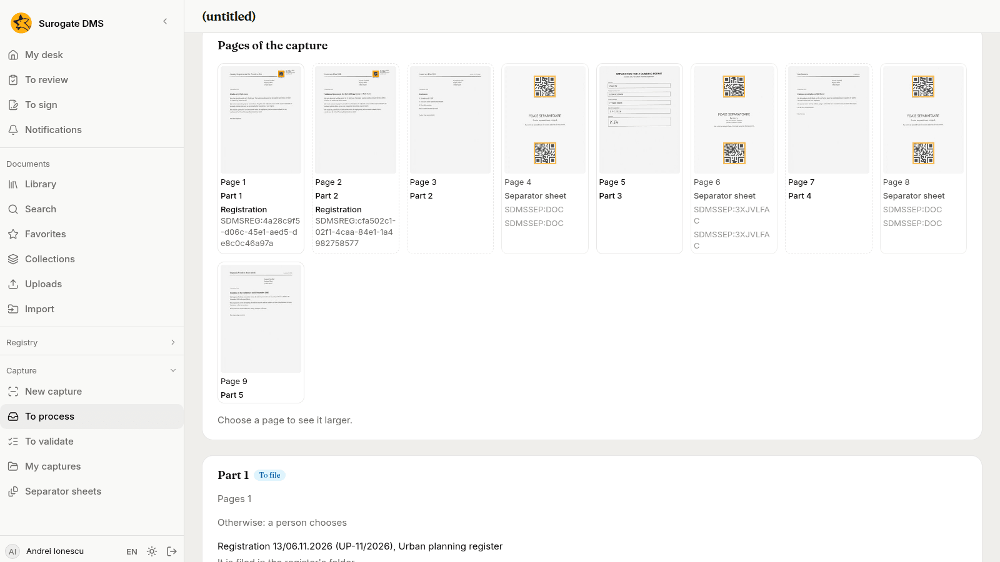
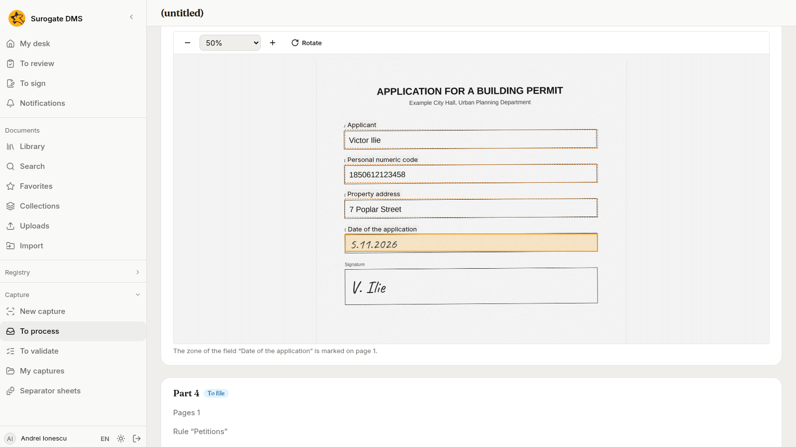
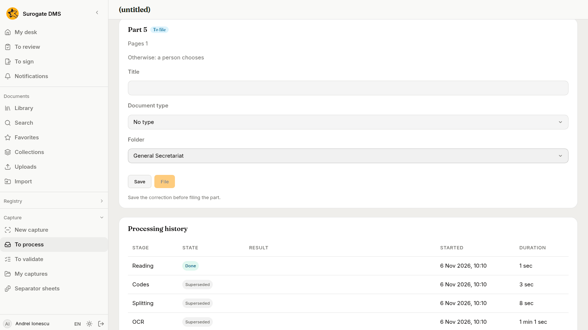
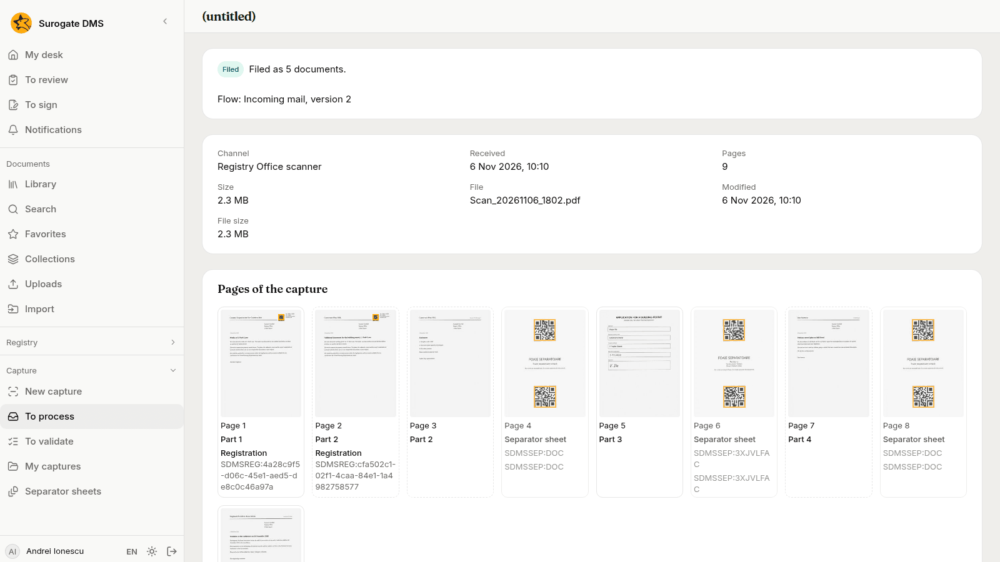
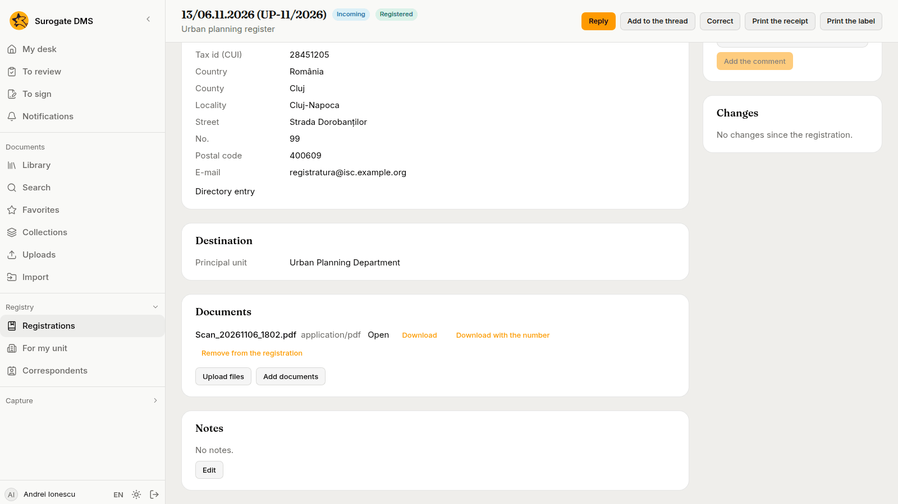
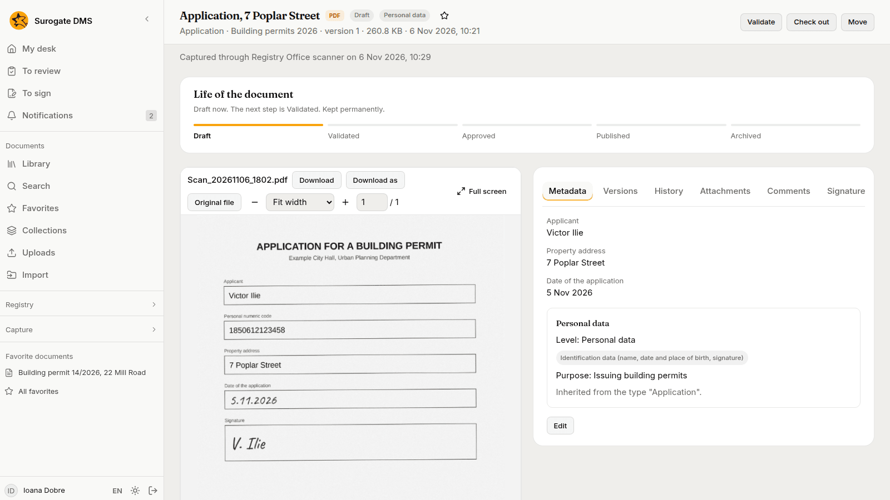

Andrei Ionescu scans two registered letters, a filled form, a petition and an invitation in one stack. The DMS cuts the stack, reads the form, and a flow files each part by its rules. The example is for staff.

The pictures were taken in a demo city hall, Example City Hall, with made-up people and documents.

## What the example does

| Who | Does what |
|---|---|
| Andrei Ionescu, registry clerk | Prints the labels of two registered letters, puts the stack together with separator sheets, scans it, checks the date written by hand on a form, fills in the data of a petition and chooses a folder for another part, and files the petition himself |
| The scanner of the Registry Office | Writes the scan into its shared folder, where the DMS takes it |
| The flow Incoming mail, switched on by Elena Marin, the administrator | Cuts the stack by its codes, reads the form with a template, and files each part by its rules |
| Ioana Dobre, urban planning inspector | Opens the application in **Building permits 2026** |

Elena has already made the channel **Registry Office scanner**, the template **Building permit application** and the flow **Incoming mail**. See [Capture channels](/dms/admin/capture-channels/), [Capture templates](/dms/admin/capture-templates/) and [Capture flows](/dms/admin/capture-flows/). [Quickstart for capture](/dms/quickstart-capture/) shows how a channel and a flow are made.

## 1. Register the letters and print their labels

Two letters arrived on paper: one from the County Inspectorate for Construction, one from the company Construct Plus. Andrei registers both as incoming mail in the Urban planning register, as the [Registry](/dms/work/registry/) pages describe. The first is registered as 13/06.11.2026 in the main register and UP-11/2026 in the Urban planning register. The second is registered as UP-12/2026 there.

In **Registry** › **Registrations**, Andrei ticks both rows and chooses **Print labels (2)**. He chooses the **Label size** **A4, 3 by 8 (70 x 37 mm)**, leaves **First free label** at 1 and **Copies** at 1, and chooses **Print**. He prints the PDF at full size.

See [Print labels](/dms/work/registry-lists/#print-labels).

## 2. Put the stack together

Andrei sticks a label on the first page of each letter. He has printed two plain separator sheets and one **Petitions** sheet, as the [quickstart](/dms/quickstart-capture/) does for its profiles. Then he puts the pages in this order:

1. the Inspectorate's letter, with its label, one page;
2. Construct Plus's letter, with its label on the first page, and its second page, which lists the enclosures;
3. a **Plain separator sheet**;
4. the filled application form of Victor Ilie;
5. the **Petitions** sheet;
6. a petition about the street lights on Mill Road;
7. a plain separator sheet;
8. the invitation to a conference.

The stack has nine pages. A label starts a part for its letter and links it to the registration. The plain sheets cut the stack where no profile is needed: the document that follows is read and filed as the flow says. The **Petitions** sheet also says that the document after it is a petition.

## 3. The scanner sends the stack

Andrei puts the stack in the scanner and scans it to one PDF. The scanner writes the file into its folder on the shared drive. When the DMS next reads the folder, it takes the file. The capture is in **Capture** › **To process**, with the channel **Registry Office scanner**, nine pages and no title, and it goes through its steps.

## 4. The codes cut the stack

Andrei opens the capture. **Pages of the capture** shows what the DMS read on each page.

- Pages 1 and 2 hold a **Registration**. Each starts a part, and the DMS links it to its registration. Part 1 says "Registration 13/06.11.2026 (UP-11/2026), Urban planning register" and "It is filed in the register's folder."
- Page 3 has no code. It belongs to part 2, because nothing starts a new part there.
- Pages 4, 6 and 8 are marked **Separator sheet**. They are left out of the documents.
- Page 5, the form, is part 3. Page 7, the petition, is part 4. Page 9, the invitation, is part 5.

## 5. Check the handwritten date

The capture stops: **Needs attention**, with the sentence "Check the data read from part 3." The form carries a date written by hand, and a person always checks a handwritten field. Andrei opens **Capture** › **To validate** and chooses **Open** on the capture.

Part 3 shows **Template: Building permit application, version 4** and the fields read from the form: the applicant Victor Ilie, the personal numeric code, the property address 7 Poplar Street and the **Date of the application**, read by machine. Andrei chooses **Show the zone** beside the date. The page opens with the zone outlined, and he compares the date with what is written there.

The machine read it right. A part with a handwritten field waits until a person has typed the field, so Andrei types the date over, writing it as 05.11.2026 instead of 5.11.2026, and leaves the box. Then he chooses **Try again** on the capture.

## 6. Choose a folder for the invitation

The capture stops again, this time with "No rule of the flow Incoming mail fits part 5; choose the folder." The rules of the flow know the form and the petition. They do not know the invitation, so **Otherwise** sends it to a person. Part 5 shows **Otherwise: a person chooses**.

Andrei chooses the **Folder** **General Secretariat** on part 5 and chooses **Save**. The page says "Save the correction before filing the part." until he has saved. Then he chooses **Try again** on the capture.

## 7. Fill in what the petition needs

The flow now tries to file the parts, and part 4 stops it: the capture says "Part 4 could not be filed" and gives the reason. The rule **Petitions** chose the folder and the title of the petition, but a rule here gives no data, and the type **Petition** asks for the petitioner and the date it was received. On part 4, Andrei fills in the **Petitioner**, Dan Sorescu, and **Received on**, 5 Nov 2026, chooses **Save**, and then **File**, which files that part as him. He chooses **Try again** on the capture so that the flow files the rest.

## 8. The flow files the rest

The flow files the other parts by its rules, as Elena, who switched it on. The page says "Filed as 5 documents."

- Parts 1 and 2, the two letters, are filed in the folder of the Urban planning register. They are attached to their registrations too: the registration 13/06.11.2026 (UP-11/2026) lists the scanned file among its **Documents**.
- Part 3, the form, is taken by the rule **Building permit applications** and filed in **Building permits 2026** of the Urban Planning Department.
- Part 4, the petition, was taken by the rule **Petitions**, which chose the folder of the type, **Petitions 2026**. Andrei filed it there.
- Part 5, the invitation, is filed in **General Secretariat**, the folder Andrei chose.

## 9. What Ioana sees

Ioana Dobre opens **Building permits 2026**. The application is there, titled "Application, 7 Poplar Street", after the property address on the form. Its header says it was captured through Registry Office scanner. Its metadata holds the applicant Victor Ilie, the property address and the date of the application, 5 Nov 2026. The type **Application** gives it its personal data level, category and purpose.

## 10. With Keel

When your institution has Keel, a **Keel** step at the end of the flow starts a Keel process for each document the flow files, for example the review of an application by the department. The step sends Keel only the identifiers of the document, its folder, the capture and the flow. See [Capture flows](/dms/admin/capture-flows/#the-keel-step) and [The Keel integration](/dms/admin/keel-integration/). In this demo Keel is not connected, so no Keel process starts.

## What to take from the example

- Labels and separator sheets let one scan hold several documents. The DMS cuts them, and a person does not have to.
- A label links a letter to its registration and files it in the register's folder.
- A template reads the form, and a person checks what a machine read from handwriting.
- Rules file what they know. A part no rule takes waits for a person to choose its folder, data a rule cannot give is filled in by a person, and the flow goes on from there.
