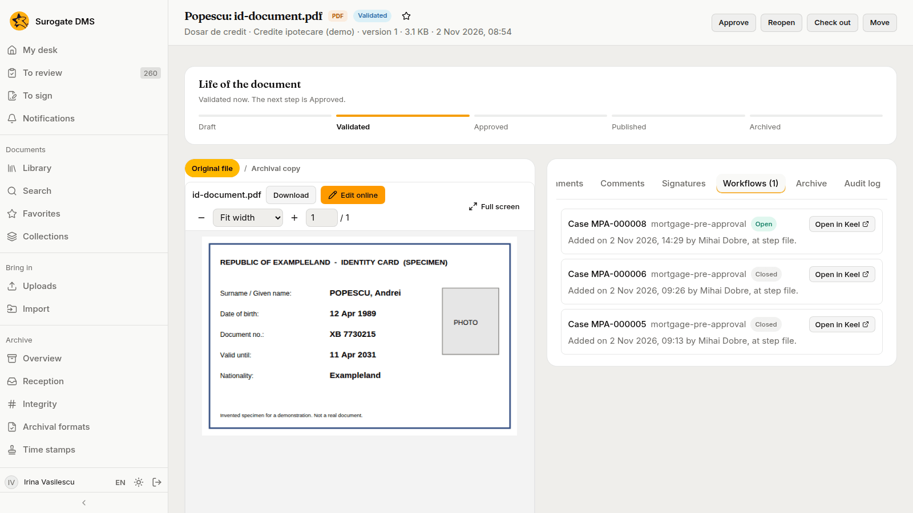
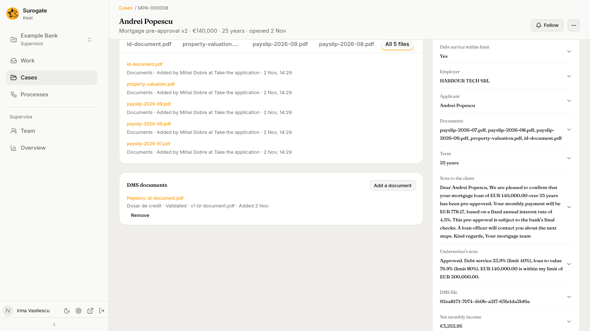
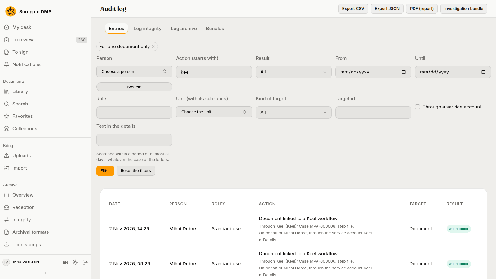
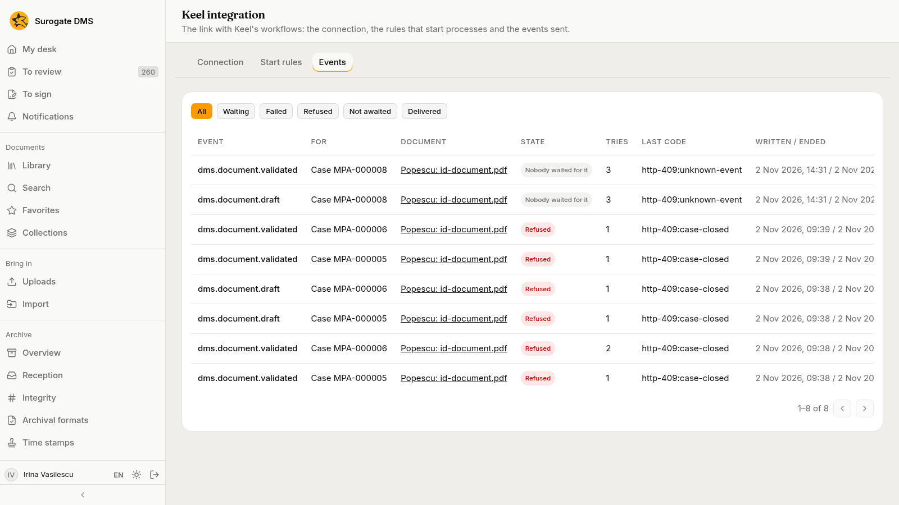
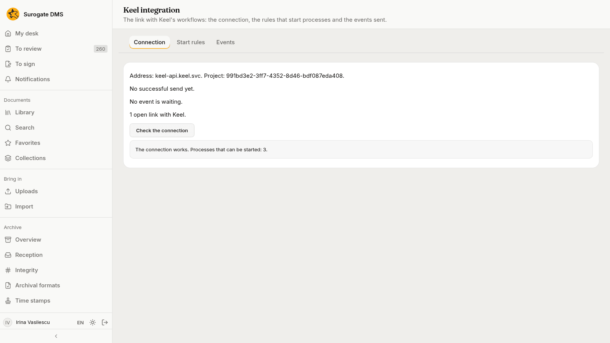

A loan officer takes a mortgage application in Keel, and the flow links the applicant's identity document, which is in the DMS, to the case. The supervisor then follows the document from the DMS.

The pictures were taken in a demo bank, Example Bank, with made-up people and documents. The case type is the one of [Mortgage pre-approval](/keel/examples/mortgage-pre-approval/), which shows the Keel side in full.

## What the example does

| Who | Does what |
|---|---|
| Mihai Dobre, loan officer | Takes the application in Keel: the applicant, the amount, the files, and the identity document that is already in the DMS |
| The flow in Keel | Links the document to the case, in the step **file**, acting for Mihai |
| Irina Vasilescu, supervisor and administrator of the DMS | Follows the document from the DMS and checks the connection |

The DMS keeps the document, its state and its history. Keel keeps the case. The link between them is a row on the document and nothing more: no file is copied in either direction.

## 1. The flow links the document

When Mihai completes the first step in Keel, the flow links the identity document of the DMS to the case MPA-000008. The flow does this **for Mihai**: it has his access to the document and no more. Linking needs the right to read the document, so if Mihai could not read it, the flow would be refused.

## 2. The document shows its case

Irina opens the document in the DMS and the tab **Workflows**. The case MPA-000008 is **Open** and was added by Mihai Dobre at the step **file**. Two earlier cases that held the same document are **Closed**: they stay on the list and receive nothing.

**Open in Keel** on a row opens that case in Keel, in a new browser tab. There the case page has a section **DMS documents** that lists the documents of the DMS that the case holds, with the state and the version of each. Keel lists the ones the person may read.

## 3. The audit log names the flow

The audit log of the DMS records the link as Mihai's, with the line "Through Keel" that names the case and the step. People who may consult the log find such entries with the action filter **keel**, or with the box **Through a service account**. The same line is on every later action a flow takes for a person, so the log always says who the action is for and which flow did it.

## 4. The DMS tells the case what happens

Irina reopens the document to correct it and validates it again. The DMS sends each change to the open case. The case waits for neither, so Keel answers that nobody waited for them, and the **Events** tab of **Keel integration** shows the two events as **Nobody waited for it**. That is normal: a flow takes only the events it needs. The six older events on the list are **Refused**: they went to two cases that Keel had already closed, before the DMS learned of it.

An event that **Failed** is the one to look at. Press **Send again** once the cause is gone.

## 5. The connection is healthy

On the **Connection** tab Irina presses **Check the connection**. Keel answers that the connection works and that three processes can be started.

When the case ends, its link closes by itself the next time the DMS asks Keel, and the row on the document says **Closed**.

## What to take from the example

- A flow acts for a person and is held to that person's access.
- The document page shows every case or process that holds the document.
- The audit log says "Through Keel" with the case and the step.
- **Keel integration** shows whether the DMS and Keel are talking, and what has not reached Keel.

To start a process by itself when a document arrives, see [Keel integration](/dms/admin/keel-integration/#the-start-rules-tab).
