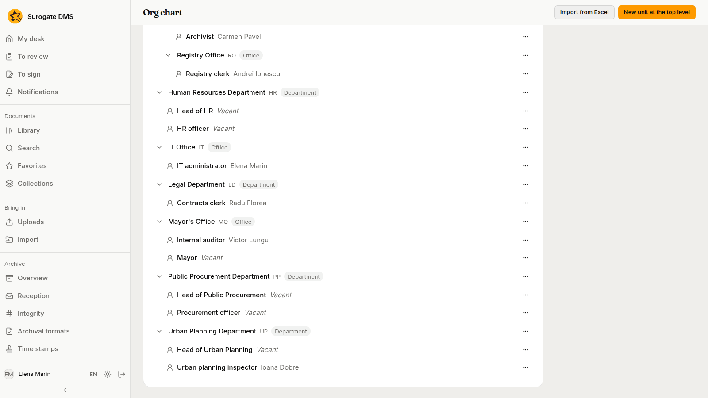
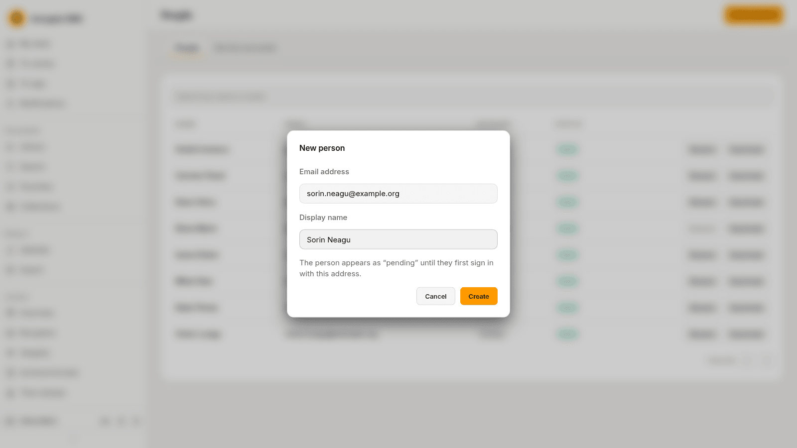
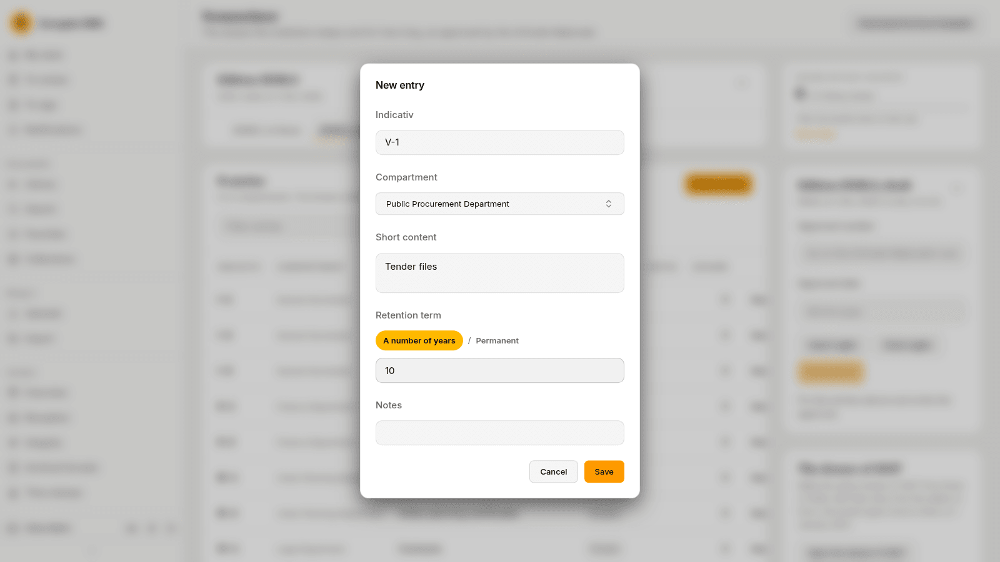
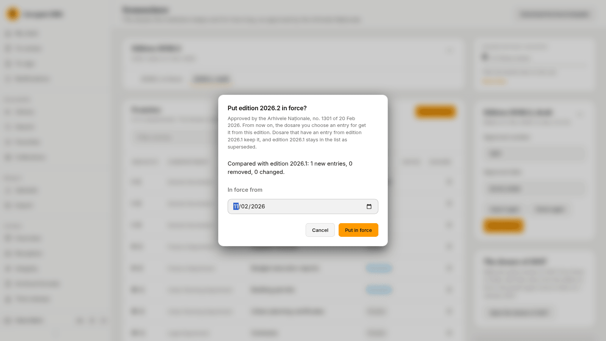
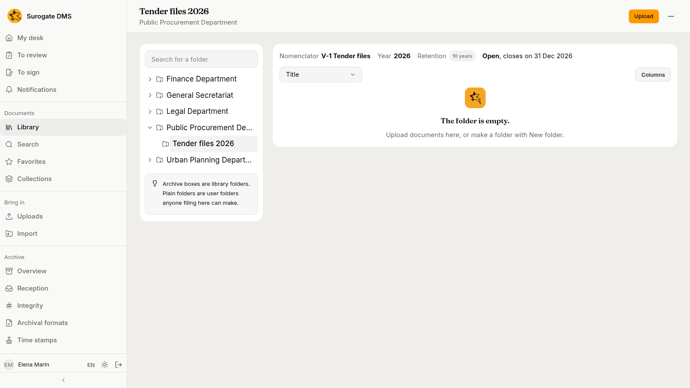
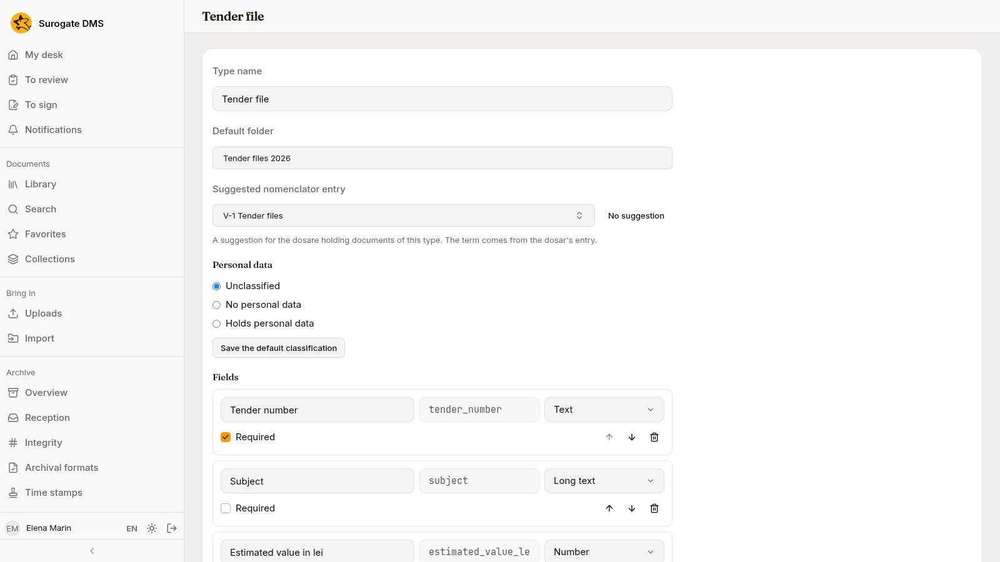
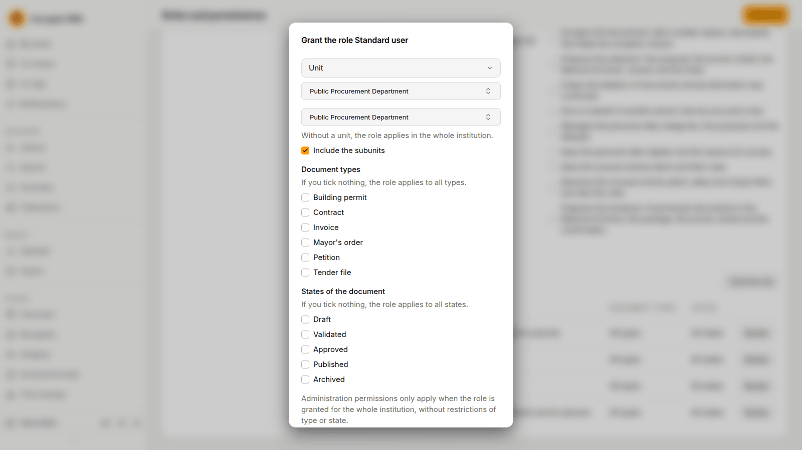
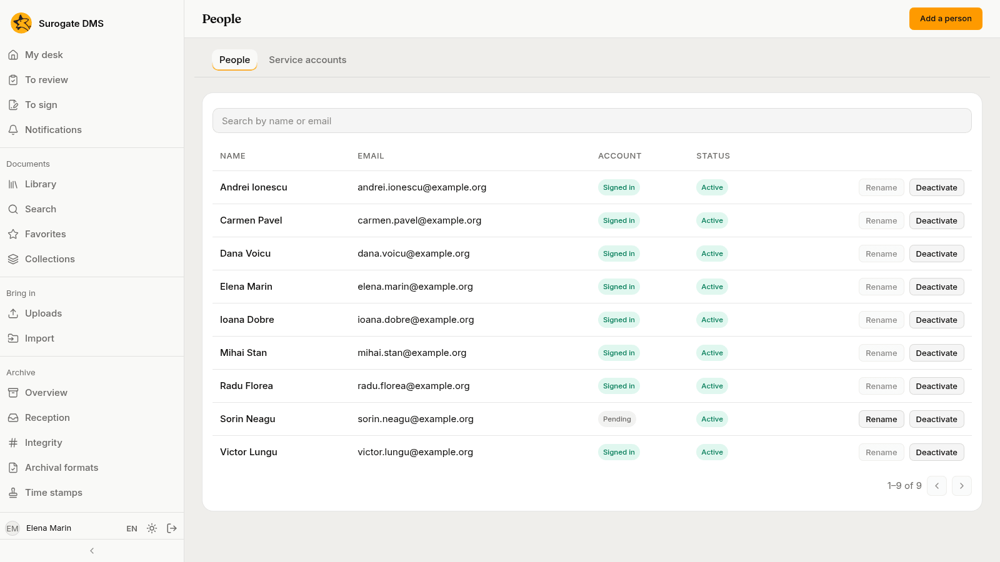

Elena Marin, the administrator, adds the Public Procurement Department: its unit and positions, a new person, a nomenclator edition with the entry for tender files, a dosar, a document type and a grant. The example is for administrators.

The pictures were taken in a demo city hall, Example City Hall, with made-up people and documents.

## 1. The unit and its positions

On **Org chart** Elena adds the unit **Public Procurement Department** at the top level, with the positions **Head of Public Procurement** and **Procurement officer**.

## 2. The new person

On **People** she presses **Add a person** for Sorin Neagu. He appears as "Pending" until he first signs in, and she makes him the holder of **Procurement officer**.

## 3. The nomenclator entry for tender files

The nomenclator in force has no entry for tender files. On **Nomenclator** Elena opens **Edition actions** › **Copy into a new edition** and names the new edition 2026.2. In the draft she presses **Add an entry** and types the entry: the indicativ **V-1**, the compartment **Public Procurement Department**, the short content "Tender files" and a term of ten years.

She fills in the **Approval number** and **Approval date** of the amendment and presses **Put in force**. The confirmation compares the edition with the one in force: one new entry, none removed, none changed. The dosare that already have an entry keep it.

## 4. The dosar

She makes a root folder for the unit with a dosar **Tender files 2026**, entry **V-1**, year 2026.

## 5. The document type

On **Document types** she makes the type **Tender file** with four fields and the dosar as its default folder.

## 6. The grant

On **Roles and permissions** she grants **Standard user** to the **Unit** Public Procurement Department, for that unit. Everyone who holds a position in it, Sorin included, can now file and read in the unit's folders.

## 7. Check the people

When Sorin has signed in once, his status turns from "Pending" to "Signed in".

## What to remember

- An amended nomenclator is a new edition; the dosare already opened keep their entry.
- A grant to a unit reaches the people who hold a position in it.
- See [The org chart](/dms/admin/org-chart/), [The nomenclator](/dms/admin/nomenclator/), [Document types](/dms/admin/document-types/) and [Roles and permissions](/dms/admin/roles/).
