Carmen Pavel, an archivist, closes an old dosar, selects the dosare whose term has ended, issues the proces-verbal and schedules the deletion. She then hands a permanent dosar over to the National Archives. The example is for archivists.

The pictures were taken in a demo city hall, Example City Hall, with made-up people and documents.

## Part 1: select dosare for elimination

### 1. Close the dosar

A dosar that spans several years is closed by hand. Carmen opens the dosar **Invoices 2014**, chooses **Folder actions** › **Close the dosar** and types the **Year in which the dosar ends**, 2014. From then on the dosar takes in and gives out no documents, and its retention term runs from the year after.

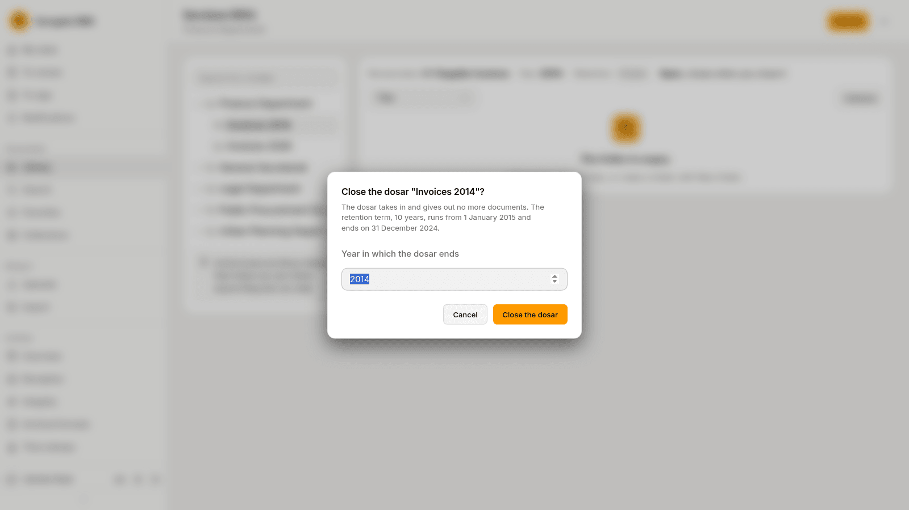

### 2. Find the dosare whose term has ended

Under **Archive** › **Selection**, the **Term ended** tab lists the closed dosare whose retention term is over. The picture lists three dosare: Petitions 2019 and 2020, and Invoices 2015.

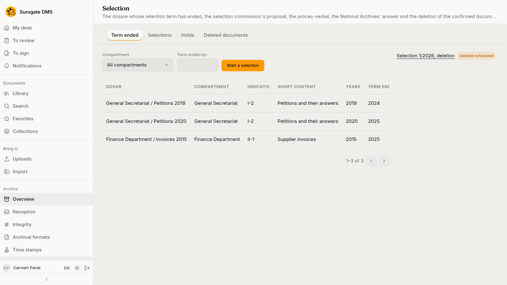

Pressing **Start a selection** makes a proposal that holds the dosare listed.

### 3. Work the proposal

The proposal lists each dosar with its entry, years, term and size. For each one Carmen can **Leave out** (the commission keeps it for now, with a reason) or **Propose permanent keeping**. She leaves Petitions 2019 out, because the petitions are still needed for an appeal.

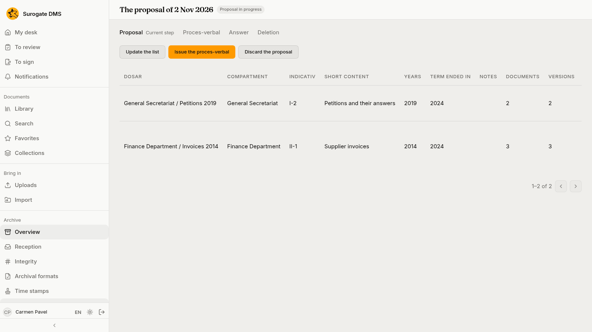

### 4. Issue the proces-verbal

**Issue the proces-verbal** asks for the decision that appointed the commission, the day the commission met, its members with their roles, who approves the proposal (optional) and the folder where the proces-verbal is filed. Once it is issued the proposal cannot change.

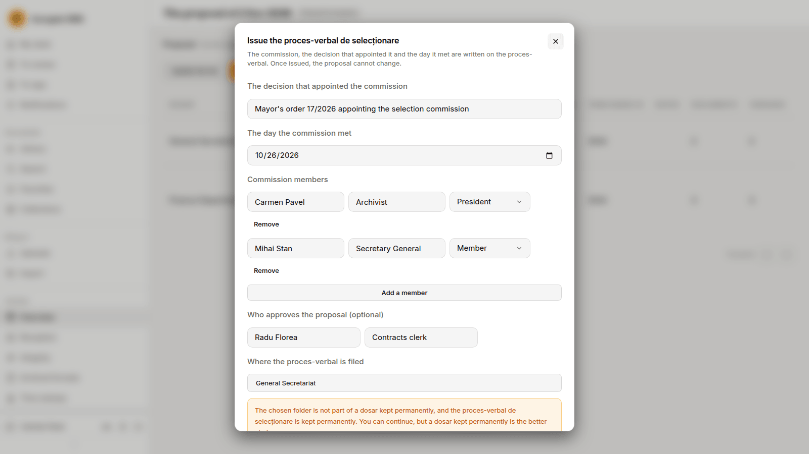

### 5. Send it and record the answer

**Mark as sent** records the day the proces-verbal went to the National Archives and a registration number. When the answer comes, **Record the answer**: confirmed in full, in part or refused, the answer's number and date, who answered and the scanned document.

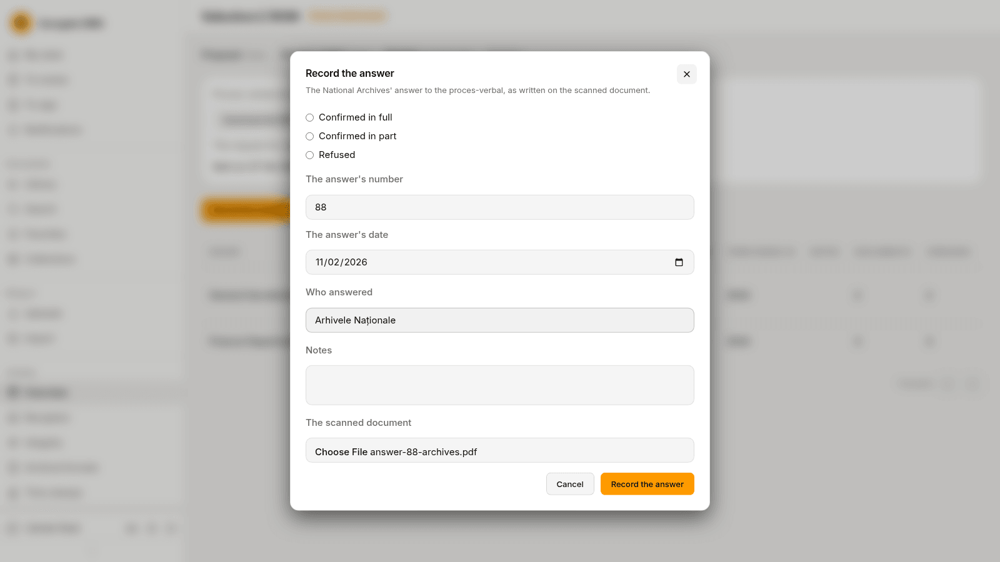

### 6. Schedule the deletion

For a confirmed answer the page says how many documents will be deleted for good and asks you to type the proces-verbal's number. **Schedule the deletion** starts a delay of seven days, during which **Cancel the deletion** is available.

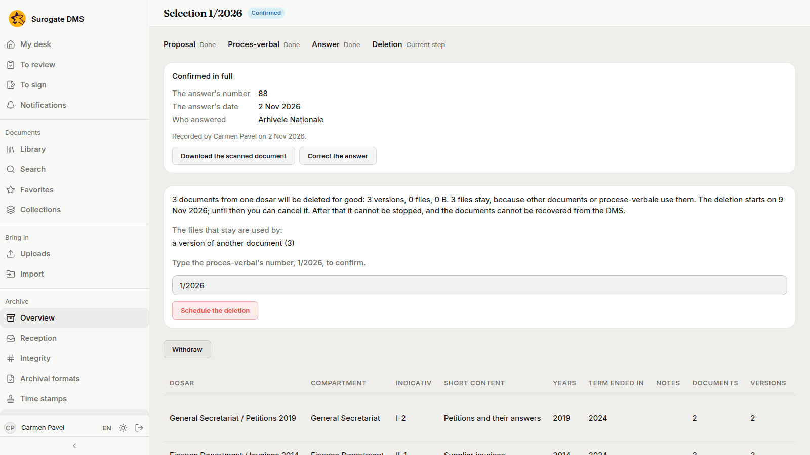

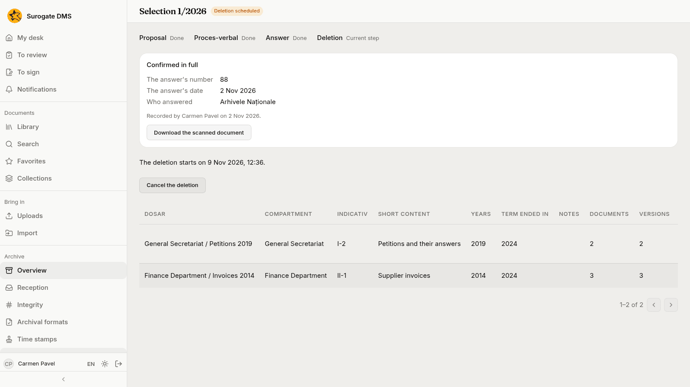

## Part 2: hand a permanent dosar over

### 7. Start the handover

Under **Archive** › **Handover**, the **Permanent dosare** tab lists the permanent dosare that can be handed over, with the year their handover is due.

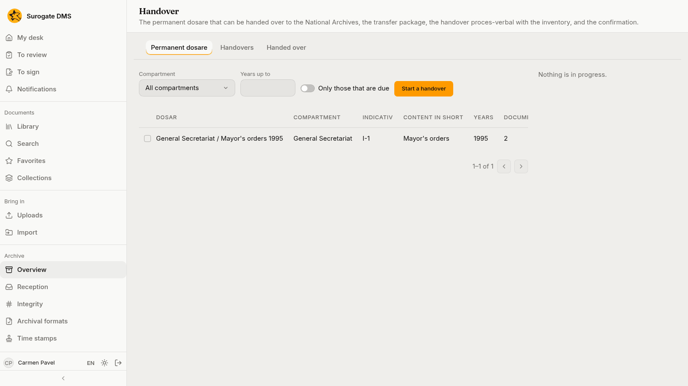

Carmen ticks the dosar and presses **Start a handover**. The proposal checks the dosare and tells her what to know before the handover.

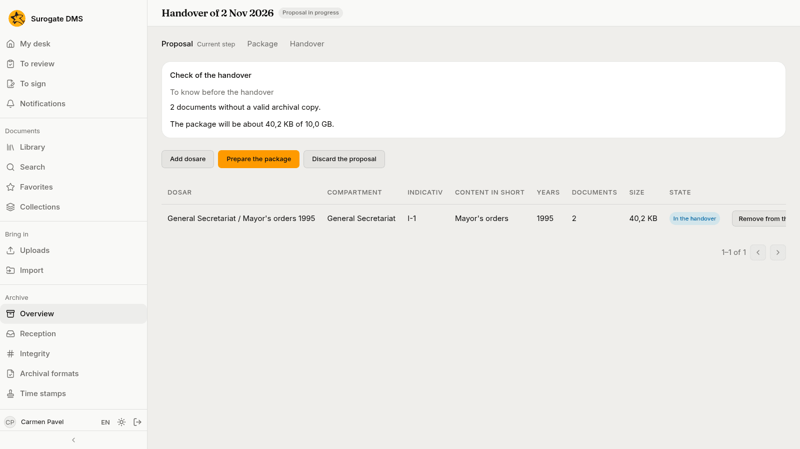

### 8. Prepare the package

**Prepare the package** asks who hands over, the recipient and who approves. The DMS draws up the handover proces-verbal with the inventory and makes the transfer package; this takes from a few minutes to a few hours, and you can close the page.

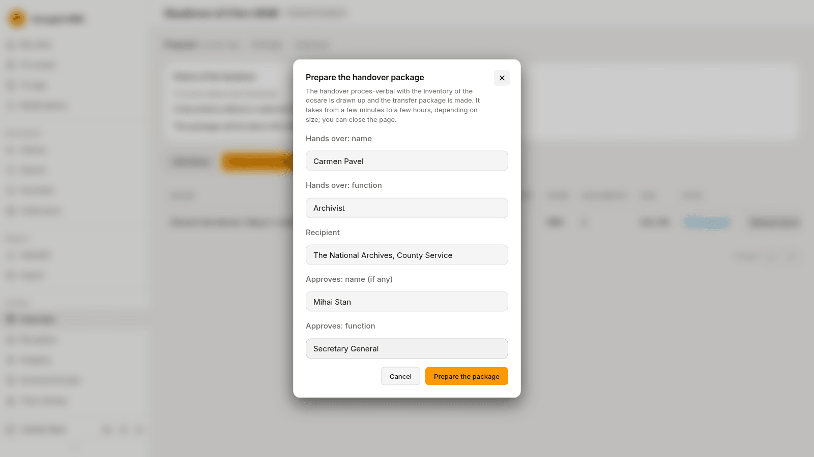

When it is done the page shows "Package ready", with **Download the package** and **Record the confirmation**.

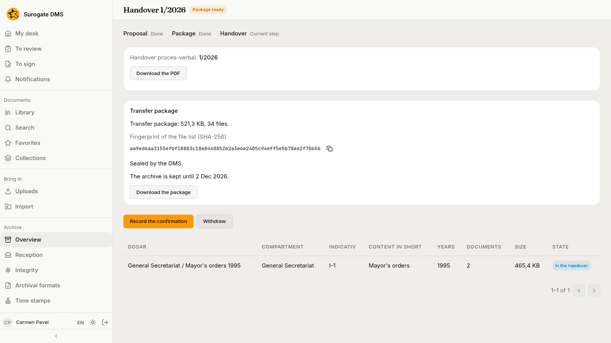

### 9. Record the confirmation

When the National Archives confirm, Carmen presses **Record the confirmation**: received in full, in part or refused, the signed proces-verbal's number and date, who received and its scan.

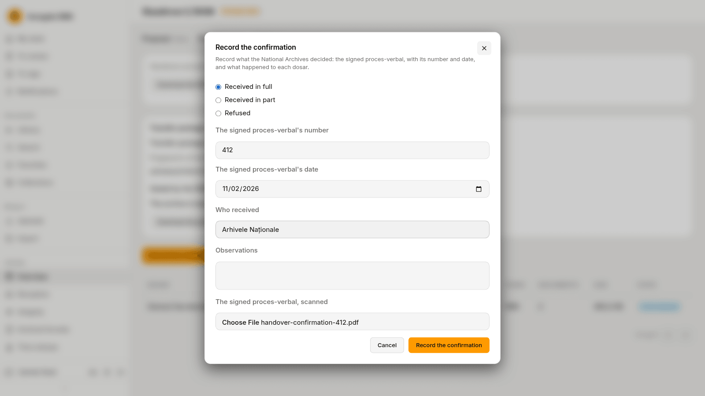

The dosar moves to the **Handed over** tab.

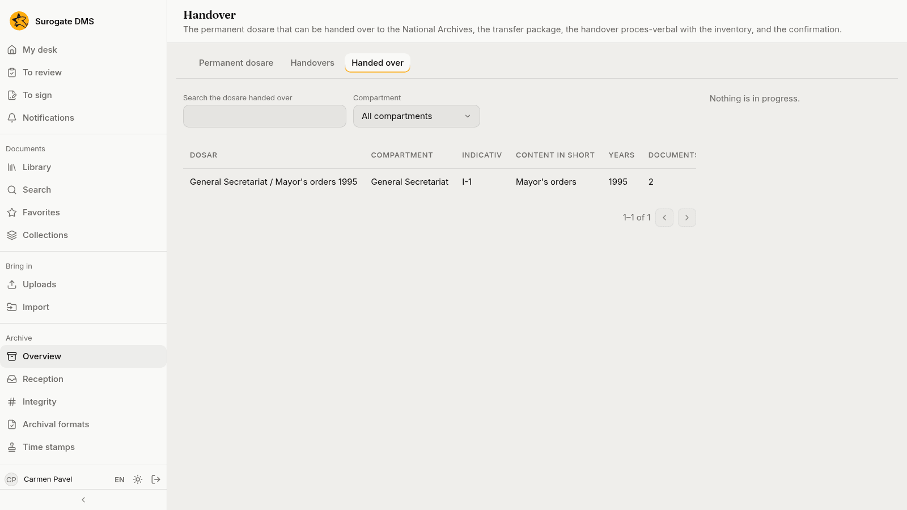

## What to remember

- A selection deletes nothing until the answer is recorded and the delay of seven days has passed; you can cancel until then.
- A hold on a dosar keeps it out of every selection.
- See [Selection](/dms/archive/selection/) and [Handover](/dms/archive/handover/).
