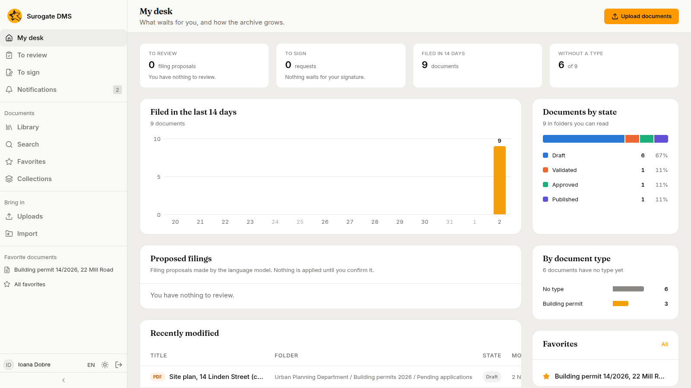
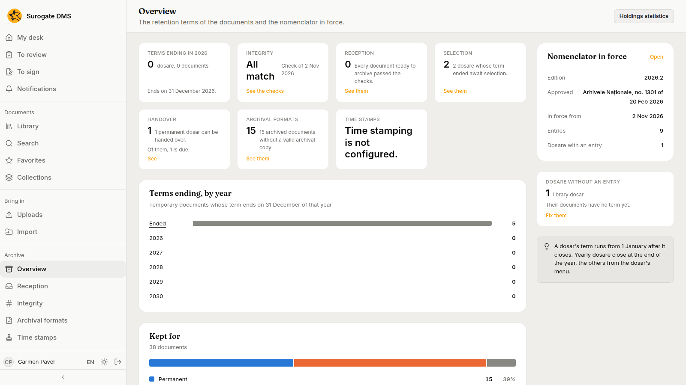

Surogate DMS keeps your institution's documents in one place: you file them, find them, have them signed and approved, and hand them to the archive when their time comes. This guide is for the people who use it and the people who administer it.

The pictures were taken in a demo city hall, Example City Hall, with made-up people and documents. Your institution has its own address for the DMS: ask your administrator for it.

## Who uses what

| You are | You mostly use | Start with |
|---|---|---|
| Staff who file and look for documents | **Library**, **Search**, **My desk**, **To sign** | [Quickstart for staff](/dms/quickstart/) |
| Staff who register incoming and outgoing documents | **Registry** | [Registering documents](/dms/work/registry/) |
| Staff who scan paper and work a unit's captures | **New capture**, **To process**, **To validate** | [Quickstart for capture](/dms/quickstart-capture/) |
| An administrator | **Org chart**, **People**, **Roles and permissions**, **Document types**, **Folders**, **Nomenclator** | [Quickstart for administrators](/dms/quickstart-admin/) |
| An electronic archivist | The **Archive** section: **Selection**, **Handover**, **Overview** | [The Archive overview](/dms/archive/overview/) |
| An auditor or the data protection officer | **Audit log**, **Personal data** | [The audit log](/dms/admin/audit-log/) |

What you see depends on your roles. The sidebar shows only the pages you may open, so a colleague may see more or fewer entries than you do.

## How a document moves

1. Someone **uploads** a file into a folder of the library and gives it a type, or the file is **captured**: it comes from a scanner, a mailbox, a printer or a phone, and is cut into documents and filed.
2. The person fills in its **metadata** and **validates** it.
3. Where the work asks for it, a colleague signs it, and a person with the right to approve **approves** and **publishes** it.
4. When it is no longer in use, an archivist **archives** it. An archived document is read only.
5. The folder it lives in carries a **retention term** from the nomenclator. When the term ends, the dosar goes through a **selection**, and permanent dosare are **handed over** to the National Archives.

## Start here

| I want to | Go to |
|---|---|
| File my first document and find it again | [Quickstart for staff](/dms/quickstart/) |
| Set up the DMS for my institution | [Quickstart for administrators](/dms/quickstart-admin/) |
| Scan paper and file it by rules | [Quickstart for capture](/dms/quickstart-capture/) |
| Scan a day's mail with labels and a form | [Scan the incoming mail](/dms/examples/incoming-mail/) |
| Understand the words the DMS uses | [Concepts](/dms/concepts/) and the [Glossary](/dms/reference/glossary/) |
| Have a contract signed and approved | [File and approve a contract](/dms/examples/contract/) |
| Add a new department | [Set up a new department](/dms/examples/new-department/) |
| Select dosare whose term has ended and hand permanent ones over | [Selection and handover](/dms/examples/selection-and-handover/) |
| See what a role may do | [Built-in roles](/dms/reference/roles/) |
| Find an answer to a message | [FAQ](/dms/reference/faq/) |
