This page takes a new installation to one that staff can use: the org chart, the people, the nomenclator, the folders, the document types and the roles, in the order the DMS needs them. It takes about an hour with your institution's data at hand.

The pictures were taken in a demo city hall, Example City Hall, with made-up people and documents. You are Elena Marin, the first administrator.

You need:

- the sign-in details of the first administrator; your operator makes you the first administrator, and sets up the accounts of the people in your institution, the institution's name and the internal certificate authority;
- the list of your units and positions, and the e-mail addresses of your staff;
- the nomenclator your institution's National Archives approved, as an Excel file, with its approval number and date.

## 1. Sign in

Sign in with your e-mail address and password. A new installation has an empty **My desk** and, in the sidebar, the **Archive** and **Administration** sections.

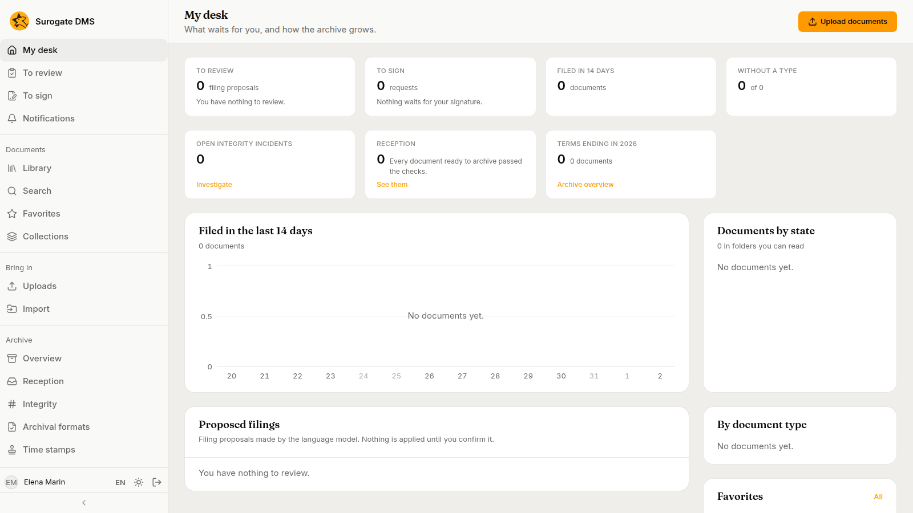

## 2. Build the org chart

Open **Administration** › **Org chart**. Add the **Unit types** your institution uses (for example Directorate, Department and Office) in the panel on the right.

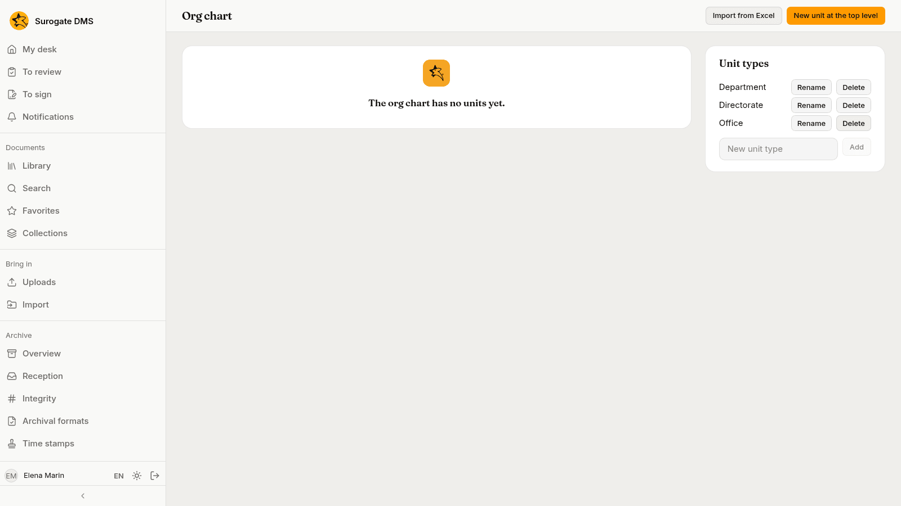

Press **New unit at the top level**, name the unit, choose its type and, if you like, give it a short code. Add subunits and positions from the menus on each unit. See [The org chart](/dms/admin/org-chart/).

## 3. Add the people and name the holders

Open **People** and press **Add a person**: an **Email address** and a **Display name**. The person is "Pending" until they first sign in.

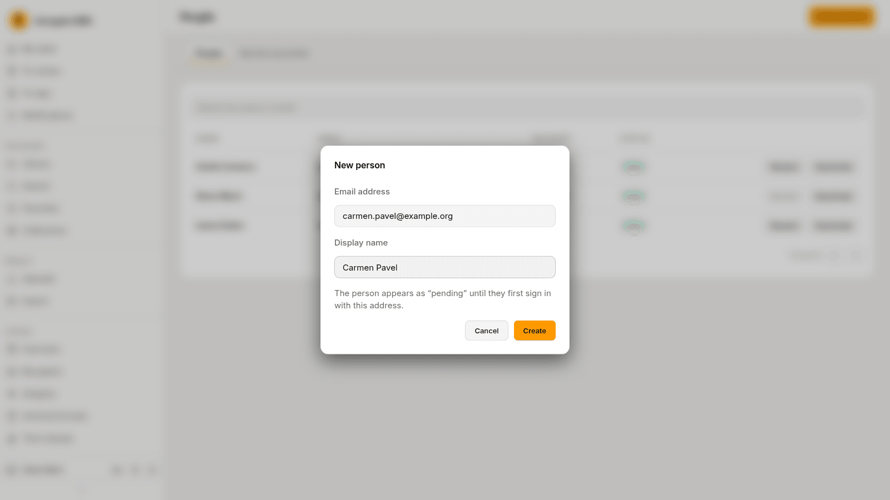

On the org chart, open the menu of a position, choose **Holder…** and choose the person who holds it.

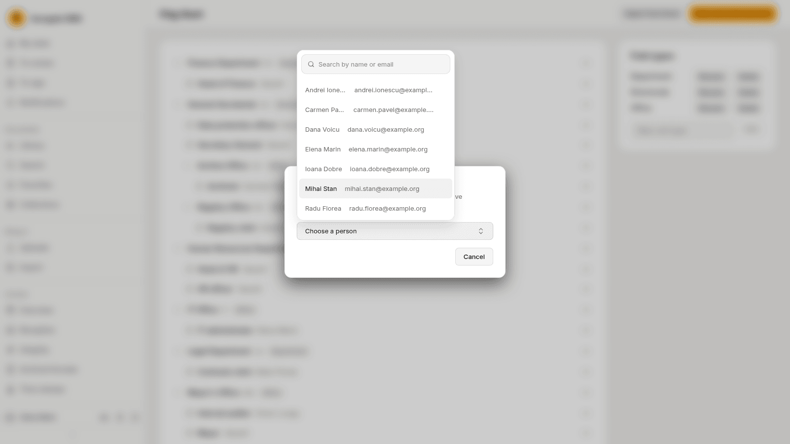

When you are done, the chart shows every position with its holder, and "Vacant" where nobody holds it.

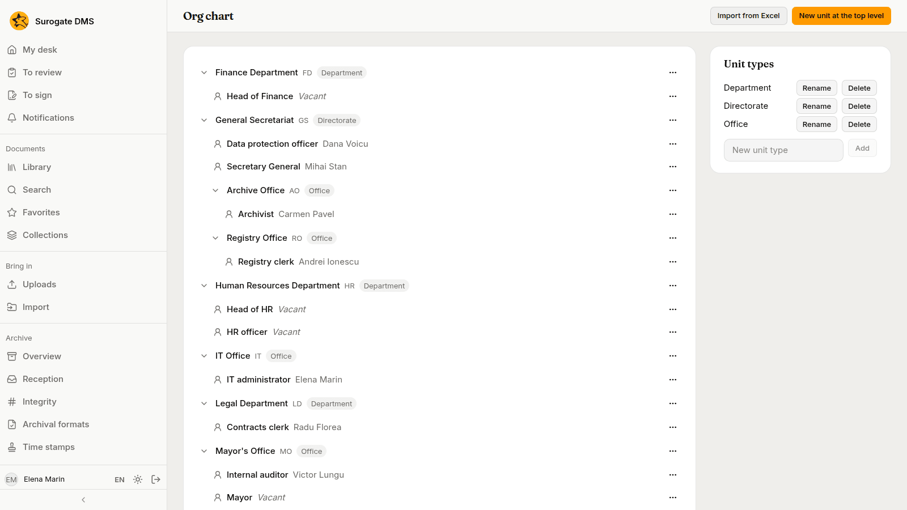

## 4. Put the nomenclator in force

Open **Nomenclator**. A new installation has none.

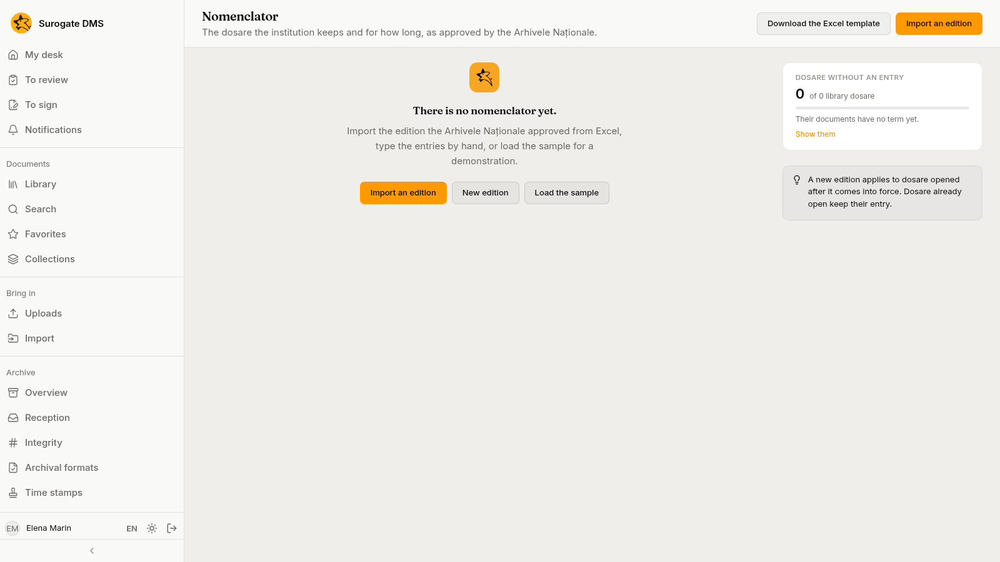

Press **Import an edition**, choose the Excel file and give the edition a name. Choose the unit of every compartment the DMS could not match, fill in the **Approval number** and **Approval date**, and press **Put in force**.

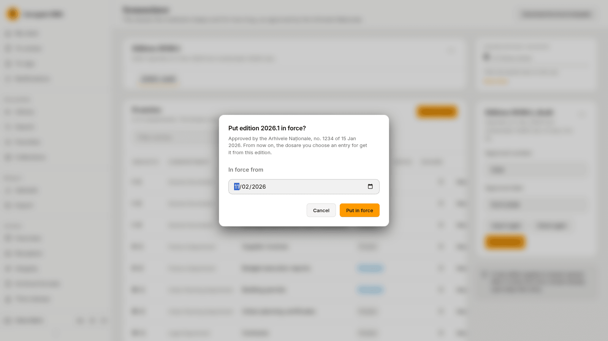

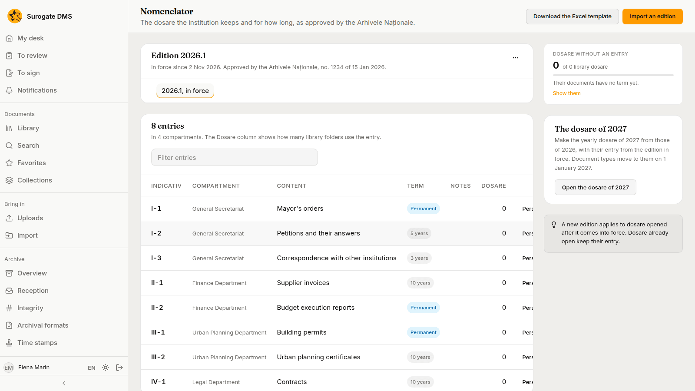

See [The nomenclator](/dms/admin/nomenclator/).

## 5. Make the folders and the dosare

Open **Folders** and press **New folder at the root**. A folder at the root belongs to a unit. Inside it, add the dosare: each has an entry of the nomenclator, a year and a closing rule.

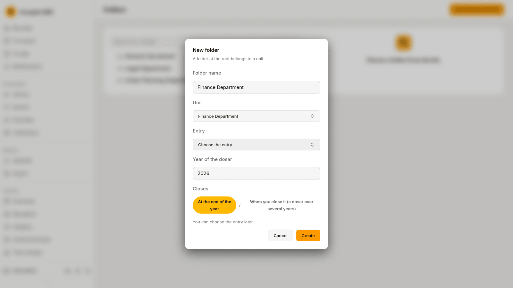

You can also set a dosar's entry from its page in the library.

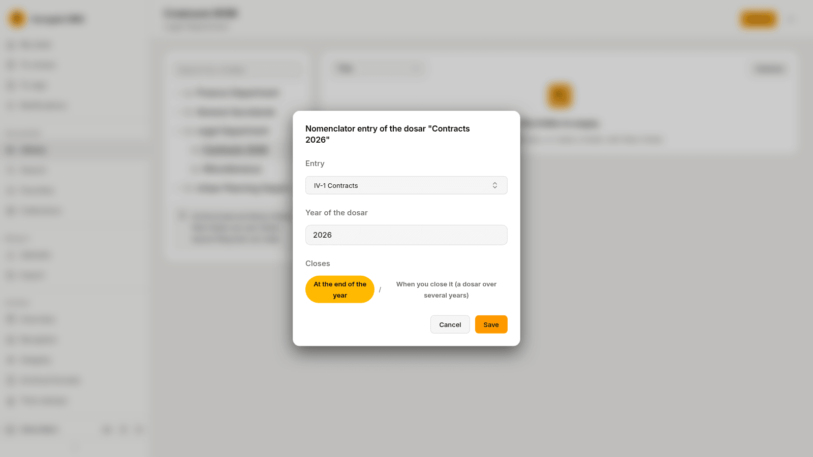

## 6. Define the document types

Open **Document types** and press **New type**. Give it a name, a default folder and its fields.

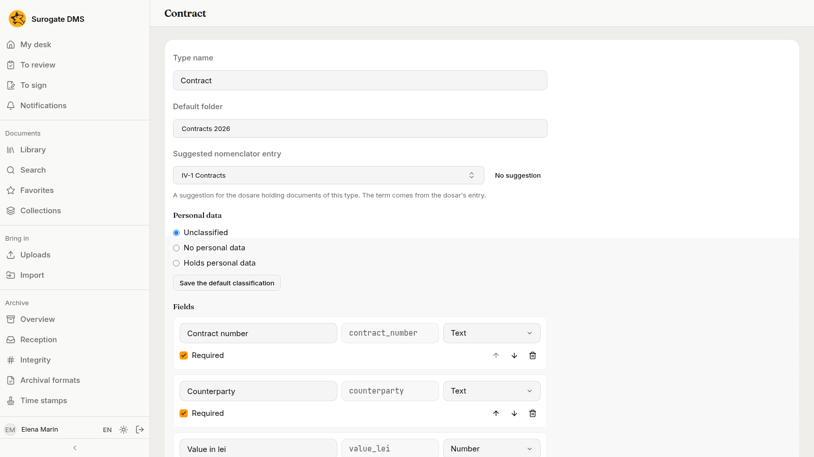

## 7. Grant roles

Open **Roles and permissions**, choose a role and press **Grant the role**. Choose who gets it (a **Person**, a **Position** or a **Unit**) and where it applies.

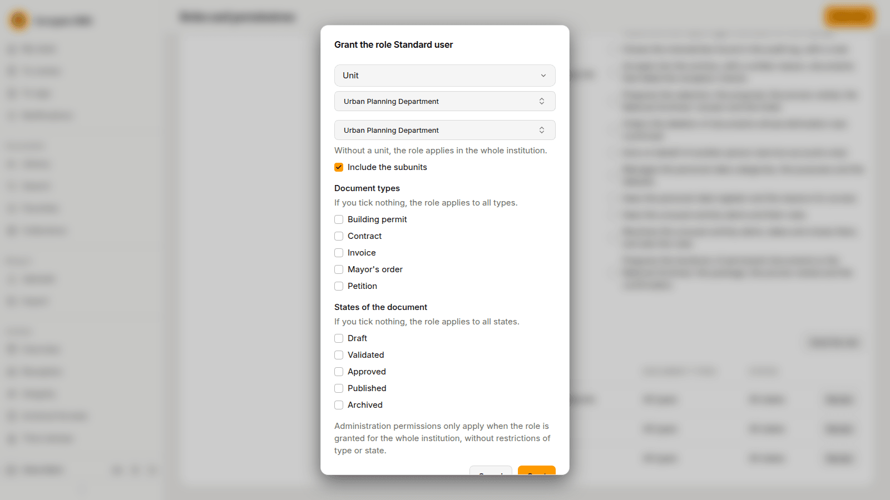

## 8. Check the alert rules

Open **Archive** › **Alerts** and look at the **Rules** tab. The working hours decide when work on documents counts as unusual.

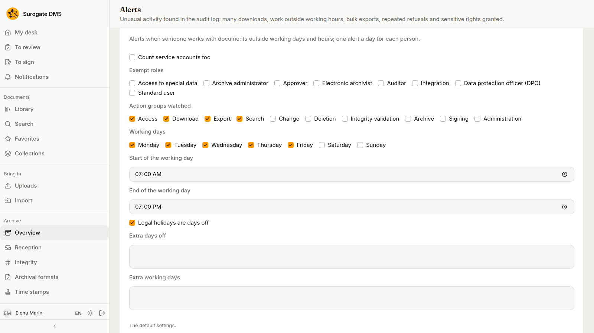

## 9. Check as a staff member

Ask a colleague who holds only **Standard user** to sign in and open their folders. If they see no folder, check their grant: [Roles and permissions](/dms/admin/roles/).

## 10. Read the audit log

Open **Audit log** and filter the **Entries** by a person to see what they did.

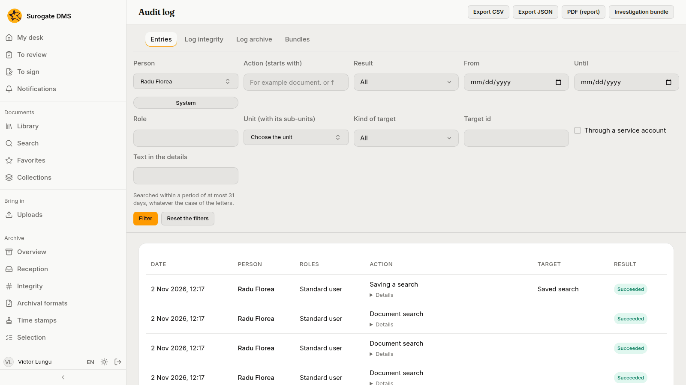

## Next steps

- [Set up a new department](/dms/examples/new-department/) repeats these steps for one department.
- [Roles and permissions](/dms/admin/roles/) explains grants.
- [The Archive overview](/dms/archive/overview/) is where an archivist starts.
- [The capture quickstart](/dms/quickstart-capture/) sets up a channel and a flow for scanned paper.
